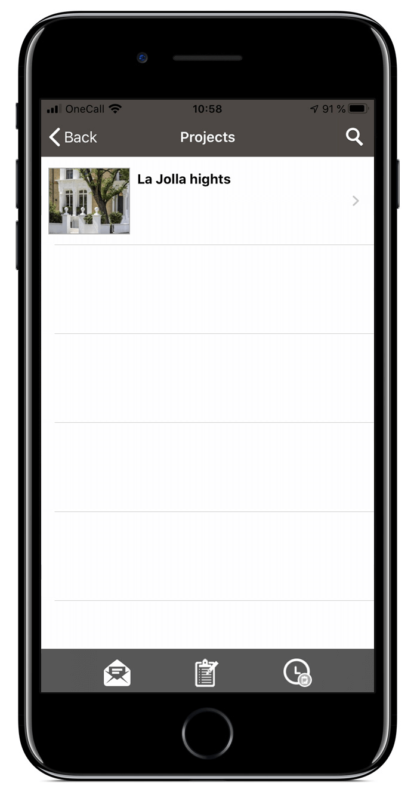
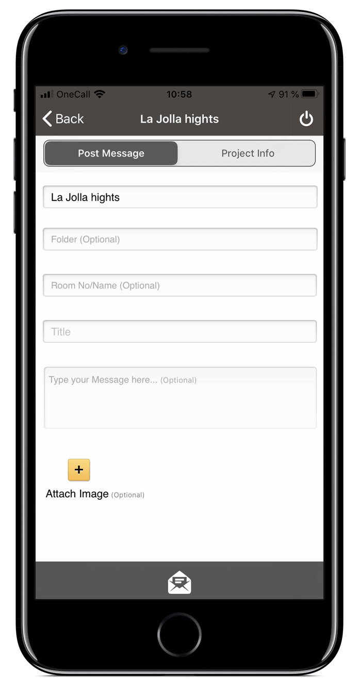

Viscenario is tailor made to streamline and improve the management of operations in Residential, Office buildings, along with hotels or other buildings that are subject to active operation. In Viscenario, you manage the follow-up of operational tasks, documentation and communication between owner, tenant and operating staff. We provide the technology that enables follow-up of scheduled tasks and maintenance, documentation, [inspection rounds](https://youtu.be/c9pxrb3YJbU) and other tasks during the operational phase. This can also be done on smartphones and tablets while the information is always available in the cloud. Those who have office jobs can access the information via the web, while all those who move in the building to do their work, can use their smart phone and or tablet. All user interfaces are designed to fit the work style and situation of each individual.

We have created Viscenario on the basis that we know the construction and real estate industry and the innovations needed in it. Viscenario also provides Management, Operations and Maintenance documentation on your tablet or directly on the current maintenance task, and you can associate the documentation directly to a specific building, floor or room.Viscenario saves Building maintenance contractors the first trip to fix the error. You don’t have to remember and call during business hours to report bugs, and no one needs to spend much of their workday on the phone instead of fixing the problems. The Viscenario app is open 24-7. Surveys show that our customers often save 2 hours per person per day in the operations department when using Viscenario.
