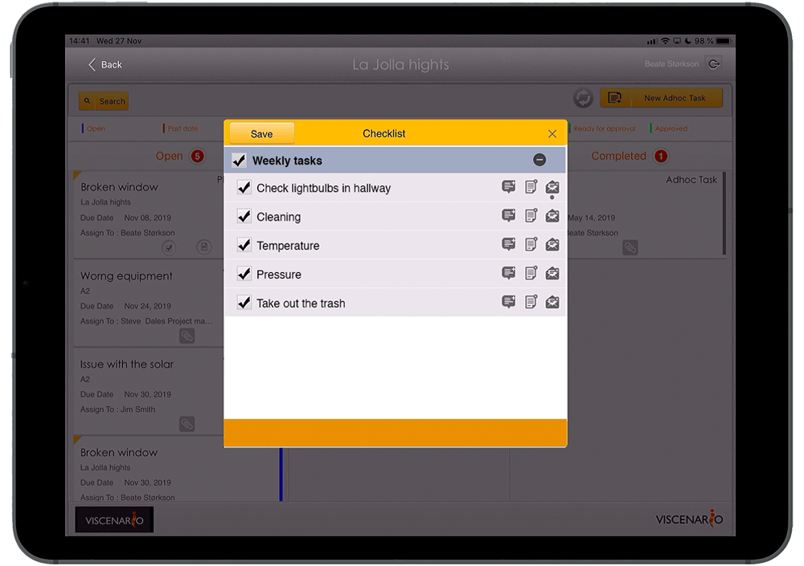

**Viscenario for Maintenance companies**

Viscenario Service App is the tool that brings the person who “does the job” into the information flow. By letting a tenant report incidents or issues directly in Viscenario, the person who is going out and repairing [receives the task on their phone,](https://youtu.be/fTYZZPag4yQ) along with their regular maintenance tasks. This means that the janitor saves a minimum of one hour each day in administration. The caretaker [closes the case](https://youtu.be/fTYZZPag4yQ) and leads hours, in an operation, as soon as the case is rectified. The customer and team leader receive a “live” update on the cases and get an overview of the tasks they pay for. The Maintenance companies save time by not having to call back to say the case is resolved. The same task flow is supported for other service providers. As long as there is something to be followed up, Viscenario streamlines task flow, documentation and reporting.

   
***“Vision scenario is open 24-7, errors can be reported all day”***

[Checklists](https://youtu.be/fK6TLFpR6rM) for internal control, such as fire, are done electronically in Viscenario. The report is available live to those who need it and can be emailed as a document if there is a requirement for external reporting. Comments are then included, and nonconformities result in new tasks with responsibility and deadline, which ensures good follow-up.

The Building Maintenance employee can manage several customers per day.

All communication with subcontractors takes place via the app, and everything is traceable. This way we have a full audit trail of who has done what and when.

This allows you to solve multiple tasks with the same customer once you are on site.

Start using Viscenario. Reduce administration time and get more time to do a good job.
