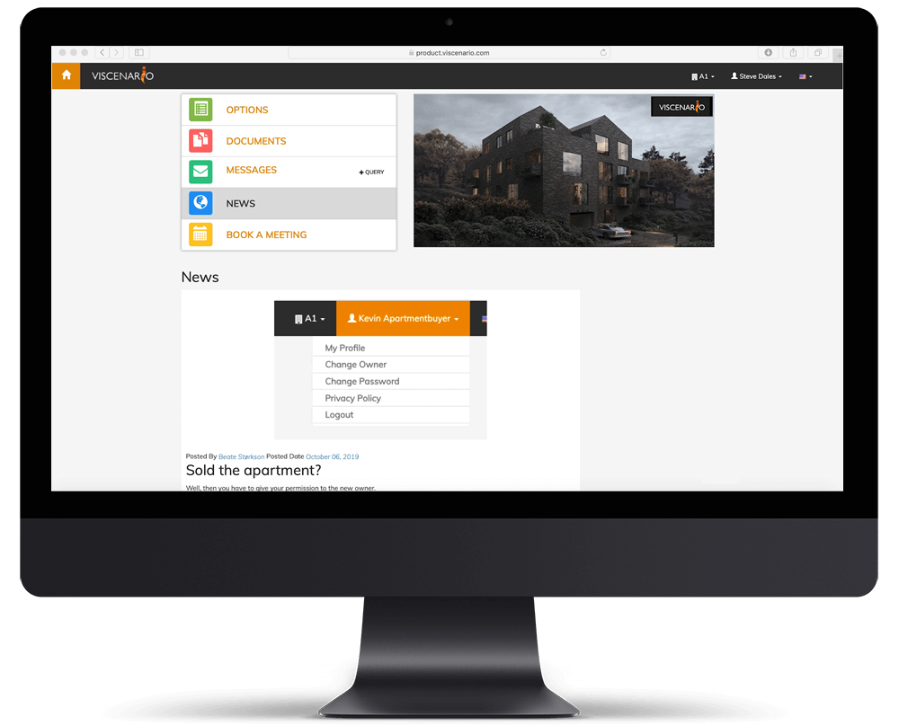
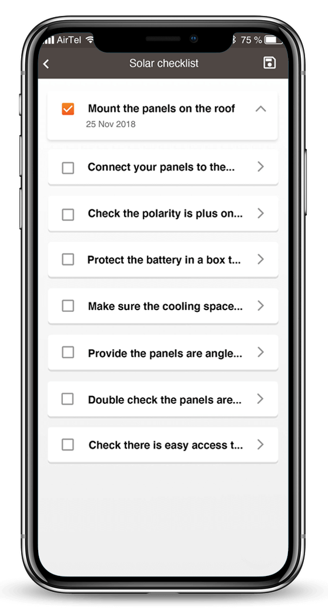

**Viscenario for Property developers**

360° with Viscenario, full Control of Project and Aftermarket.

Viscenario – gives you full control over all tasks and documents in your projects.

There are many documents and tasks to keep in mind in connection with market analysis, concept development, planning and construction work, and not least during construction and warranty period / operation / rental.

The advantage of Viscenario is that all the tasks that need to be kept in mind are placed in Viscenario, as well as all documents stored on the project. In addition, the Viscenario Quality System will help you ensure that the same templates and checklists are used on all projects. You can easily invite contractors, advisors and partners to see all the common documents for the projects. While you employees can see the internal documents. Viscenario is as effective as it is simple and user-friendly – and information security is safeguarded! This is why we call ourselves the “Property Developer’s Best Friend”.

The scenario is scaled just as easily to the smallest companies as to the larger companies. The solution grows with your business. The standard solution can be customized using modules with the functionality you need!  
   
**Some examples of applications**  
All project participants, including employees, builders, subcontractors and buyers of apartments, have access to the information they are supposed to have based on their role.

**Webshop for buyers**

-   [Customer portal](https://youtu.be/DIFo7TsCBA8)
-   [Show Apartments documents](https://www.youtube.com/watch?v=DIFo7TsCBA8&feature=youtu.be&t=80)
-   [Questions & Answers](https://youtu.be/0voTgv09ci4)
-   Issue Management
-   News
-   Book a Meeting

[**Inspection**](https://youtu.be/c9pxrb3YJbU)

-   Internal inspections
-   Pre-inspection with clients
-   [Hand Over](https://youtu.be/ihruydtLGiM)
-   1-year inspection
-   Task management

**Warranty Period**

-   Issue management
-   1-year inspections
-   [Portal for clients](https://youtu.be/DIFo7TsCBA8)

**HSE**

-   [JSA – Job Safety analyses](https://youtu.be/1YS7omQg4QY)
-   Weekly HSE reporting
-   HSE reporting
-   Admission Control/ Administration control

**Quality Assurance**

-   [Checklist on mobile](https://youtu.be/fK6TLFpR6rM)
-   [Log](https://youtu.be/dTjbTB5IkbQ)
-   [Pictures](https://youtu.be/zaHJpt_db7o)
-   Issue management/ Defect management
-   Quality System
-   Logistic booking

**Maintenance & Operational Documentation**

-   Show Documentation on tablet
-   Schedule service agreements
-   Workflow for approval
-   Sub-contractors Hand Over their documents

**Integration we have done for clients:**

-   SharePoint
-   Microsoft Dynamics
-   Super Office
-   Bank ID (Europe)
-   ERP

**Using Viscenario saves the projects:**

-   3-4 months in optional work per project
-   1 hour per inspection in pre and post work
-   1 hour per Report on adverse event
-   1 hour per Safe Job Analysis
-   2 hours per safety round
-   30-300 hours per collection of Management Operations and Maintenance documentation
-    1 hour in administration per janitor per day
