Viscenario er skreddersydd for å effektivisere og forbedre administrasjon av drift i leilighets- og kontorbygg, hoteller eller andre bygg som er underlagt aktiv drift. I Viscenario håndterer du oppfølging av driftsoppgaver, dokumentasjon og kommunikasjon mellom eier, leietaker og driftspersonale.

Vi leverer teknologien som gjør at oppfølging av planlagt og ad-hoc vedlikehold, dokumentasjon, befaringsrunder og andre oppgaver i driftsfasen kan gjøres på smarttelefoner og nettbrett mens informasjonen alltid er tilgjengelig i nettskyen. De som har kontorjobb, får tilgang til informasjonen via web, mens alle de som beveger seg i bygningsmassen for å utføre sitt arbeide, bruker telefon og nettbrett. Alle brukergrensesnittene er laget for å passe arbeidsform og -situasjon til hver enkelt person.

Viscenario tilgjengeliggjør også [FDV-dokumentasjon](https://youtu.be/jl0Wip3xquw) (Forvaltning, Drift og Vedlikehold) på nettbrettet eller rett på aktuell vedlikeholdsoppgave, og du kan knytte dokumentasjonen direkte til et bestemt rom eller en etasje.

**Leietakerpermen med oppgaver for internkontroll og dokumentasjon er nå også tilgjengelig for leietakerne i Viscenario**

Viscenario sparer både leietaker og vaktmester den første turen for å befare feilen. Du trenger ikke å huske og ringe i åpningstiden for å melde fra om feil, og ingen trenger å bruke store deler av arbeidsdagen på telefonen i stedet for å fikse problemene. Viscenario appen er åpen 24-7. Målinger viser at våre kunder sparer gjerne 2 timer pr person pr dag i driftsavdelingen når de tar i bruk Viscenario.

**Leietakere**

Leietakere kan [rapportere inn feil](https://youtu.be/h3esBGSr1Qs) fra sin mobiltelefon i appen ViscenarioGO. Aktuell eiendom vises basert på GPS koordinaten til telefonen; brukeren av eiendommen kan ta bilde, skrive inn en beskrivelse av feilen og deretter trykke send fra sin mobil.

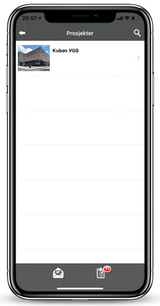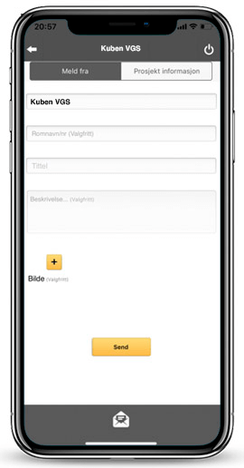

**Driftspersonell**

Driftspersonell får faste vedlikeholdsoppgaver og tilgang til dokumentasjon på sitt nettbrett. Driftspersonell fyller ut sjekklister på de faste oppgavene som skal utføres. Faste oppgaver er alt fra driftsoppgaver, brannoppgaver eller andre av mer ad-hoc karakter. På mobilen får driftspersonell opp de knappene som dere gir de tilgang til; trykker de på Oppgaver, får de listen over alle åpne oppgaver, som den personen har på sine eiendommer. Drar man oppgaven til venstre får man opp en meny med hurtigtaster for å gå til sjekkliste og vedlagte tegninger, instrukser til aktuell oppgave:

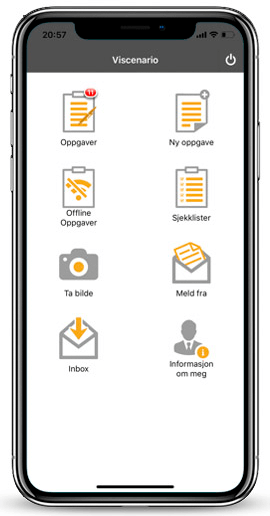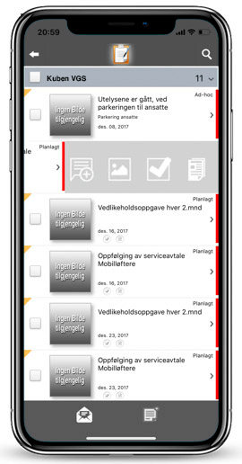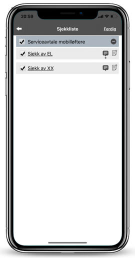

På nettbrett appen, Viscenario har man full tilgang på FDV-dokumentasjon og rapport på sine eiendommer.

På nettbrettet får man oversikt over en eiendom:

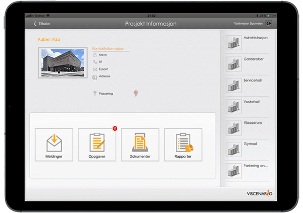

Oversikt over alle oppgaver du har fått og gitt til andre:

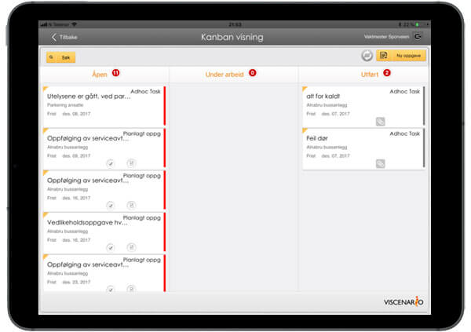

Oversikt over alle oppgaver på aktuell eiendom og status på dem:

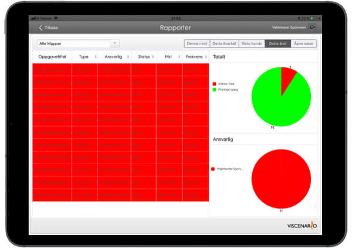

Dokumenter (FDV-dokumentasjon, tegninger, utfylte sjekklister)

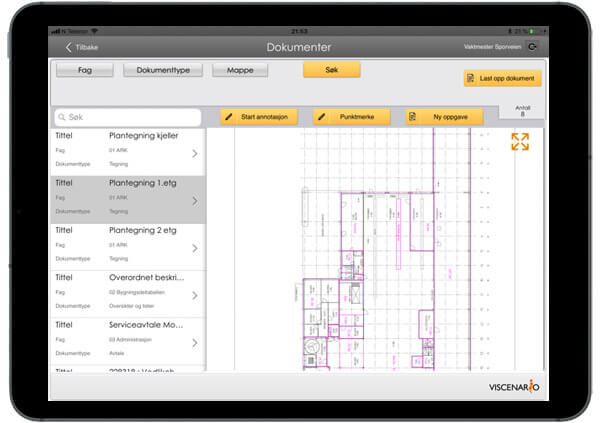

**Eiendomsansvarlig**

Eiendomsansvarlig har en overordnet oversikt over hva som ikke er utført og kan følge opp på en strukturert måte. Rapporter viser totalt antall åpne saker på alle eiendommene og per leietaker:

Man kan også velge en leietaker og få oversikt per leieobjekt:

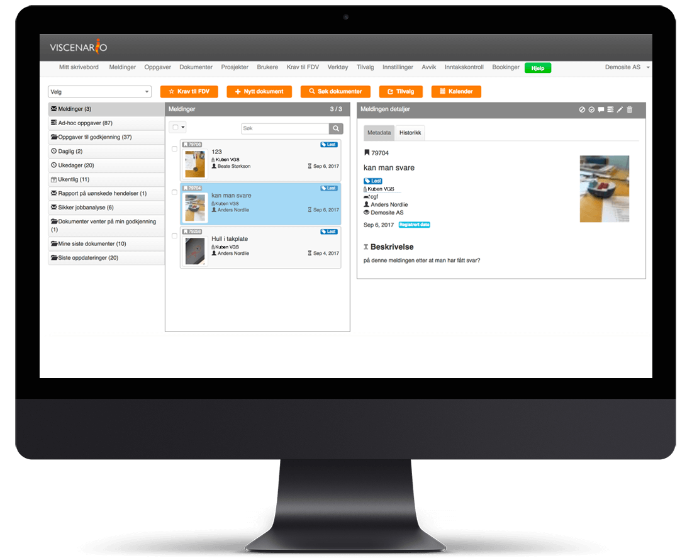

Appene fungerer på Android og IOS (Apple)

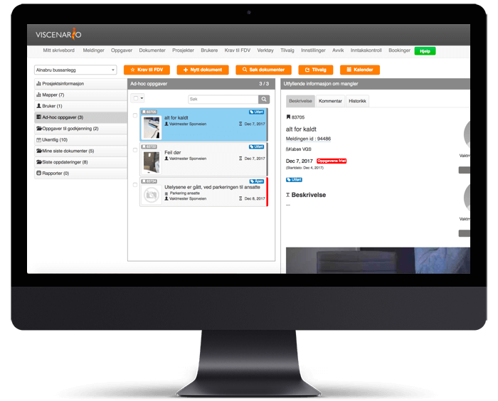

**Brannvern**

Viscenario har ikke en egen modul for brannbok, med automatisk oppfølging av brannforskrifter. Men man kan legge inn branntegninger, brannvernorganisering, myndighetskrav, instrukser, prosedyrer, sjekklister på hva som skal sjekkes gjennom året for oppfølging av brannsikkerheten. Ved å fylle ut sjekklister, blir det automatisk generert rapporter som blir lagret i Viscenario på aktuell eiendom og leietaker. Ved å bruke branntegningene og sjekklistemodulen, kan man markere på tegningen hvor det er avvik på brann, lage avvik og sende ut til de (leietakerne) som skal utbedre det. Når man er ferdig blir rapporten automatisk generert og lagret i Viscenario. Eksterne, som eks brannvesenet kan få tilgang til Viscenario og branndokumentasjonen. Eksterne brannrådgivere kan også få tilgang til å legge inn sine tilsynsrapporter i Viscenario.

Det kan hentes ut rapporter over hvilke avvik som er registrert i for eksempel 2018 ifm branntilsyn.

**Ombyggingsprosjekter**

**Viscenario – gir deg full kontroll på alle oppgaver og dokumenter i dine ombyggings prosjekter. Med prosedyrene og malene for SHA styrer du prosjektene til suksess!**

Det er mange dokumenter og oppgaver å huske på i forbindelse med markedsanalyser, konseptutvikling, plan og byggesaksarbeid og ikke minst under bygging og ettermarked/drift/utleie. Fordelen med Viscenario er at alle oppgavene som må huskes på legges i Viscenario, samt at alle dokumenter lagres på prosjektet. I tillegg vil [Viscenario Styringssystem](https://youtu.be/vYshpiGwaAE) hjelpe dere med å sørge for at de samme malene og sjekklistene brukes på alle prosjekt. Dere kan enkelt invitere inn entreprenører, rådgivere og samarbeidspartnere, slik at de ser alle felles dokumenter for prosjektene, mens dere ansatte kan se de interne dokumentene. Viscenario er like effektiv som den er enkel og brukervennlig – og informasjonssikkerheten er trygt ivaretatt! I Viscenario sitt SHA-system, bestående av lovpålagte SHA-dokumenter for byggherrer og HMS-dokumenter for hovedbedrift og underentreprenører, kan du sette opp faste sjekklister for oppfølging i prosjektene. Ved å lage faste månedlige oppfølginger for KU møter og befaringer kan du dokumentere disse på mobilen eller nettbrettet, og når møtet/befaringen er ferdig flettes alle dataene sammen i en PDF, som kan sendes ut automatisk og lagres automatisk i Viscenario.

Viscenario skaleres like enkelt til de minste bedriftene som til de større. Løsningen vokser sammen med din bedrift. Standardløsningen kan skreddersys ved hjelp av moduler med den funksjonalitet du trenger!

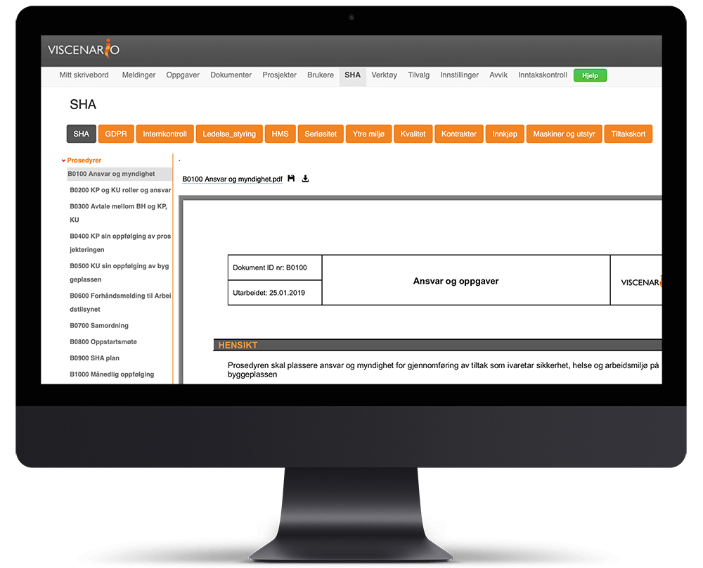
