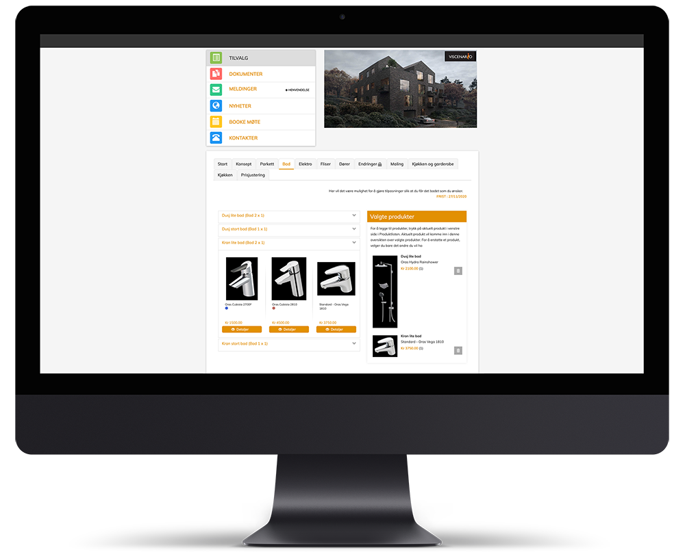
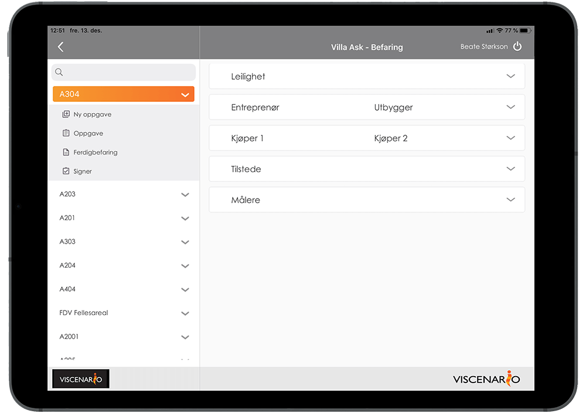
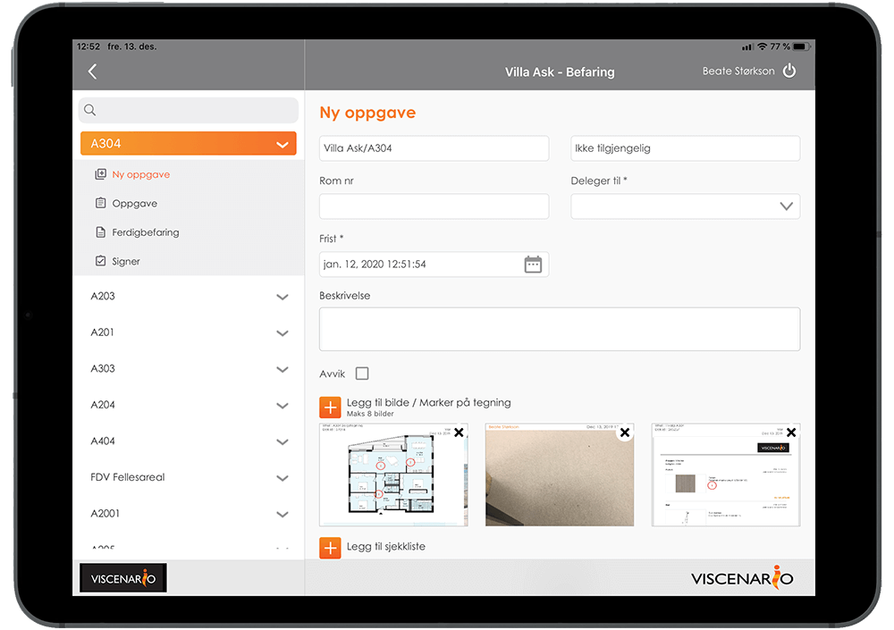
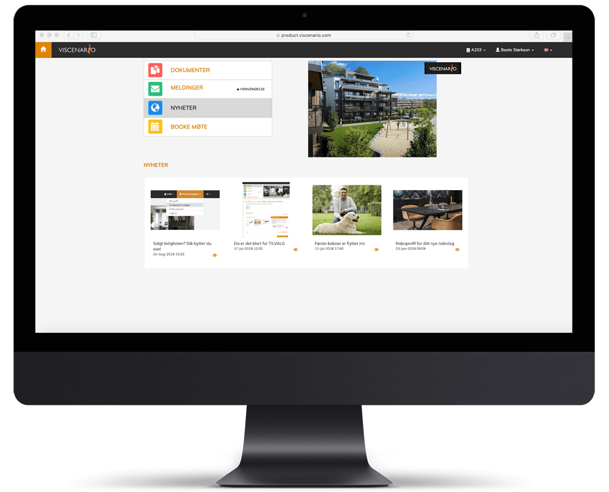
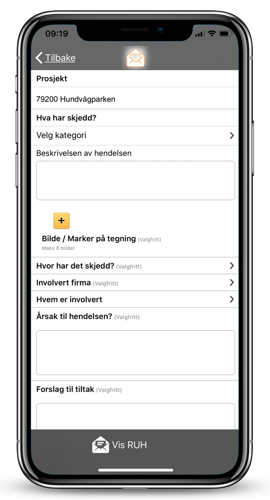
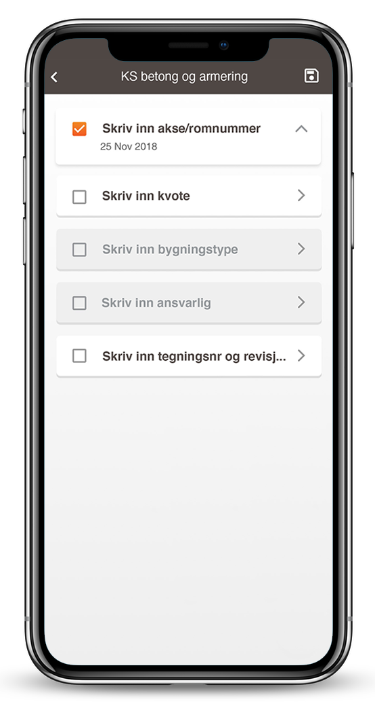

360° med Viscenario, full kontroll på prosjekt og ettermarked

**Viscenario – gir deg full kontroll på alle oppgaver og dokumenter i dine prosjekter. Med prosedyrene og malene for SHA styrer du prosjektene til suksess!**

Det er mange dokumenter og oppgaver å huske på i forbindelse med markedsanalyser, konseptutvikling, plan og byggesaksarbeid og ikke minst under bygging og ettermarked/drift/utleie. Fordelen med Viscenario er at alle oppgavene som må huskes på legges i Viscenario, samt at alle dokumenter lagres på prosjektet. I tillegg vil [Viscenario Styringssystem](https://youtu.be/vYshpiGwaAE) hjelpe dere med å sørge for at de samme malene og sjekklistene brukes på alle prosjekt. Dere kan enkelt invitere inn entreprenører, rådgivere og samarbeidspartnere, slik at de ser alle felles dokumenter for prosjektene, mens dere ansatte kan se de interne dokumentene. Viscenario er like effektiv som den er enkel og brukervennlig – og informasjonssikkerheten er trygt ivaretatt!

## SHA

I Viscenario sitt SHA-system, bestående av lovpålagte SHA-dokumenter for byggherrer og HMS-dokumenter for hovedbedrift og underentreprenører, kan du sette opp faste sjekklister for oppfølging i prosjektene. Ved å lage faste månedlige oppfølginger for KU møter og befaringer kan du dokumentere disse på mobilen eller nettbrettet, og når møtet/befaringen er ferdig flettes alle dataene sammen i en PDF, som kan sendes ut automatisk og lagres automatisk i Viscenario.

Viscenario skaleres like enkelt til de minste bedriftene som til de større. Løsningen vokser sammen med din bedrift. Standardløsningen kan skreddersys ved hjelp av moduler med den funksjonalitet du trenger!

**Noen eksempler på bruksområder**

Alle prosjektdeltakere inkludert ansatte, byggherre, underentreprenører og kjøper av f eks leiligheter får tilgang til den informasjonen de skal ha basert på sin rolle.

[**Tilvalg**](https://youtu.be/kbpImAmukMM)

-   Min side for boligkjøper
-   Dokumenter
-   Spm & Svar
-   [Reklamasjonshåndtering](https://youtu.be/jI4arPWssxU)
-   Nyheter

**Befaring**

-   Intern KS befaring
-   [Ferdigbefaring med kunde](https://youtu.be/yu98RzfV9No)
-   [Overtakelser](https://youtu.be/RND2sr3meM0s)
-   [Ettårsbefaring](https://youtu.be/GQtThle2h2s)
-   Mangelliste

**Ettermarked**

-   [Reklamasjonshåndtering](https://youtu.be/jI4arPWssxU)
-   [Ettårsbefaring](https://youtu.be/GQtThle2h2s)
-   Full oversikt over hva som skjedde i prosjektfasen
-   [FDV-dokumentasjonen tilgjengelig på nettbrett](https://youtu.be/jl0Wip3xquw)
-   [Egen side for kundene](https://youtu.be/zD_3qU-RHPk)

**HMS**

-   [RUH](https://youtu.be/IJvBylQoExc)
-   [SJA](https://youtu.be/IJvBylQoExc)
-   [Vernerunder](https://youtu.be/1suew-8Se38)
-   [Digital mannskapsliste/Inntakskontroll](https://youtu.be/tnLRdJ-wFM4)

**KS**

-   [BIM på byggeplass](https://www.youtube.com/watch?v=MQu3muXCFqo)
-   [Sjekklister](https://youtu.be/wyqkUBeUFdo)
-   [Logg](https://youtu.be/T1d1W_aLQb0)
-   [Bildedokumentasjon](https://youtu.be/7FNXr7VxWP8)
-   [Avvikshåndtering](https://youtu.be/MTN60AsR3kg)
-   [Styringssystem:](https://youtu.be/vYshpiGwaAE) Vi har prosedyrer og maler for å oppfylle internkontrollforskriften
-   [Logistikk booking](https://youtu.be/xILgtcp8CDk)

**FDV-dokumentasjon**

-   Maler for næring og boligprosjekter
-   Arbeidsflyt for [innsending](https://youtu.be/-75SOtjN8is) og [godkjenning](https://youtu.be/a-yqugPP16g) av FDV-dokumentasjon
-   [FDV-dokumentasjon på nettbrett](https://youtu.be/jl0Wip3xquw)
-   [Boligperm for boligkunder](https://youtu.be/0MTsyDgSgkI)
-   [FDV-dokumentasjon for kontorbygg, hoteller, skoler o.l.](https://youtu.be/-75SOtjN8is)
-   Serviceavtaler

**Integrasjon – åpent API. Eksempel på integrasjoner vi har i dag:**

-   [SharePoint](https://youtu.be/UuurQ4bQtI0)
-   [Catenda](https://www.youtube.com/watch?v=MQu3muXCFqo)
-   Microsoft Dynamics
-   Super Office
-   Bank ID
-   Agresso
    

**Ved å bruke Viscenario sparer prosjektene:**

-   3-4 måneder i tilvalgsarbeid per prosjekt
-   1 timer per befaring i før-og etterarbeid
-   30-300 timer per innsamling av FDV dokumentasjon
-   1 timer i administrasjon per vaktmester per dag

<iframe src="https://www.youtube-nocookie.com/embed/4BiBIdp4Ib8" title="Viscenario video" loading="lazy" allow="encrypted-media; picture-in-picture" allowfullscreen></iframe>

