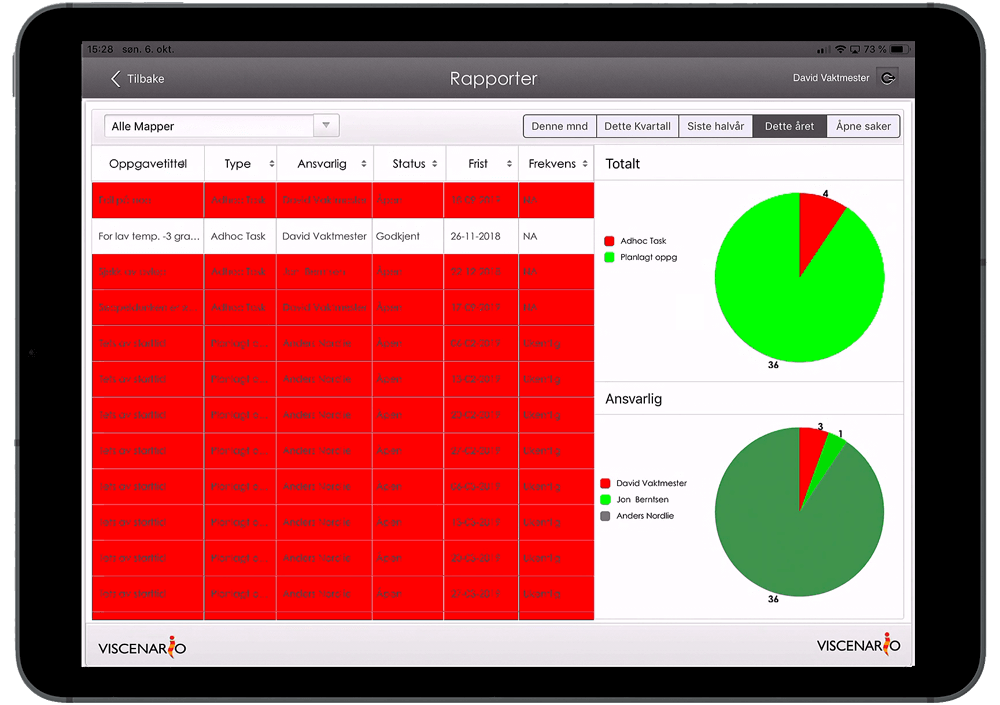
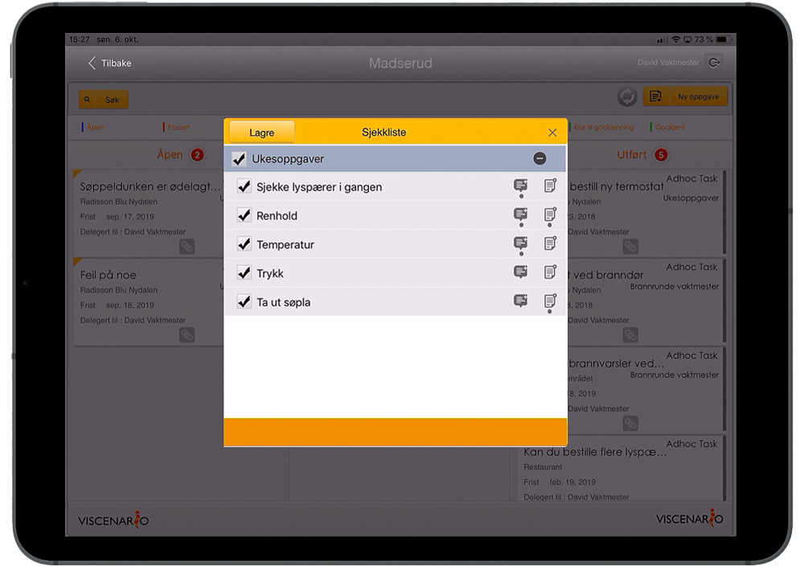

Viscenario er verktøyet som bringer den personen som “gjør jobben” inn i informasjonsflyten. Ved å la en leietaker [rapportere hendelser](https://youtu.be/h3esBGSr1Qs) eller feil direkte i Viscenario, får den som skal ut og reparere, [oppgaven ut på telefonen sin,](https://youtu.be/MTN60AsR3kg) sammen med sine [faste vedlikeholdsoppgaver.](https://www.youtube.com/watch?v=jl0Wip3xquw) Dette gjør at vaktmesterne sparer minimum en time hver dag i administrasjon. Vaktmesteren [lukker saken](https://youtu.be/MTN60AsR3kg) og fører timer, i en operasjon, med en gang saken er utbedret. Kunden og teamlederen får “live” oppdatering på sakene og får oversikt over oppgavene de betaler for. Vaktmesterfirmaene sparer tid ved å slippe å ringe tilbake for å si at saken er løst. Samme oppgaveflyt støttes for andre servicetilbydere. Så lenge det er noe som skal følges opp, effektiviserer Viscenario oppgaveflyt, dokumentasjon og rapportering.

***“Viscenario holder åpent 24-7, feil kan rapporteres inn hele døgnet”***

[Sjekklister](https://youtu.be/wyqkUBeUFdo) for internkontroll, for eksempel brann, gjøres elektronisk i Viscenario. Rapporten er live tilgjengelig for de som trenger den og kan sendes som dokument på e-post hvis det er krav til rapportering eksternt. Kommentarer kommer da med, og avvik resulterer i nye oppgaver med ansvarlig og frist, som sikrer god oppfølging.

Vaktmesterne klarer flere kunder per dag.

All kommunikasjon med underleverandører foregår via appen, og alt er sporbart.

Lar deg løse flere oppgaver hos samme kunde, når du først er på stedet.

Ta i bruk Viscenario – og reduser tiden til administrasjon, og få mer tid til å gjøre en god jobb.

<iframe src="https://www.youtube-nocookie.com/embed/0Z5-pUG_Oh8" title="Viscenario video" loading="lazy" allow="encrypted-media; picture-in-picture" allowfullscreen></iframe>

<iframe src="https://www.youtube-nocookie.com/embed/RsJ_exHu9vw" title="Viscenario video" loading="lazy" allow="encrypted-media; picture-in-picture" allowfullscreen></iframe>

