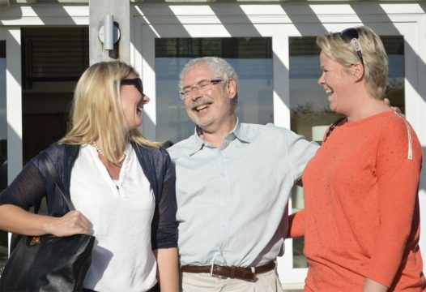

**History**

Viscenario was founded in 2012 by two project managers, one from an IT back ground and the other an engineer.

Since then, the company has expanded worldwide, and now has users in all corners of the world.

Viscenario now comes in several languages, English, German, Norwegian, with Spanish and Dutch on the way.

Viscenario is developed based on the methodology in Lean Startup with focus on Minimum Viable Product and The Startup Owner´s Manual, by Steve Blanks. Customers have been involved in the development and we have continuously tested, verified and improved the product.

Before we started the development, we ran a pre-project to see which IT systems were used in projects, the collect of Maintenance documentation and for the warranty period. What we saw was that Construction companies use 3-5 systems, and that there was a lot of pen and paper. We also saw that 30% of the time on a construction site is waiting time.

In addition, we saw that a lot of information was lost from the Project phase to the service desk in the Warranty Period. It was also very difficult for the service desk to handle Issues. There was strictly no control over who had done what from the project and 5% of the total cost of the project was eaten up by poor control.

We also saw that a lot of time was spent on communication and post-work after visits to the construction sites. We saw a gap between management’s project management system based on financial systems and the practical task and document management of a construction site.

We also saw that building owners did not document how it looked like when tenants moving in, which in turn poses challenges when moving out. Reporting errors by tenants took a lot of time to manage to get them done. The Janitors/ Building maintenance personal, used SMS as well as pen and paper. Much information was forgotten.

With all this information with us into the development we have now developed Viscenario.

Our customers now save all office time after performing mobile tasks:

-   1 hour per inspection before and after work
-   1 hours per HSE repor
-   1 hour per Job Safety Analysis
-   2 hours per HSE Inspections
-   30-300 hours per collection of maintenance documentation
-   1 hour in administration per Janitors per day

When all tasks and documents are combined into Viscenario, the client has unique control over all information. It is also much easier to reject tasks and Issues from their customers, as everything has been documented on the mobile with pictures and text already during the construction phase.

Typical clients are contractors, construction, builders and janitor/Building Maintenance companies.

Viscenario is role-based and based on the role you have you get access to the information you need. Some examples:

Subcontractors and contractor company employees report HSE incidents and get tasks and can then submit Maintenance documentation when the construction project is complete.

Management gets statistics on HSE incidents and defects, and can easily assess the potential for improvement for the next project. The builder / buyer can view all the Documentations and report issues in the Warranty period.

In the picuture bellow we are at Steve Blanks Ranch in California, just finish with great conversations and tips on how to start a international Software Company. The meeting was arranged by Innovation Norway during our TINC visist in 2012.

The story is not over yet, now it is about finding more tasks that we can make more efficient for the building and the real estate industry.
