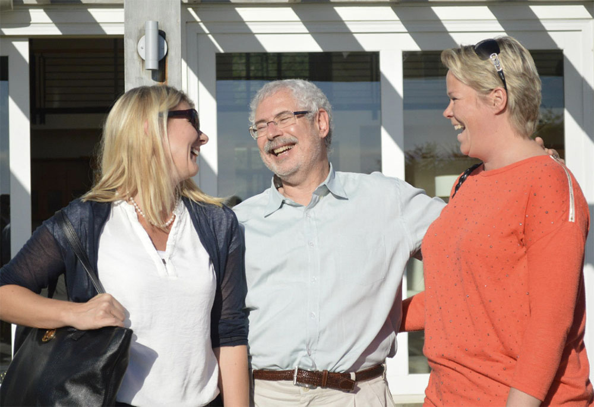

Viscenario er utviklet basert på metodikken i Lean Startup med fokus på Minimum Viable Product og The Startup Owner´s Manual, av Steve Blanks. Kunder har vært med i utviklingen og vi har testet, verifisert og forbedret produktet løpende.

**Før vi startet utviklingen** kjørte vi et forprosjekt for å se hvilke IT systemer som ble bruk i prosjekt, innsamling av FDV (Forvaltning Drift og Vedlikehold) dokumentasjon og drift/ettermarked.

Det vi så var at Entreprenører bruker 3-5 systemer, samt at det var mye penn og papir. Vi så også at 30% av tiden på en byggeplass er ventetid.

I tillegg så vi at mye informasjon ble borte fra prosjektet til ettermarked. Det var også veldig vanskelig for kundesenteret å håndtere reklamasjoner. Det var strengt tatt ikke kontroll på hvem hadde gjort hva fra prosjektet og de 5% av prosjektets totale kostnad ble spist opp av dårlig kontroll.

Vi så også at det brukes mye tid på kommunikasjon og etterarbeid etter besøk på byggeplassene. Vi så et gap mellom ledelsens prosjektstyringssystem som er bygget på økonomisystemer og den praktiske oppgave- og dokumenthåndteringen på en byggeplass.

Vi så også at de som driver med utleie ikke dokumenterte hvordan det så ut ved innflytning, som igjen gir utfordringer ved utflytning. Innrapportering av feil fra leietakerne tok mye tid å administrere for å få de utført. Vaktmesterne brukte SMS samt penn og papir. Mye informasjon ble glemt.

Med all denne informasjonen med oss inn i utviklingen har vi nå utviklet Viscenario.

***Kundene våre sparer all kontortid i etterkant av utførte oppgaver på mobilen:***

-   1 timer per befaring i før-og etterarbeid
-   1 timer per RUH (Rapport om uønsket hendelse)
-   1 timer per SJA (Sikker jobbanalyse)
-   2 timer per vernerunde
-   30-300 timer per innsamling av FDV dokumentasjon
-   1 timer i administrasjon per vaktmester per dag

Nå som alle avvik og dokumenter er samlet i ett system, sitter kundene våre med unik kontroll på all informasjon. Det er også mye enklere å avvise feil og mangler fra deres kunder, da alt har blitt dokumentert på mobilen med bilder og tekst allerede under byggefasen.

**Typiske kunder er entreprenører, utbyggere, byggeiere og vaktmesterfirmaer.**  
**Viscenario er rollestyrt og basert på den rollen du har får du tilgang til den informasjonen du trenger. Her følger noen eksempler:**

Underleverandører og ansatte i entreprenørfirmaet rapporterer [RUH](https://youtu.be/IJvBylQoExc) og [avvik](https://youtu.be/hGi96lLQXbo) registreres ifm [KS](/nb/products/ks/) og [befaringer.](https://youtu.be/yu98RzfV9No) Alle leverer sin [FDV-](https://youtu.be/-75SOtjN8is) (Forvaltnings Drift og Vedlikeholds) dokumentasjon når byggeprosjektet er ferdig i Viscenario sin [FDV-modul.](/nb/products/fdv-dokumentasjon/)

Ledelsen får ut statistikk på uønskede hendelser og avvik, og kan enkelt vurdere forbedringspotensiale for neste prosjekt.

Utbygger/boligkjøperen får [tilgang til FDV-dokumentasjonen](https://youtu.be/0MTsyDgSgkI) når prosjektet er ferdig. De kan også [rapportere inn feil og mangler](https://youtu.be/h3esBGSr1Qs) i garantiperioden, slik at det er enkelt å følge opp.  
Når bygget er ferdig kan man dokumentere inn- og utflytning av leietakere, leietakere kan også rapportere inn feil og mangler i Viscenario. Vaktmesterne får de innmeldte sakene, [løser feilene,](https://youtu.be/MTN60AsR3kg) og rapporterer tilbake i Viscenario til leietakerne.

I bildet under er vi på Ranchen til Steve Blanks, akkurat ferdig med gode samtaler og tips fra The Startup Owner´s Manual. Møtet var arrangert av Innovasjon Norge under vårt TINC opphold i 2012.

Historien er ikke slutt – nå handler det om å finne flere oppgaver som vi kan effektivisere for bygg og eiendomsbransjen.
