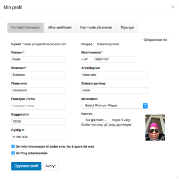

## 1\. Avtalens parter og innhold

1.1 Denne avtalen **(«Avtalen»)** er inngått mellom Viscenario og det firmaet som har signert kjøpskontrakten, Kunden.

1.2 Viscenario et 360 graders programvare som støtter prosjekt, innsamling av FDV og ettermarked. Avtalen gjelder bruk av de tjenester som til enhver tid tilbys i Viscenario **(«Tjenestene»)**, og regulerer partenes rettigheter og plikter.

1.3 Avtalen anses inngått og er bindende for begge parter fra det tidspunkt en kjøpskontrakt er inngått.

### 2\. Administratorkonto

2.1 Bruk av Tjenestene krever en administratorkonto for Kunden, gjennom denne kan man opprette brukere, grupper, prosjekter, samt legge inn alle parametere som skal til for at dere kan bruke Viscenario. Administratorkontoen er opprettet når Avtalen er akseptert av Kunden i henhold til punkt 1.3.

2.2 Kunden kan avslutte kontrakten ved å si opp 3 måneder før neste års lisens blir forlenget. Alle dataene vil da blir slettet.

2.3 Viscenario forbeholder seg retten til å midlertidig stenge kontoen:

Ved manglende betaling. Når kunden har gjort opp sitt mellomværende med Viscenario skal kontoen åpnes igjen.

Dersom Kunden ikke overholder, eller Viscenario mistenker at Kunden ikke overholder, sine forpliktelser som behandlingsansvarlig etter den til enhver tid gjeldende personopplysningslov.

Dersom Kunden ikke overholder, eller Viscenario mistenker at Kunden ikke overholder, sine forpliktelser etter gjeldende lover og regler av betydning for denne Avtalen. Ved misbruk, eller mistanke om misbruk. Eller dersom det etter Viscenarios oppfatning foreligger andre saklige grunner.

2.4 Dersom Kundens konto midlertidig stenges i henhold til punkt 2.3, vil Viscenario informere Kunden om dette ved å sende en e-post til Kundens registrerte e-postadresse. Kunden skal gis mulighet til å redegjøre for bruken av Tjenestene og eventuelt gis en frist til å bringe forholdet i orden. Midlertidig stenging av brukerkonto regnes ikke som heving av Avtalen.

2.5 Dersom Kunden ikke tilfredsstillende besvarer Viscenario sin henvendelse om å redegjøre for bruken av Tjenestene innen 30 dager forbeholder Viscenario seg retten til å heve Avtalen med umiddelbar virkning. Kunden vil ikke gis anledning til å laste ned kopi av data lagret i Kundens personlige profil for egen lagring med mindre annet er skriftlig avtalt med Viscenario.

#### 3\. Bruk av Tjenestene

3.1 Kunden er ansvarlig for og garanterer at alle opplysninger som registreres ved bruk av Tjenestene er korrekte.

3.2 Kunden er ansvarlig for all aktivitet knyttet til sin konto, opprettelse av brukerkontoer for ansatte og underleverandører kan skje ut i fra det antall lisenser som er kjøpt og betalt for.

##### 4\. Markedsføring

4.1 Ved inngåelsen av Avtalen godtar Kunden at Viscenario kan benytte Kundens registrerte e-postadresse til å sende informasjon om og/eller markedsføre Tjenestene og relaterte produkter fra Viscenario og sine samarbeidspartnere. Mottak av markedsføringshenvendelser er ikke en betingelse for å inngå Avtalen og Kunden kan når som helst melde seg av mottakerlisten for markedsføringshenvendelser, uten at dette vil påvirke vilkårene i Avtalen.

##### 5\. Betaling

5.1 Viscenario fakturerer Kunden etterskuddsvis per måned for konsulentbistand og årlig for lisensen. Fakturering av lisensen skjer forskuddsvis.

5.2 Kunden må si opp lisensen minimum 2 måneder før den fornyes.

##### 6\. Personvern

6.1 Viscenario er opptatt av personvern og behandler personopplysninger i samsvar med den til enhver tid gjeldende personvernlovgivning.

Personvernet ditt og datasikkerheten kommer først i alle oppdateringer av Viscenario. Vi oppfyller nå den høye standarden for personvern introdusert av den nye europeiske personvernloven, General Data ProtectionRegulation (GDPR).

Vi gjør det enda enklere å forstå hvilke opplysninger vi har lagret om deg, hvordan de kan redigeres og hvorfor de er lagret.

Alle brukere av Viscenario kan i webben under sin profil og i ViscenarioGO appen på mobilen under «Informasjon om meg», se hvilke data som er registrert på din bruker:

<table width="100%"><tbody><tr><td></td><td></td><td></td></tr></tbody></table>

Alle dataene kan du som bruker endre og legge til ny informasjon. Du eier dataene om deg selv. Får du en bruker hos et annet firma, som bruker Viscenario og de skriver inn din e-post adresse, vil dine master data bli lagt inn slik at det ikke blir feilregistreringer. Så lenge du har haket av på «Del min informasjon til andre siter, for å spare tid» så vil dine sertifikater og kontaktinformasjon bli foreslått når nye brukere blir registrert ved inntakskontroll på nye prosjekter.

Formålet med behandlingen er at Viscenario sin Kunde, som oftest en entreprenørvirksomhet skal være i stand til å etterleve de krav som stilles i byggherreforskriften. Det skal føres kontroll med hvem som har tilgang til prosjektet og det skal føres elektroniske mannskapslister.

**6.2 Behandlingsansvarlig**

Viscenario er databehandler på vegne av våre kunder som bruker verktøyet Viscenario i forbindelse med oppfølging av avvik, HMS rapportering, vernerunder, inntakskontroll, FDV dokumentasjon, tilvalgs løsninger, egenbefaringer, forbefaringer og overtakelser.

Det er det selskapet som har gitt deg brukertilgang til Viscenario løsningen som blir behandlingsansvarlig.

**6.3 Formålet**

Formålet med behandlingen er at kunden, som oftest en entreprenørvirksomhet skal være i stand til å etterleve de krav som stilles i byggherreforskriften. Det skal føres kontroll med hvem som har tilgang til prosjektet og det skal føres elektroniske mannskapslister.  
De som er tildelt en bruker tilgang kan også registrere avvik og oppgaver, samt få tildelt oppgaver som skal utbedres.

**6.4 Behandlingsgrunnlaget**

Vi har to type data, dataene om håndverkerne som jobber i byggeprosjektene og boligkjøperne.

**Data om håndverkerne**

Behandlingsgrunnlaget er de krav som stilles til entreprenørvirksomheten gjennom Byggherreforskriften og de krav som entreprenøren setter til egen/ interkontroll av egne prosjekter / virksomhet. Byggherreforskriften gir byggherre et selvstendig og overordnet ansvar for at sikkerhet, helse og arbeidsmiljø på byggeplassen blir ivaretatt. Som et ledd i kampen mot svart arbeid, innføres det krav om digital føring av mannskapslister fra og med 1.juli 2017.

**Data om boligkjøperne**

For at Viscenario sine kunder, utbyggere/entreprenører. Skal kunne jobbe effektivt med tilvalg og reklamasjonshåndtering må aktuelle data lagres og forvaltes. Bustaføringsloven krever at kjøper kan reklamere på sin bolig i 5 år. Uten full oversikt over disse dataene vil ikke utbyggere/entreprenører kunne oppfylle denne loven.

I dag er all bygging av nye boliger regulert av bustadoppføringslova. Dette gjelder uansett måten boligformen er organisert på, enten det dreier seg om borettslagsleiligheter, eierleiligheter eller eneboliger og fritidsboliger. Loven stiller opp ufravikelige regler for kontraktsforholdet mellom byggherren (forbrukeren) og entreprenøren (selgeren).

**6.5 Hvilke personopplysninger som behandles**

Brukere av Viscenario  
For brukere av Viscenario løsningen er det registrert følgende for å få en brukerrettighet/tilgang:

<table style="border-collapse: collapse;" border="1" width="80%" align="center"><tbody><tr><td><strong>Kategorier av datasubjekter</strong></td><td><strong>Kategorier av personopplysninger</strong></td><td><strong>Særlige kategorier av personopplysninger</strong></td></tr><tr><td valign="top">Data om håndverker</td><td valign="top"><ul><li style="list-style-type: circle; list-style-position: inside;">Fornavn</li><li style="list-style-type: circle; list-style-position: inside;">Etternavn</li><li style="list-style-type: circle; list-style-position: inside;">Firma / Arbeidsgiver</li><li style="list-style-type: circle; list-style-position: inside;">E-post adresse</li><li style="list-style-type: circle; list-style-position: inside;">Telefonnummer</li><li style="list-style-type: circle; list-style-position: inside;">Tilgangtileiendommer/prosjekter</li></ul>
<strong>Digitale mannskapslister inneholder disse feltene i tillegg til de over:</strong>
<ul><li style="list-style-type: circle; list-style-position: inside;">Arbeidsgiver</li><li style="list-style-type: circle; list-style-position: inside;">Telefonnummer</li><li style="list-style-type: circle; list-style-position: inside;">Tilgangtileiendommer/prosjekter</li><li style="list-style-type: circle; list-style-position: inside;">Statsborgerskap</li><li style="list-style-type: circle; list-style-position: inside;">Nrvedinnregistrering</li><li style="list-style-type: circle; list-style-position: inside;">Hvem de skal på besøk til</li><li style="list-style-type: circle; list-style-position: inside;">Kategori (om de er innleid, ansatt)</li><li style="list-style-type: circle; list-style-position: inside;">Nærmeste pårørendes navn og telefon nr – ifm skader på arbeidsplassen</li><li style="list-style-type: circle; list-style-position: inside;">Byggekortnr</li><li style="list-style-type: circle; list-style-position: inside;">Byggekortetsgyldighet</li><li style="list-style-type: circle; list-style-position: inside;">Tildeltsinterntnr</li><li style="list-style-type: circle; list-style-position: inside;">Funksjonifirma</li><li style="list-style-type: circle; list-style-position: inside;">Harvedkommendeenskriftligarbeidsavtale</li><li style="list-style-type: circle; list-style-position: inside;">Det tas bilder av deres HMS kort og sertifikater (sertifisert opplæring, dokumentert sikkerhetsopplæring, kompetanse, arbeid i høyden, stillasbruker, kranfører sikker bruk av arbeidsutstyr, varme arbeider, bruk av lift, sprengninger, førstehjelpskurs, anhuking, maskinførerbevis, stillasbygger)</li></ul>
Disse dataene er da tilgjengelig for prosjektledelsen og ledelsen hos entreprenørfirmaene. Skal samme person jobbe på et annet prosjekteller hos et annet firma, vil disse dataene komme opp, hvis brukeren har akseptert at dataene kan deles med andre siter. 
</td><td valign="top">Behandlingsaktivitetene inneholder ingen behandling av særlige kategorier av personopplysninger.</td></tr></tbody></table>

Boligkjøper

<table style="border-collapse: collapse;" border="1" width="80%" align="center"><tbody><tr><td><strong>Kategorier av datasubjekter</strong></td><td><strong>Kategorier av personopplysninger</strong></td><td><strong>Særlige kategorier av personopplysninger</strong></td></tr><tr><td valign="top">Boligkjøper</td><td valign="top"><ul><li style="list-style-type: circle; list-style-position: inside;">E-post adresse</li><li style="list-style-type: circle; list-style-position: inside;">Fornavnkjøper 1</li><li style="list-style-type: circle; list-style-position: inside;">EtternavnKjøper 1</li><li style="list-style-type: circle; list-style-position: inside;">TelefonnummerKjøper 1</li><li style="list-style-type: circle; list-style-position: inside;">Fornavnkjøper 2</li><li style="list-style-type: circle; list-style-position: inside;">EtternavnKjøper 2</li><li style="list-style-type: circle; list-style-position: inside;">Nåværendeadresse</li><li style="list-style-type: circle; list-style-position: inside;">Fødselsdato for boligkjøper</li></ul>
<strong>Informasjon om boligen:</strong>
<ul><li style="list-style-type: circle; list-style-position: inside;">Snr, Hnr, Gnr/Bnr</li><li style="list-style-type: circle; list-style-position: inside;">Parkering</li><li style="list-style-type: circle; list-style-position: inside;">Bod</li><li style="list-style-type: circle; list-style-position: inside;">Målernr, Måler-ID og målerstand på strøm, kalt vann, varmtvann, fjernvarme, ventilasjon og gass</li><li style="list-style-type: circle; list-style-position: inside;">Polisnr</li><li style="list-style-type: circle; list-style-position: inside;">Forsikringstype</li><li style="list-style-type: circle; list-style-position: inside;">Forsikringsselskap</li></ul></td><td valign="top">Behandlingsaktivitetene inneholder ingen behandling av særlige kategorier av personopplysninger.</td></tr></tbody></table>

I tillegg til det som fremgår ovenfor, skal Databehandler kun behandle Personopplysninger som er strengt nødvendig for å utføre tjenestene for den Behandlingsansvarlige.

**6.7 Hvor kommer personopplysningen fra?**

Det er databehandleransvarlig (entreprenøren/utbyggeren) som registrerer personopplysningene som er i bruk og som har ansvar for riktigheten av registrerte opplysninger.

**6.8 Frivillighet eller nødvendighet**

For at databehandleransvarlig (entreprenøren) skal være i stand til å utføre sine plikter i henhold til Byggherreforskriften og gi service i forbindelse med reklamasjonssaker (Bustaføringsloven) er det nødvendig med registrering av personopplysninger (kontakt opplysninger).

**6.9 Utlevering til tredjepart**

Det er databehandlingsansvarlig som «eier» registrerte personopplysninger. Viscenario AS utleverer ikke personopplysninger til tredjepart. Informasjon om boligkjøper, adresse, fødselsdato, målerpunktid, måler nr og målerstand kan fritt sendes til strømselskaper, der boligkjøper har akseptert dette ved overtakelse av bolig.

**6.10 Sletting av personopplysninger**

Det er databehandleransvarlig som registrere personopplysningene som er ansvarlig for sletting av registrerte personopplysninger.

**6.11 Innsyn**

Alle brukere av Viscenario kan i webben under sin profil og i ViscenarioGO appen på mobilen under «Informasjon om meg», se hvilke data som er registrert på din bruker:

<table width="100%"><tbody><tr><td></td><td></td><td></td></tr></tbody></table>

Alle dataene kan du som bruker endre og legge til ny informasjon. Du eier dataene om deg selv. Får du en bruker hos et annet firma og de skriver inn din e-post adresse, vil dine master data bli lagt inn slik at det ikke blir feilregistreringer. Så lenge du har haket av på «Del min informasjon til andre siter, for å spare tid» så vil dine sertifikater og kontaktinformasjon bli foreslått når nye brukere blir registrert ved inntakskontroll på nye prosjekter.

**6.12 Informasjonssikkerhet**

Viscenario benytter anerkjente standarder og beste praksis i arbeidet med sikkerhet. Viscenario gjennomfører jevnlig risikovurderinger og sikkerhetstester av løsningen.

Viscenario har følgende sikkerhetstiltak i produktet:

-   Autentisering ved hjelp av brukernavn og passord
-   All informasjonsutveksling skjer med sterk kryptering( SSL)
-   Viscenario sine servere er plassert i Amazons skysenter i Irland, som er et firma som har lang erfaring med å drifte virksomhetskritiske og sensitiv informasjon.

Registrerte personopplysninger er databehandleransvarlig sin «eiendom» og utleveres ikke til tredjepart fra Viscenario AS.  
Viscenario tjenesten er en skybasert tjeneste som er levert på Amazon Web Services (AWS) plattform og er sikret med tilgangskontroll og standard backup rutiner med mindre annet er avtalt med databehandlingsansvarlig.

##### 7\. Endringer

7.1 For å opprettholde kvaliteten og forbedre Tjenestene, forbeholder Viscenario seg retten til å endre vilkårene i Avtalen. Slike endringer vil bli varslet om på nettsiden [www.viscenario.no](http://www.viscenario.no) en måned før endringene trer i kraft. Dersom Kunden ikke er villig til å godta de endrede avtalebetingelsene, kan Kunden si opp Avtalen med Viscenario.

##### 8\. Immaterielle rettigheter

8.1 Alle immaterielle rettigheter (inkludert, men ikke begrenset til opphavs- og fotorettigheter, varemerker og patenter) knyttet til [www.viscenario.no](http://www.viscenario.no) tilhører Viscenario eller Viscenarios leverandører og samarbeidspartnere.

8.2. Overdragelse av rettigheter og plikter.

Kunden har ikke rett til å overdra Avtalen, herunder sin konto til andre uten at dette er skriftlig forhåndsgodkjent av Viscenario.

8.3 Viscenario har rett til å overdra Avtalen og kundeforholdet til andre selskaper. Ved eventuelt oppkjøp, fusjon eller fisjon overdras Avtalen og kundeforholdet til den virksomheten som driver Tjenestene videre. Kunden vil i så fall bli varsel om dette på forhånd.

##### 9\. Ansvar

9.1 Kunden skal gjøre nødvendige tiltak for å forhindre at skadelig programvare blir lastet opp til Kundens konto, f.eks. i forbindelse med Kundens opplasting av dokumenter. For det tilfellet at skadelig programvare blir lastet opp av Kunden, skal Kunden være ansvarlig for konsekvensene av dette. Dette gjelder både overfor Viscenario, samt mottakere av vedlegget som Kunden har forespurt utsendelse til. Eventuelle krav mot Viscenario fra mottakere av vedlegget, som følger slik skadelig programvare, skal dekkes av Kunden. Dersom Kunden laster opp skadelig programvare og dette skyldes uaktsomme eller forsettlige handlinger skal det anses som vesentlig mislighold av Avtalen og Viscenario kan heve Avtalen og slette Kundens konto.

9.2 Viscenario har ikke ansvar for e-poster som ikke kommer frem på grunn av at Kundens e-postadresse ikke eksisterer, ikke fungerer, filtrerer bort e-posten som søppelpost eller lignende.

9.3 Viscenario er ikke ansvarlig for skade eller tap som skyldes innholdet bruk av Viscenario.Viscenario er ikke ansvarlig for direkte eller indirekte tap, uteblitt fortjeneste eller annet tap som skyldes bruk av Viscenario. Dette gjelder også der Tjenestene er ute av funksjon for kortere eller lengre tid uansett om dette skyldes tekniske årsaker, som for eksempel datasystem, nettverksoppkoblinger mv.

9.4 Ved mislighold av Avtalen kan den part som rammes kreve erstatning for dokumentert økonomisk tap innenfor følgende begrensninger:

-   Tapets art og omfang må være adekvat og påregnelig etter vanlige prinsipper for erstatning i avtaleforhold.
-   Tap av fortjeneste, indirekte tap, konsekvenstap og andre følgetap dekkes ikke.
-   Erstatningskravet kan ikke overstige det samlede årlige vederlag etter Avtalen.

Ansvarsbegrensningene i pkt. over gjelder ikke dersom vedkommende part har utvist grov uaktsomhet eller forsett.

##### 10\. Mislighold

10.1 Dersom en av partene vesentlig misligholder sine forpliktelser etter denne Avtalen, kan den annen part, etter å ha gitt den andre parten skriftlig forhåndsvarsel med 30 dagers frist til å bringe forholdet i orden, heve Avtalen med øyeblikkelig virkning. Midlertidig stenging av konto i henhold til punkt 2.4 regnes ikke som heving av Avtalen.

10.2 Dersom Viscenario hever Avtalen i henhold til punkt 10.1 ovenfor, slettes Kundens konto inkludert all data og dokumentasjon lagret i kontoen, med mindre annet skriftlig avtales med Kunden. Sletting skjer likevel ikke dersom Viscenario har et gyldig rettslig grunnlag for fortsatt lagring av opplysningene. Dette gjelder for eksempel opplysninger som er nødvendige for at Viscenario skal kunne forfølge eventuelle utestående krav mot Kunden.

10.3 Som vesentlig mislighold regnes blant annet, men er ikke begrenset til, følgende forhold:

-   Ved vesentlig betalingsmislighold fra Kunden.
-   Dersom Kunden laster opp skadelig programvare i Viscenario, hvis dette skyldes uaktsomme eller forsettlige handlinger fra Kunden.
-   Ved vesentlig mislighold av forpliktelser etter gjeldende personopplysningslov.

10.4 Dersom Kunden vesentlig misligholder Avtalen forbeholder Viscenario seg retten til å nekte Kunden å opprette en ny konto.

10.5 Dersom Avtalens gjennomføring helt eller delvis hindres, eller i vesentlig grad vanskeliggjøres av forhold som ligger utenfor Viscenariosin kontroll, suspenderes pliktene i den utstrekning forholdet er relevant, og for så lang tid som forholdet varer. Slike forhold inkluderer, men er ikke begrenset til streik, lockout, og ethvert forhold som etter norsk rett vil bli bedømt som force majeure. Hver av partene kan imidlertid si opp Avtalen med én måneds varsel dersom force majeure-tilfellet gjør det særlig byrdefullt for vedkommende å opprettholde Avtalen.

##### 11\. Tvister

11.1 Tvister mellom partene skal søkes løst i minnelighet. Dersom det ikke lar seg gjøre, kan hver av partene bringe tvisten inn for de ordinære domstoler med Oslo Tingrett som verneting.
