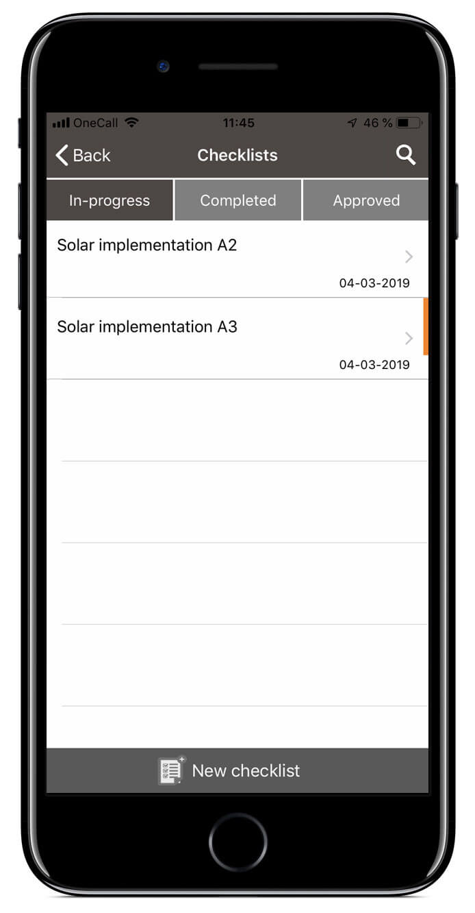
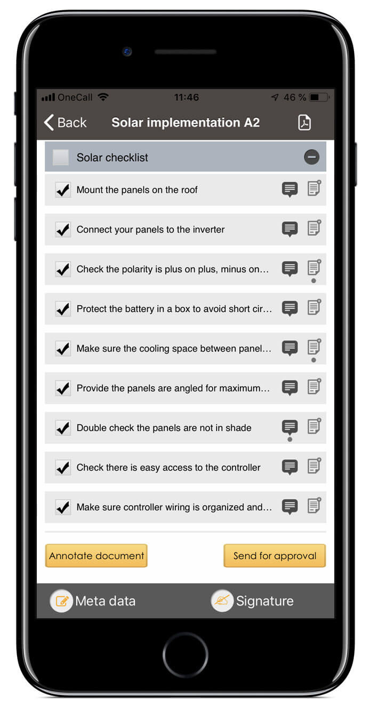
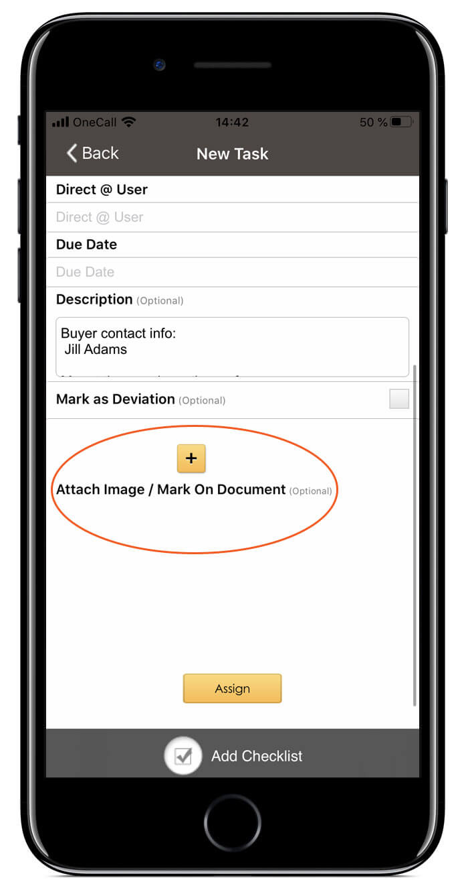
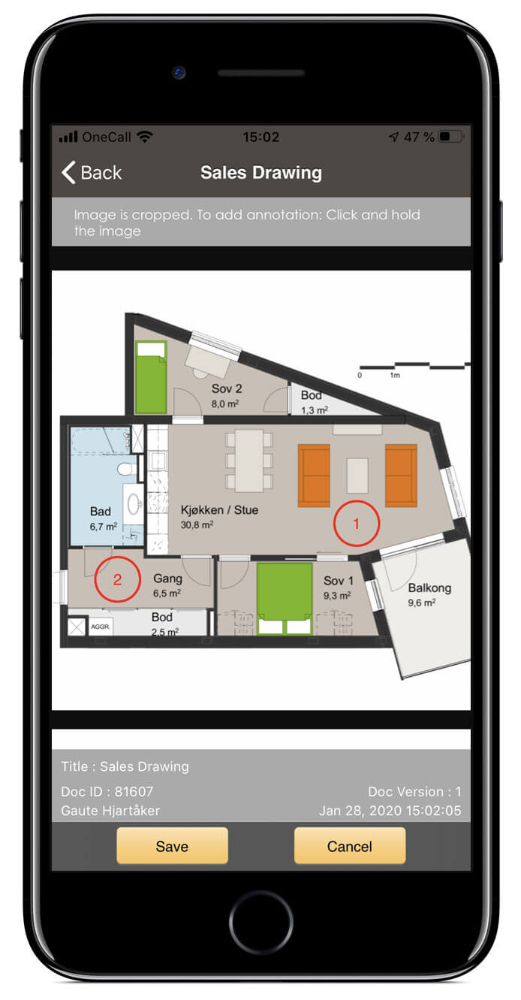

## Quality assurance with checklists on smartphone

Viscenario gives you one system for handling [Quality Assurance (checklists),](https://youtu.be/fK6TLFpR6rM) defects/issues, HSE reporting, [JSA,](https://youtu.be/1YS7omQg4QY) [inspections,](https://youtu.be/c9pxrb3YJbU) [options,](https://youtu.be/DIFo7TsCBA8) maintenance documentation and issue handling on Smartphone, tablet and web. By using checklist for documenting work, you make sure everyone checks the same thing for the same discipline.

**Save 1 hour in work**  
By documenting on your Smartphone or tablet there and then, you save all your office time afterwards.

**Standardizing using checklists**  
Defect/issues found in connection with the use of a checklist are [pushed to the smartphone](https://youtu.be/fTYZZPag4yQ) to the person who has to correct it.

**Learn from project to project**  
By using checklists you standardize the documentation. Therefore, you can easily see what discrepancies you find in the various jobs.

### Checklists

[Checklists](https://youtu.be/fK6TLFpR6rM) are important for internal controls and to document quality work. In Viscenario you can use checklists on your smartphone, tablet or browser.

You can link a checklist to a task, which is then either an ad-hoc or scheduled planned task. Several people can also work on a checklist at the same time. The advantage of checklists is that you standardize how to document a job. At each checkpoint you can leave a comment with a picture or create a follow-up task / defect. When the checklist is completed and you have completed the task(s), Viscenario merges all of this into a PDF and automatically saves it in the document folders on the project or building in question. You save yourself all the work by merging images, text and task into a summary. In addition to this, all the discrepancies / tasks that you have created in connection with the checklist are already [pushed out to the one who needs to correct them.](https://youtu.be/fTYZZPag4yQ) [Live overview of all tasks and deviations](https://www.youtube.com/watch?v=AeihMDcWMDE&feature=youtu.be&t=122) can be found in Viscenario.

If you use checklists on planned tasks, such as a safety rounds or weekly assignment, you can easily see what was not done last week. You do not have to register the same issue again. If the tasks you registered last week have already been completed, they will not be displayed.

Our customers post their own checklists and customize them to their own needs. You can easily pick check points from a checklist to other jobs. It is also possible to mark on drawings to mark where there is a defect on the checkpoints.

One of the benefits of using Viscenario for checklists is that you can learn from project to project. For example, you can easily get an overview of how many deviations we have had from a job (a job you have used checklists on) in project A, compared to the number of deviations from the same job in project B.

-   Quality Assurance checklist
-   Pre-registration checklist for pre-acquisition, takeover or one-year inspection
-   A safety inspection
-   Service agreements – check on what to check for connection to service such as ventilation or elevator
-   Fire Rounds
-   Season Tasks
-   Appointments
-   Weekly assignments for janitor
-   Contractor Meetings

Our customers save a minimum of 1 hour after work by using Viscenario’s checklist module.
