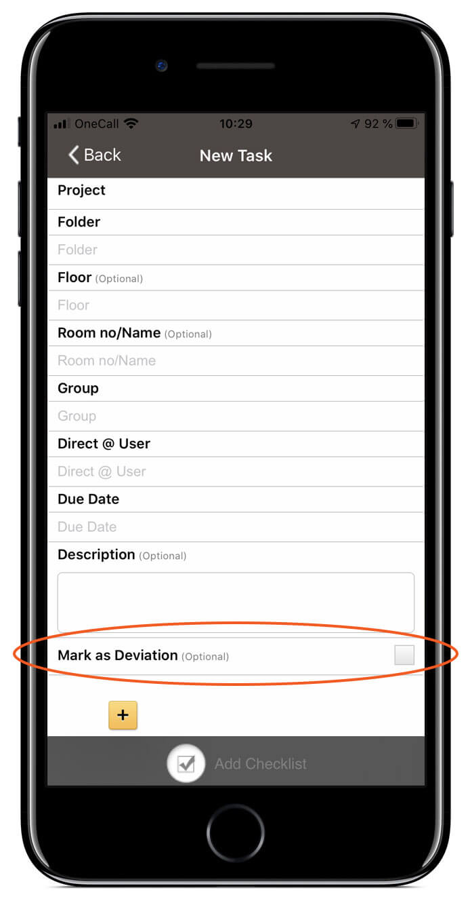
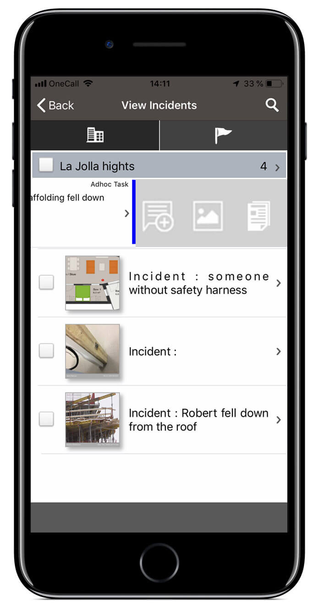
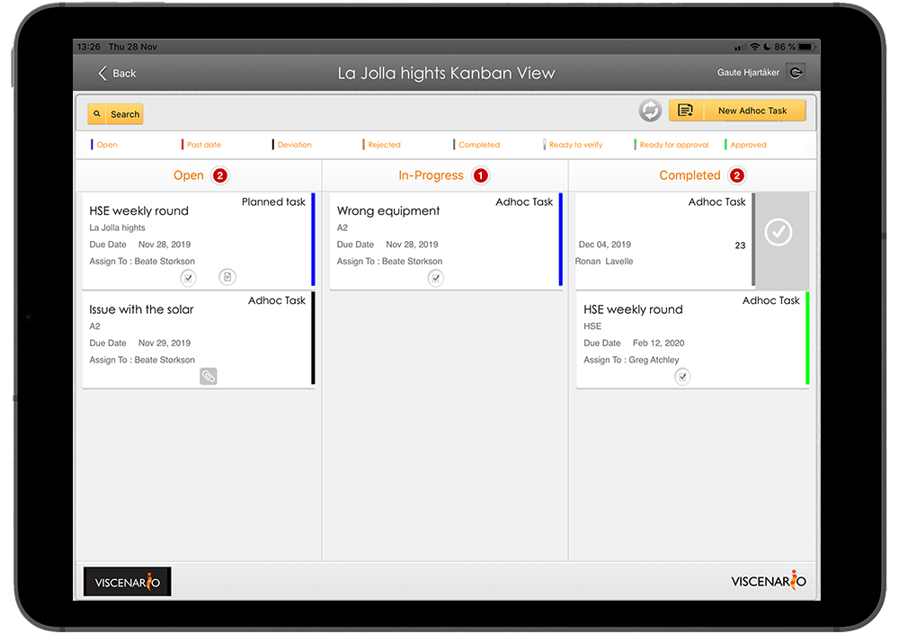
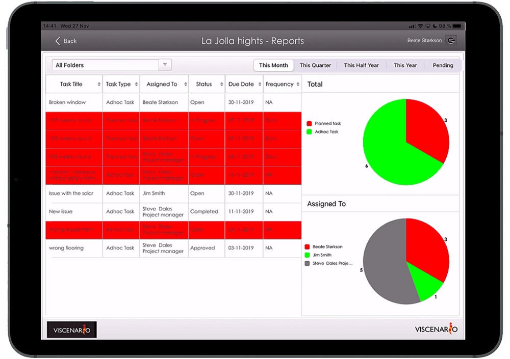

## Defect management

Viscenario provides you with one system for handling defects/issues, HSE reporting, [JSA,](https://youtu.be/1YS7omQg4QY) [inspections,](https://youtu.be/c9pxrb3YJbU) [Quality Assurance checklists,](https://youtu.be/fK6TLFpR6rM) [options,](https://youtu.be/DIFo7TsCBA8) maintenance documentation, housing permits and complaints management on your iPhone, tablet and web.

**Save 1 hour per defects**  
Drawings, maintenance documents, housing permits, options and overview of reported issues are live on the tablet

**Full overview**  
Employees and subcontractors receive push notifications and [see their defects on their phone.](https://youtu.be/fTYZZPag4yQ)

**Consequences?**  
Does the defect/issue have a consequence for finances, progress or quality, or against the maintenance system, laws and regulations, description, drawings, plans or orders? Full case management and Reporting!

### Registration of defects/issues on your phone

By registering defects in Viscenario from your smartphone, tablet or web browser, you get all the defects/issues in Viscenario. You can [take pictures](https://youtu.be/zaHJpt_db7o) and describe the issues from your smartphone. In Viscenario or on your tablet, you can also mark on a drawing to explain where the deviation is, while also taking a picture of what needs to be fixed. A subcontractor or employee will receive a push notification on their smartphone and possibly by email (if they have an internet connection) when new defects are registered. It is also possible to add a checklist to a task, if you want the defect to be documented according to a checklist.

#### Defect/issue management – which defects/issues have an economic impact?

It is also possible for everyone in the project to mark defects, which is believed to have a consequence for the project. Then the project management will be notified of this and can address whether this defect has a consequence for finances, progress or quality, or whether the defect applies to the municipality system, laws and regulations, description, drawings, plans or orders. Who was responsible for the work where the discrepancy occurred is also important to record, as well as the costs that it entailed? It is easy to retrieve reports on all nonconformities that have cost the company Money, or defects you have had the builder cover.

#### The project management has live overview of all defects/issues

The project management has an overview of all the defects they have registered and received themselves, in a status view on the tablet. Here they easily see the current status of all defects. There are also separate reports for all tasks on the project on the tablet, where you can easily see discrepancies on a building or apartment. Here you can easily see which people and department have not corrected the defects / issue. You can easily retrieve reports of defects per supplier or department, or defects that have a financial consequence. All the recorded data can be searched in the browser version of Viscenario.

#### Learn from one project to the next

The advantage of using Viscenario for deviation management is that you can easily learn from project to the next. For example, you can easily get an overview of, for example, the number of defects that have had a financial consequence in Project A, compared to Project B, exported to Excel. Number of defects compared to drawings, municipality system, progress, etc.

#### Access to all information about the project on tablet or the internet

By using Viscenario for deviations, you have with you all drawings, operation maintenance documents, options and orders in the app on your tablet. In addition, you have a live overview of all defects that are on the building or the apartment in question. This information means you have everything with you and is accessible at all times.

#### You save minimum 1 hour in administration cost per defect

Our customers save a minimum of 1 hour of administration by using Viscenario for defect management.
