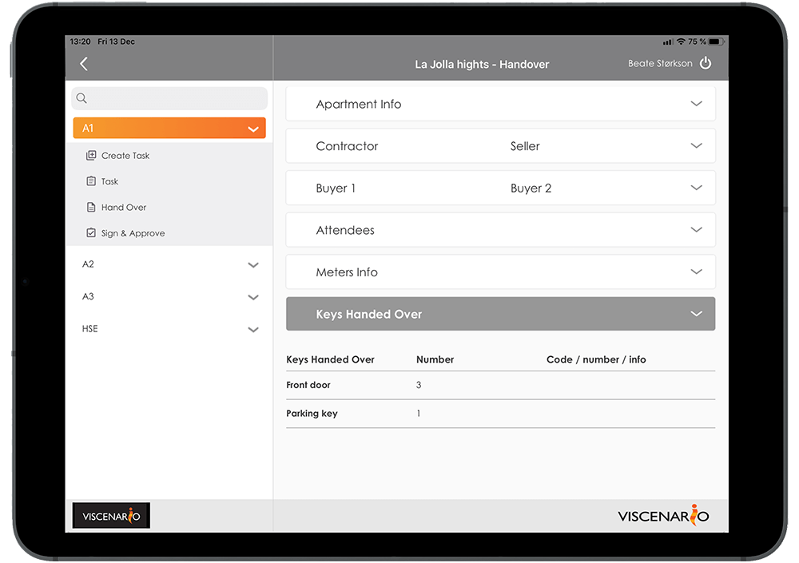
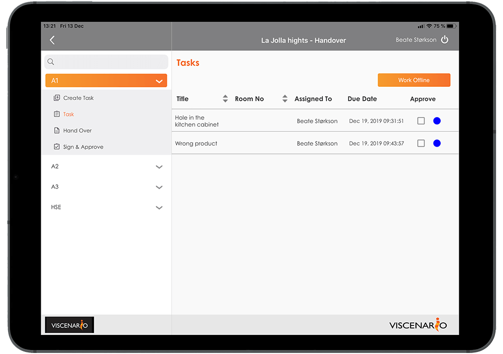
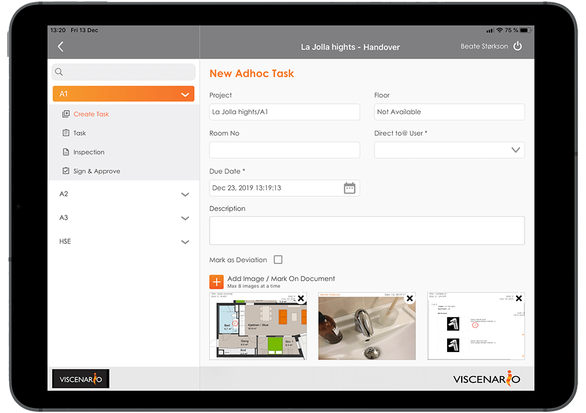
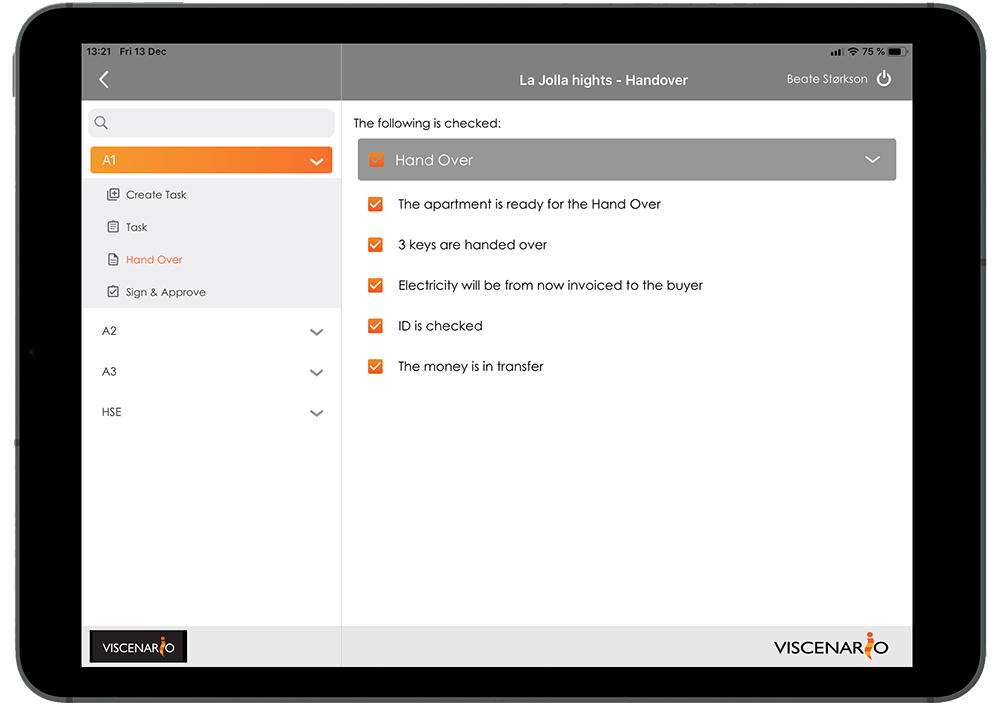
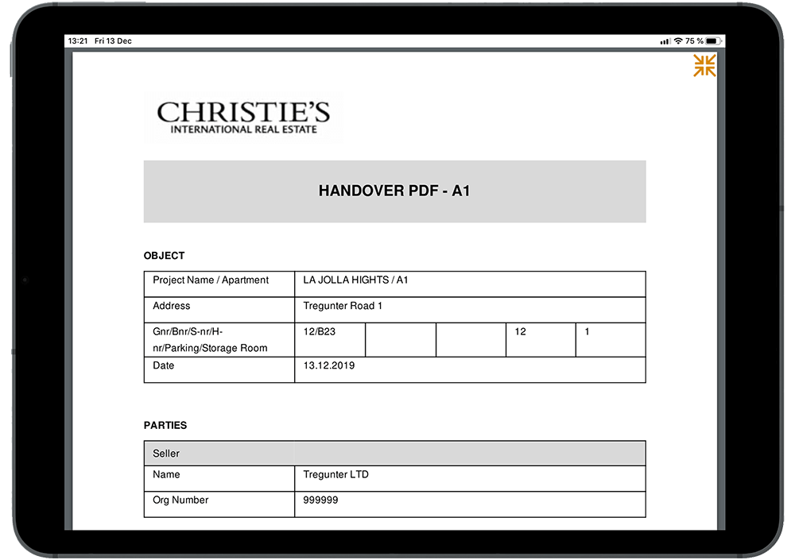

## Hand Over inspection on tablet

By using Viscenario to document various [inspections](https://youtu.be/c9pxrb3YJbU) such as pre-inspections, [Hand Over,](https://youtu.be/ihruydtLGiM) one-year or subcontractor inspections, you will save all the office time you would have spent after each inspection.

**All information available**  
Drawings, maintenance documents, options orders and overview of reported issues and defects are live on the tablet

**Saves 1 hour of work**  
Viscenario merges signatures, images, text, defects and drawing into a protocol.

**Having a live overview of open issue**  
[Live overview](https://www.youtube.com/watch?v=AeihMDcWMDE&feature=youtu.be&t=122) of all open issues and it is available on tablets. Does not require any preparation before the actual inspection.

### Access to all information about the project on the tablet

When you use Viscenario for Hand Over, you have all the drawings, maintenance documents and options ordered in Viscenario on your tablet. In addition, you have a [live overview](https://www.youtube.com/watch?v=AeihMDcWMDE&feature=youtu.be&t=122) of all defects on the building and the actual location. This information means you have everything with you and is accessible at all times.

#### The protocol of the hand over inspections is automatically stored and emailed

Using Viscenario on a tablet gives you the drawings of the building or location, where you can mark the places where the defects have been detected. You then delegate the task(s) to correct the defects to the right professional from your tablet. Viscenario then merges all information such as logo, project, building / apartment, drawing number, defects/issues with comments and pictures, as well as signatures from those present.

#### Standardizing inspections using checklists

You can also combine an inspections with a [checklist.](https://youtu.be/c9pxrb3YJbU?t=67) The advantage of checklists is that you standardize what is to be checked and how to document the inspections. At each checkpoint you can leave a comment with a picture or create a follow-up task / defect. When the checklist is completed and you are done with the one-year inspection, Viscenario merges all this into a PDF document and automatically saves it in the document folders of the project or building / apartment. You save everything after work by merging images, text and discrepancies into a protocol. In addition, any discrepancies that you have corrected in connection with the one-year inspections are already pushed out to the person(s) in charge. Live overview of all deviations can be found in Viscenario.

#### See the live status from the issues from previous inspection

You can easily see what has not been done since the last time you did the inspection. Then you do not have to re-register the same issue. If the task you last registered is already done, it will not be displayed. You do not have to spend any time acquiring status before embarking on inspections.

#### Learn from one project to the next

The advantage of using Viscenario to document Hand Over inspections, is that you can learn from one project to the next. For example, you can easily get an overview of how many defects/issues were found on all Hand Over inspections in project A, compared to the number of defects/issues from one-year inspections in project B. What most people know is that it is cheaper to find the issues before taking over, so by focusing on finding the anomalies earlier, there will be major savings during the warranty period.

#### You save minimum 1 hour on office work after inspection

Our customers save a minimum of 1 hour after work by using Viscenario to create Hand Over protocols.
