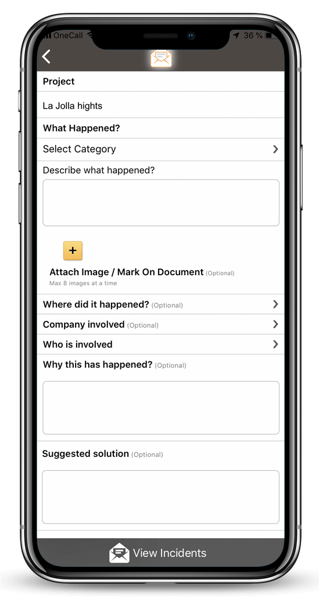
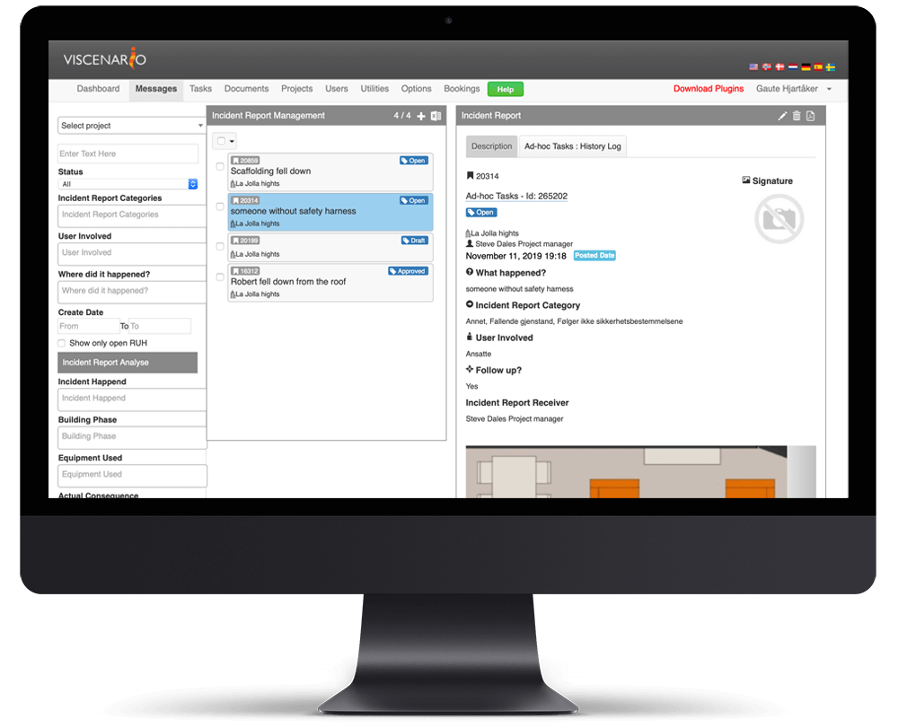

## HSE reporting on the mobile

Reporting of HSE incidents at the construction site increases focus on safety and contributes to fewer accidents.

**Save time per incident**  
Live overview of status at all incidents. Available on tablet and web.

**Full overview**  
Easily retrieves an overview of the number of incidents per category.

**Teaches and sharpens focus**  
Increases focus on safety and contributes to fewer accidents.

### HSE reporting focuses on reducing number of accidents

Experience from our customers shows that an increase in HSE Reporting leads to a decrease in the number of accidents. This is due to increased awareness of safety and a focus on following routines and regulations to avoid dangerous situations.

By using Viscenario on a mobile device (phone or tablet), all project participants have easy access to register HSE incidents. It is possible to add your own categories that it is important to measure in your organization. The project management manages registered HSE incidents and must close the open issues that is then created. It is easy for the responsible manager in the project to get an overview of the number of maintenance documents for the different categories, periods and projects.

<iframe src="https://www.youtube-nocookie.com/embed/n1RPZuH3hRw" title="Viscenario video" loading="lazy" allow="encrypted-media; picture-in-picture" allowfullscreen></iframe>

