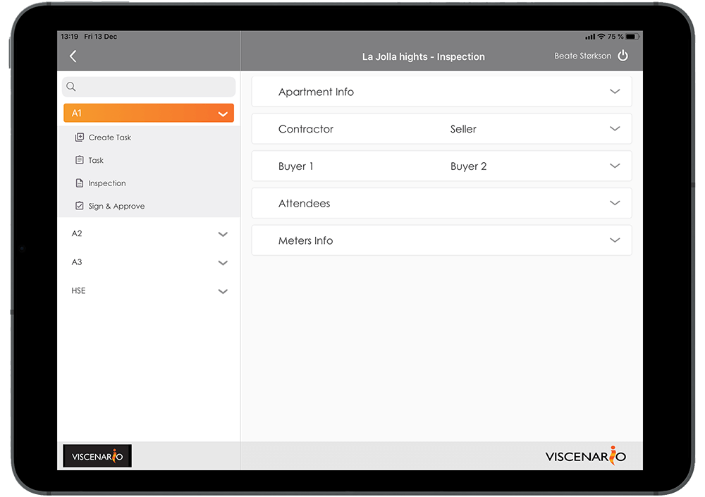
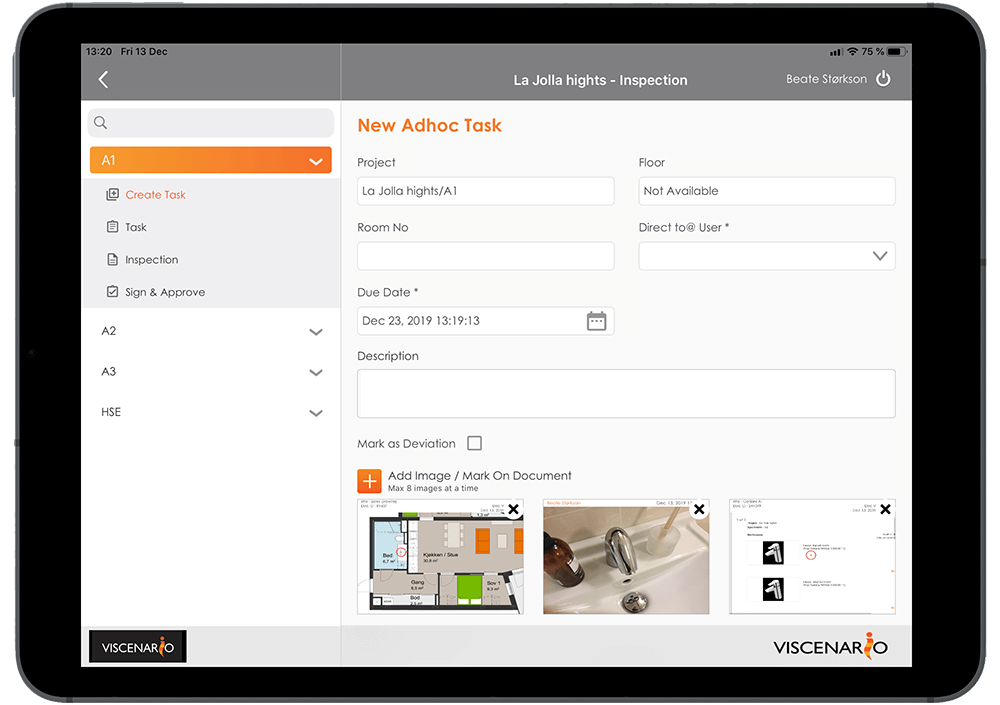

## Inspection on tablet

By using Viscenario to document various [inspections](https://youtu.be/c9pxrb3YJbU) such as pre-inspections, [Hand Over,](https://youtu.be/ihruydtLGiM) one-year or subcontractor inspections, you will save all the office time you would have spent after each inspection.

**All information available**  
Drawings, maintenance documentation, housing permits, options and overview of reported errors and issue are live on the tablet.

**Saves 1 hour of work**  
Viscenario merges signatures, images, text, defect and drawing into a protocol.

**Having a live overview of open issues**  
[Live overview](https://youtu.be/AeihMDcWMDE?t=122) of all open issues and defects is available on tablets. Does not require any preparation before the actual inspection.

### Access to all information about the project on the tablet

When you use Viscenario for [inspections,](https://youtu.be/c9pxrb3YJbU) you have all the drawings, maintenance documents, options and orders in Viscenario on your tablet. In addition, you have a [live overview](https://youtu.be/AeihMDcWMDE?t=122) of all defects on the building and the actual apartment. This information means you have everything with you and is accessible at all times.

#### The protocol of inspections is automatically stored and emailed

Using Viscenario on a tablet gives you the drawings of the building or apartment, where you can mark the place where the defects have been detected. You then delegate the task(s) to correct the defects to the right professional from your tablet. Viscenario then merges all information such as logo, project, building / apartment, drawing number, defects with comments and pictures, as well as signatures from those present.

#### Standardizing inspections using checklists

You can also combine an inspection with a [checklist.](https://youtu.be/c9pxrb3YJbU?t=67) The advantage of checklists is that you standardize what is to be checked and how to document the inspections. At each checkpoint you can leave a comment with a picture or create a follow-up task to correct a defect. When the checklist is completed and you are done with the one-year inspection, Viscenario merges all this into a PDF document and automatically saves it in the document folders of the project or building / apartment. You save everything after work by merging images, text and discrepancies into a protocol. In addition, any discrepancies that you have corrected in connection with the one-year inspections are already pushed out to the person(s) in charge. Live overview of all defects can be found in Viscenario.

#### See the live status from the defects from previous inspections

You can easily see what has not been done anything with since the last time you did the inspection. You do not have to re-register the same issue. If the task you last registered is already done, it will not be displayed. You do not have to spend any time acquiring status before embarking on inspections.

#### Learn from one project to the next

The advantage of using Viscenario for inspection is that you can learn from project to project. For example, you can easily get an overview of how many defects have been found on all the pre inspections in project A, compared to the number of defects from pre inspections in project B.

#### You save minimum 1 hour on office work after inspection

Our customers save a minimum of 1 hour after work by using Viscenario to create inspection protocols.

<iframe src="https://www.youtube-nocookie.com/embed/fhPlKoRhBOM" title="Viscenario video" loading="lazy" allow="encrypted-media; picture-in-picture" allowfullscreen></iframe>

