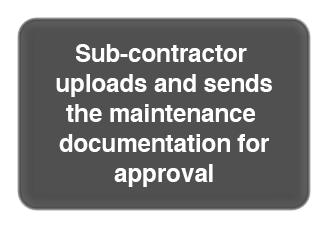
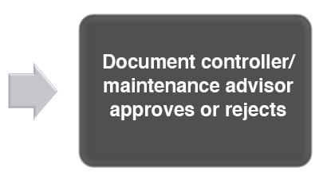
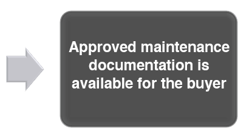
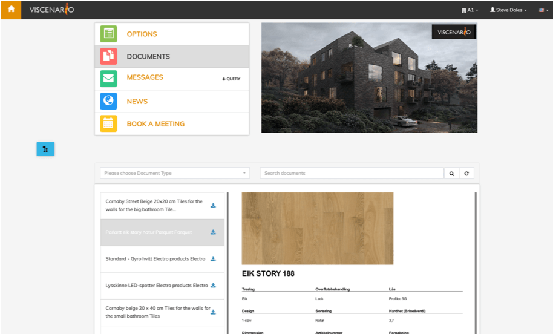

## Maintenance documentation available on tablet

In Viscenario, [the customer receives their maintenance documentation](https://www.youtube.com/watch?v=DIFo7TsCBA8&feature=youtu.be&t=80) either via the Viscenario app for tablets or via the browser. If you have many properties in Viscenario, it is easy to find maintenance documentation on the various properties. It is easy to search for and find the maintenance documentation. The janitor has also access to maintenance documentation.

**All information available**  
All documents and tasks are available in one place

**Register new issues from the viscenario app**  
The tenants/owner/janitor takes a photo and notifies you of issues from his smart phone or tablet.

**Planned maintenance tasks?**  
Easy to follow-up of signed service agreements and planned maintenance tasks.

### The sub-contractor uploads and sends the maintenance documentation for approval

The subcontractors and employees of the contractor have access to project documents and drawings in Viscenario in the projects. They also get pushed out in the Viscenario app. When a subcontractor or employee enters Viscenario to look at the templates on their subject, they know what the maintenance documentation should look like. Once they have filled in the template, they either use Viscenario Drive to “drop” the documents into the correct folder in the building discipline structure or upload them to the browser. Once they have submitted it for approval, the document controller or maintenance advisor will either approve or reject the maintenance documentation. Approved maintenance documentation is then available for the buyer and for the board of the condominium for common area.

### Warranty Period – Issue Management

In addition to [finding the maintenance documentation,](https://www.youtube.com/watch?v=DIFo7TsCBA8&feature=youtu.be&t=80) the buyer can also [report issues](https://youtu.be/0voTgv09ci4) in Viscenario. By taking a picture and describing where the error is, the issues will go straight to Aftermarket, which in turn can delegate the task to the right professional.

### Planned maintenance tasks pushed notified into Viscenario app

Planned maintenance tasks that contractors think building owners should do are set up so that the janitor receives emails and notifications in the Viscenario app when it’s time for a filter change, elevator or ventilation service, etc.

### Pre-inspections, hand over and one-year inspections

When you use Viscenario for [inspections,](https://youtu.be/c9pxrb3YJbU) you have all the drawings, maintenance documents, orders in Viscenario on your tablet. In addition to this, you have a live overview of all defects on the building and the apartment in question. This information means you always have everything with you and available at all times.

### The protocol is automatically created, stored and mailed

When you use Viscenario on your tablet, you also get the drawings of the building or apartment, where you can mark the places where the defects have been detected. You then delegate the defects to the right professional from your tablet. When you’re done, the developer or client can sign on your tablet with you. Viscenario then merges all information such as logo, project, building / apartment, drawing number, defects/issues with comments and pictures, as well as the signatures of those present.

### See live status of defects/issues from previous inspections

If you use the module for pre-inspection and [Hand Over;](https://youtu.be/ihruydtLGiM) you can easily see what has not been arranged in the page the last time you went to the inspection. You then do not have to register the same error again. If the tasks you last registered are already solved, then it will not be displayed.
