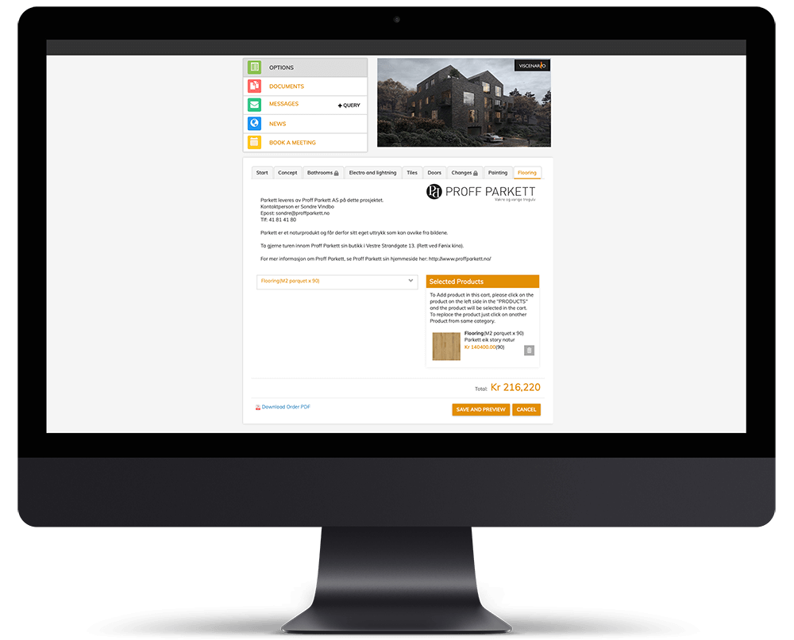

## Portal for buyers with Options throughout the Warranty period

Viscenario provides you with one system for handling [Options,](https://youtu.be/DIFo7TsCBA8) project news, booking of appointment meetings, maintenance documents, inspections, Defect and issue management.

When your client buys a home from you, they get the opportunity to personalize it in the Viscenario Option module. It starts with the exterior style and carries through to the interior with options for flooring, appliances, lighting, technology wiring and more.

**Save 75% of the time**  
All time associated with the distribution, collection and dissemination of optional lists is considered.

**Full overview**  
Buyer of apartments places the orders in Viscenario. The orders are ready for the suppliers when the deadline is past and its ready for the contractor to add the flooring, tiles and so on for the apartment.

**No mistakes**  
The maintenance documentation are completed when the buyer has sent his order. It is available on tablets and is used to verify options at inspections.

### Options – web shop

Viscenario offers software for housing, apartments and home projects.  
Both the buyer of the home, the contractor, the developer and all the subcontractors have access to Viscenario’s role-based software.  
Normally, you spend 4-5 months setting up and managing options in a 150 unit construction project, but with Viscenario it can take as little as 1-3 days. The dialogue with the buyer should still be maintained to ensure a good customer dialogue. The overview of all the apartments and what parameters they have are imported from Excel.

#### Customer portal from signature throughout warranty period

The buyer of the apartment has one username and password to find everything from [project news, drawings and options, to dialogue with the developer and issue management.](https://youtu.be/DIFo7TsCBA8) The buyer logs on to the web portal where you choose which options you want. An option is an individual customization, based on each customer’s needs and desires. Typical options can be in kitchens, tiles, plumbing, electrical, paint, flooring.

The buyer sees the current / available options for their home divided into individual tabs / categories.

All products in the sub-selection category are displayed with product descriptions / product details, images, movies and product datasheets. When the buyer has ticked off the options she wants, she sends the orders away with a single keystroke!

If he or she is not quite sure yet, the order can be saved for later.  
The buyer can download and print the electric drawings and mark where the electronic plant the various options should be.

There is a separate tab next to the optional categories in Viscenario, where buyers can ask questions and get answers.  
The buyer gets all the documentation in one place.

When the orders have been sent, the buyer has the documents, with data sheets on their options, the sales drawing, the electric drawing and the optional order digitally in Viscenario. When the order is shipped, the buyer receives an email copy.

#### What is required to get the optional solution ready?

The contractor or builder defines which options apply to the project in question. Alternative products from previous projects can also be reused.

**THE FOLLOWING MUST BE REGISTERED:**  
Products with price and order deadlines, as well as tabs / categories the various products will be presented on. Sales drawings and electrical drawings must be entered in all apartments. Terms that the customer must accept before they can make the options must be defined.

All apartments with rooms and parameters are imported from Excel. These parameters are included in the price calculation. For example, sq. meter of flooring is displayed and calculates the current price for the buyer.

This saves you time

-   When the buyer has sent the order for the relevant options, the maintenance documentation will be created automatically together with the products’ corresponding data sheets.
-   With just two clicks, the orders are exported to Excel and are ready to be sent to the various suppliers. Then you get the orders divided by subject, what is the total sum for the entire project and what the different apartments should have. It is easy to check incoming invoices from their subcontractors up against the orders.
-   Easily send e-mails to all buyers in a project.
-   When the contractor is going to inspect, Hand Over or one-year inspection, they have all the information and history pertaining to this apartment available on their tablet.
    -   There they have all the maintenance documentation, the sales drawing, the electric drawing, the options order and the data sheets of all the options and the standard choices.
    -   In addition, they have live status on all defects and ongoing tasks at the apartment in question. They have all this with them on their tablets.
-   At the actual inspection, the points will be marked as defects in the sales drawing. The errors will automatically be sent to the person responsible for rectifying them. When the inspection is complete, the buyer and the contractor sign the digital inspection protocol, before the contractor creates it as a PDF document. The inspection protocol is then filled in with the defects, the drawing with bullets, pictures, text and the signature. It is automatically stored in the apartment in question.
-   Subcontractors such as electricians and kitchen suppliers upload updated drawings on relevant apartments right in Viscenario. They also have access to updated drawings and documents on the project.
-   The subcontractors also upload the maintenance documentation on common areas in the same solution, so that the maintenance documentation on the entire building is available in Viscenario. The board of the condominium then gets access to the maintenance documentation in the common area and the home buyers get the housing permit for their home. All of this is available on tablets (iOS and Android)

#### The benefit when everything is together in a 360 degree viscenario

-   Significant time savings associated with administration
-   Minimized risk of errors
-   Live listings of all tasks and defects on entire projects and down to the apartment level
-   Better communication
-   Better reporting
-   All maintenance is automatically placed in the right apartment.
-   Subcontractors submit their maintenance documentation.

Our customers save 75% of the time they would normally spend on pen and paper in addition to Excel.

<iframe src="https://www.youtube-nocookie.com/embed/rWpCWot85nE" title="Viscenario video" loading="lazy" allow="encrypted-media; picture-in-picture" allowfullscreen></iframe>

