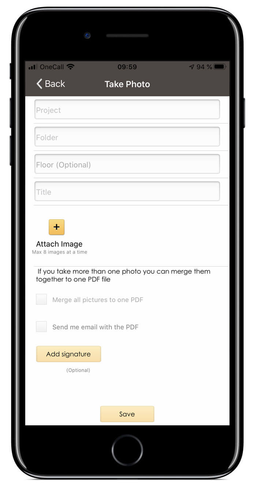
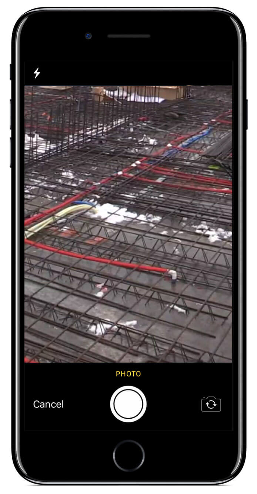

## Photos taken with smartphone are automatically stored in Viscenario

[Take photos](https://youtu.be/zaHJpt_db7o) directly with your smartphone or retrieve photos from the camera roll. Enter explanations per image. The images can either be sent one by one or merged into a PDF report, where the logo, project, building, apartment or room explains where the pictures were taken, as well as what is in the pictures. The images are automatically saved to the current folder in the project or property. Getting pictures from your phone to the document management system is no longer a hassle. The images are then available both in the browser and on tablets on the relevant building or apartment. This is a great feature to use for, among other things, documenting actual work, work done on pipes or pictures from a survey, which should be the basis for an offer.

**Save 1 hour of work**  
Using the “take photo” feature, you get merged images, text, logo and signature. This is automatically saved in the document folder.

**Standardizing using fixed setup**  
Viscenario merges images, text and descriptions into a documentation of work done

**Auto storage of images**  
The images are stored as image files, and they are merged into a PDF document to document, for example, pipe work.

### Document management system with viscenario drive

Viscenario has its own [Drive,](https://youtu.be/TOD2Zsm887s) where the folders of the various projects / properties you have access to are visible. In Viscenario Drive in Explorer on your Windows 8 or 10 PC or in Finder on your Mac, you will be able to drag and drop documents, and then send them to Viscenario in the cloud. Viscenario supports all types of files; everything from IFC (3D models), DWG, PDF and Office documents to name a few.

### Office 2013 and 2016 integration

Viscenario also has plugins for Office 2013 and 2016 on PC, so that you can work with documents in Word, Excel and PowerPoint. Changes are saved as a new version or document. Searching for and editing existing documents is easy.

### Browser

In Viscenario in the browser, you can search across and download documents. It is also possible to upload documents in Viscenario in the browser.

### The documents are available on tablet

When a document is updated in Viscenario Drive, Office or the browser, it is immediately available on the tablet, so you can, for example, open the DWG drawing in the Autodesk A360 app or open a PDF drawing and use it as a backdrop for a survey, where you can mark the places where the deviations have been detected. You can also use the drawing to explain where there is a deviation that needs to be rectified.

### Viscenario uses amazon cloud

The advantage of Viscenario being in the cloud is that it is easy to have both internal and external users on the same project. Access is distributed to the various folders in a project or building.
