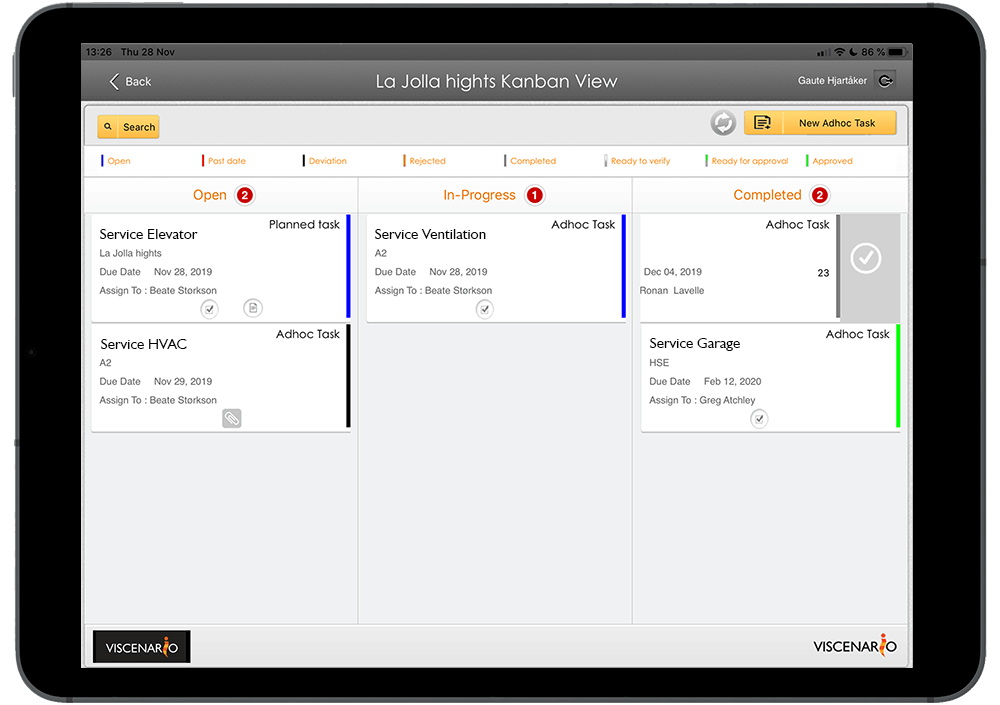

## Follow-up of service agreements in Viscenario

Planned service agreements can be entered into Viscenario in the last part of the construction project. The service provider will be notified in the Viscenario app when it is time to follow up on the various service agreements. A checklist of what is to be checked is attached to the assignment, as well as drawings and documents on the relevant equipment. When the service is done, the service person ticks off the checklist and signs with he who handled the service visit. In this way it is easy to follow up that service has been carried out on everything from elevator to ventilation system.

**The boards get more professional**  
Boards become more professional in following up service agreements.

**Full overview**  
Full overview of the services is provided to all customers in one view

**Easy to follow up**  
It is easier to get hold of those who have not followed up on the service agreements, when it is easy to find in the overview.

### Maintenance documentation is available on tablet and web

In Viscenario, the board of the condominium receives maintenance documentation on the Common Area either via the tablet app Viscenario or via the web browser. It is easy to search for and find the maintenance documentation. The janitors can also access maintenance documentation for Common Area.

#### Report issues with pictures in viscenario

In addition to finding the Maintenance documentation, the building owner also can register issues in Viscenario. By taking a picture and describing where the issue is, the complaint will go straight to Aftermarket, which in turn can delegate the task of correcting the defect to the right professional. One picture says more than 1000 words.
