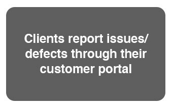
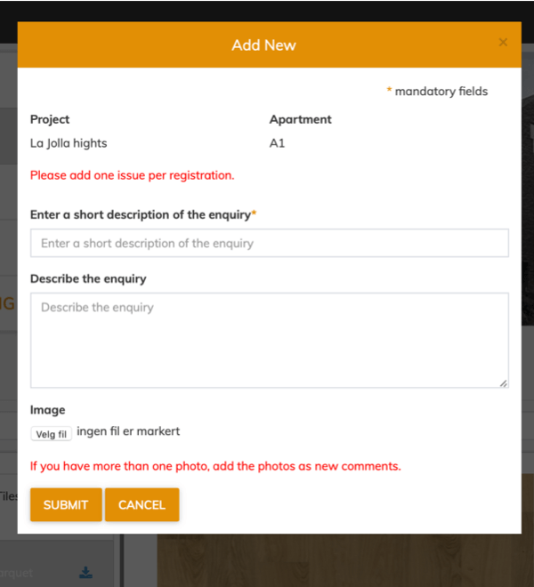
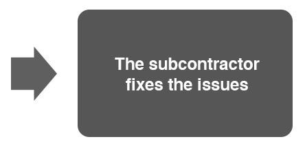
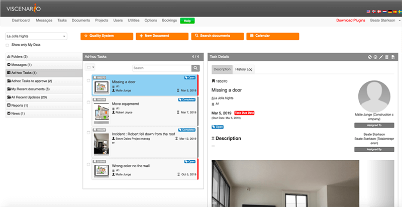
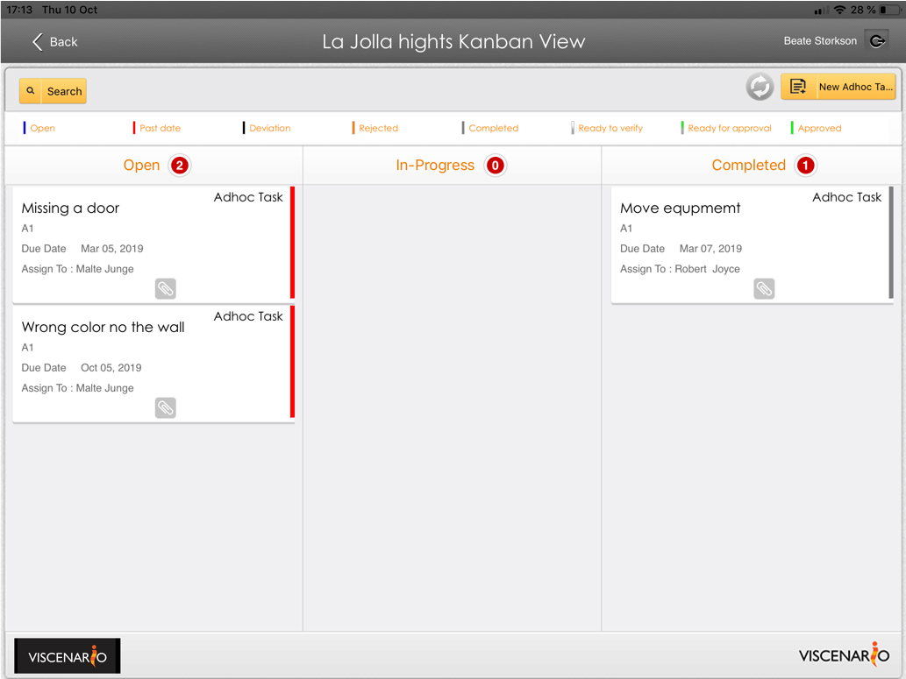
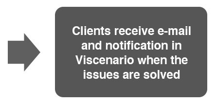
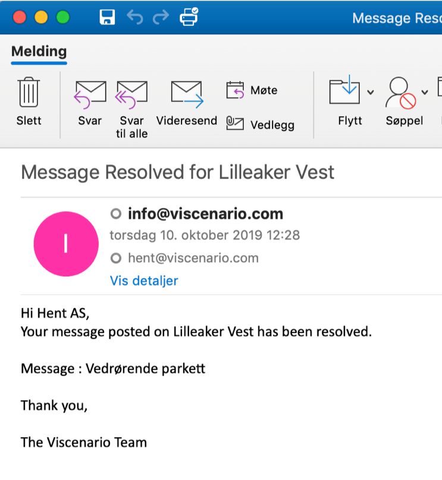
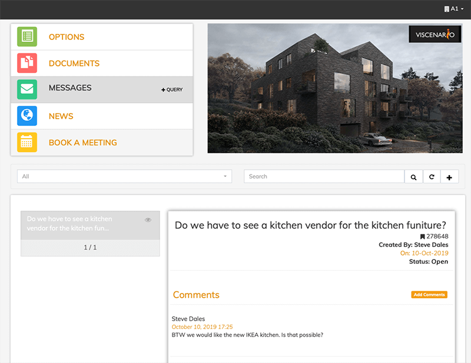

## Warranty Period – Issue Management

By having your clients [register issues](https://youtu.be/0voTgv09ci4) in Viscenario from their mobile, tablet or web you get all the issues/defects in Viscenario. They can take pictures of and describe what is wrong. You can also provide this opportunity to tenants, users of the building or buyers of apartments. When complaints come into the aftermarket or service desk, they have it electronically and can easily delegate it to the right professional to get it repaired. The person who advertised receives push notification and e-mail when the issue is rectified. This way, you have a live overview of all open issues and their status.

For 1-year inspections, you also have a live record of all issues and open cases on the apartment or building, in addition to the maintenance documentation and the housing permit. The actual [inspection](https://youtu.be/c9pxrb3YJbU) is also done in Viscenario by using [checklists](https://www.youtube.com/watch?v=c9pxrb3YJbU&feature=youtu.be&t=67) with signature and pictures. All issues can also be sent to CRM systems or other systems if you wish. Today we have integration with Microsoft CRM, Super Office and SharePoint.

**Save 1 hour saved per issue**  
Live overview of the status of all issues. Available on tablets and the web.

**Full overview**  
Employees and subcontractors receive push notifications and [see their issues on smartphone.](https://youtu.be/fTYZZPag4yQ)

**Consequence?**  
Does the issue/defect have a consequence for finances, progress or quality, or against the maintenance system, laws and regulations, description, drawings, plans or orders? Full case management and reporting!

### Administration management – what issues have economic impact?

It is also possible to mark issues that are believed to have a consequence. Then the management will be notified of this and can assess whether this issue has a consequence for finances, progress or quality. Or whether the issue goes on the maintenance system, laws / regulations, description, drawings, plans or orders. Who was responsible for the work that was advertised on is also important to record, as well as the cost. It is easy to retrieve reports on all issues that have cost us more than USD 55,000, or issues we have the customer cover.

#### Live overview of all Issue Status

The head of department has an [overview](https://www.youtube.com/watch?v=AeihMDcWMDE&feature=youtu.be&t=122) of all the issues they have delegated and received even in status view on his tablet, where he can easily see the status. There are also separate reports of all issues on a project / property on the tablet, where you can easily see open issues on a building or apartment. Here you can easily see which professionals and responsible parties have not corrected the issue yet. In the browser on the PC you can easily retrieve reports on issues by supplier or responsible party, or which have a financial consequence. All the data you enter can be searched in the browser.

#### Learn from project to project

The advantage of using Viscenario for issues management is that you can easily learn from project to project. For example, you can easily get an overview of the number of issues that have had a financial consequence in Project A, compared to Project B.

#### Access to all information about the project on the tablet and internet

By using Viscenario for issues management you have with you all the drawings, maintenance documentations, options and optional orders in Viscenario [on your tablet.](https://www.youtube.com/watch?v=AeihMDcWMDE) In addition, you have a [live overview](https://www.youtube.com/watch?v=AeihMDcWMDE&feature=youtu.be&t=122) of all deviations and issues on the building and the apartment in question. This information means you always have everything with you and available.

#### You save 1 hour in administration per claim

Our customers save a minimum of 1 hour in administration by using Viscenario for claims management.

<iframe src="https://www.youtube-nocookie.com/embed/XHR2fGJZd7M" title="Viscenario video" loading="lazy" allow="encrypted-media; picture-in-picture" allowfullscreen></iframe>

