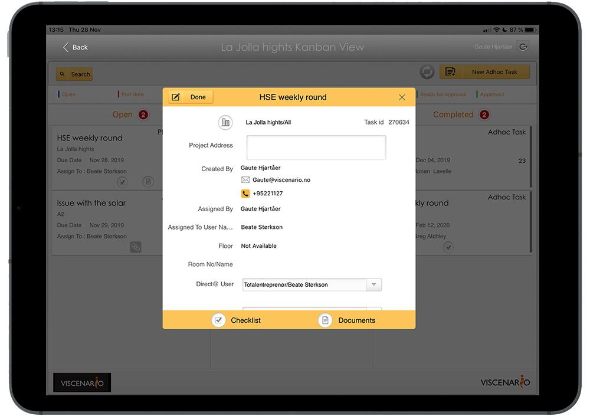
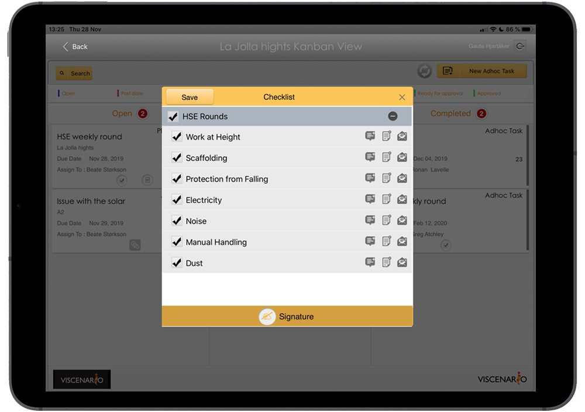
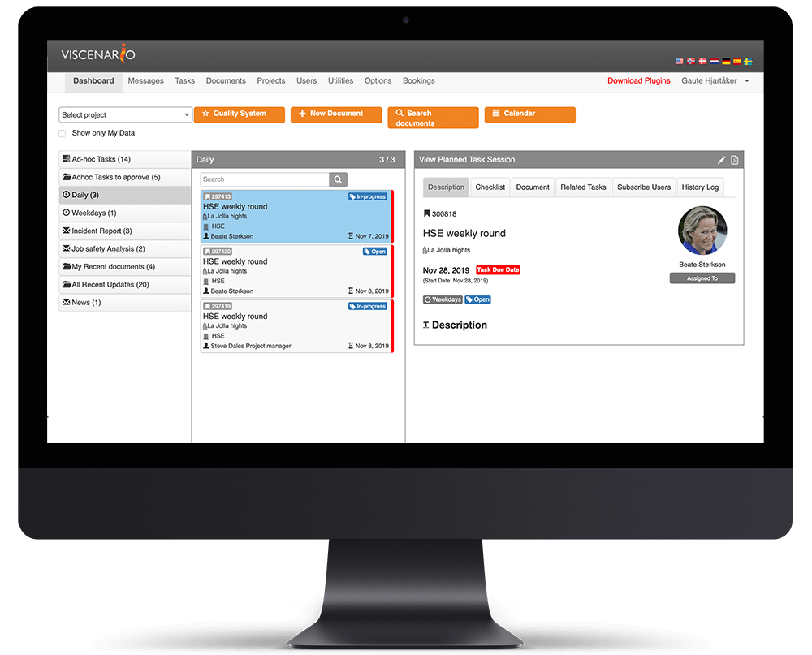

## Make safety inspections on your smart phone or tablet

By using Viscenario to document safety measures, you will save all the office time you would have spent after the completed safety inspection. In this way, you will prevent HSE activities and avoid adverse working environment conditions, as well as uncovering risk conditions and ensuring that the improvements are carried out. This way, you get the best tool for getting a picture of what’s going on in your projects.

**All information is easily available**  
Drawings are available.

**You save hours of work**  
Viscenario merges signatures, images, text, defects and drawings into a protocol for the safety inspection.

**See live overview of open issues**  
Live overview of all open HSE reporting and defects/issues available on tablets. Requires no preparation before the safety inspection itself.

### Weekly safety inspections – full overview of what is not resolved since last inspection

By setting up a scheduled task at intervals every week or every other week, you will easily be able to see what was commented or recorded on the previous safety inspection, which has not improved at this moment. This gives you a live warning while you are out on the next round. At a checkpoint in the safety inspection, you can register an HSE report (report on unwanted incident) and mark on the drawing where the defect has occurred, as well as take a picture of the incident. You can create follow-up tasks and add a comment with a picture. The recipient of the defect receives a push alert on the phone or tablet, and documents that they have been resolved by taking a picture and noting what has been rectified before they finish the task.

#### Learn from project to project

The advantage of using Viscenario for checklists and security inspections is that you easily learn from project to project. For example, you can easily get an overview of how many defects and HSE reports you have found in the safety inspections in project A, compared to the number in project B. Our customers enter their own, customized checkpoints for their safety inspections.

#### You save 1.5 hours in work creating the reports

Our customers save a minimum of 1.5 hours after work by using Viscenario’s Weekly HSE reporting.

#### The project management has live overview of all issues on the project on your tablet and on the internet

The project management has an overview of all the deviations they have registered and receives a full status view on their tablet. Here he or she can easily see the current status of all deviations. There are also separate reports for all defects of the project on the tablet. Where you can easily view open defects on a building or apartment. Here you can easily view which persons and responsible parties have not corrected the defect / error. In the browser on the PC you can easily retrieve reports of defects per supplier or contractor, or defect/issues that have a financial consequence. All the recorded data can be searched in the browser version of Viscenario.

