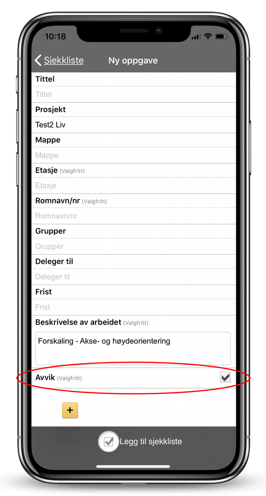
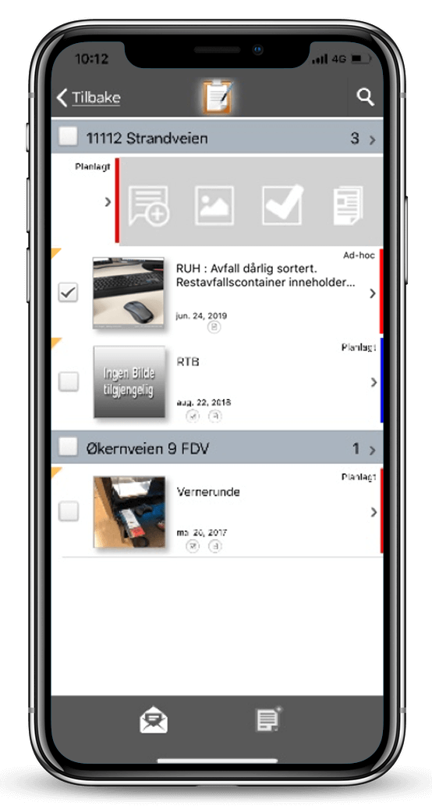
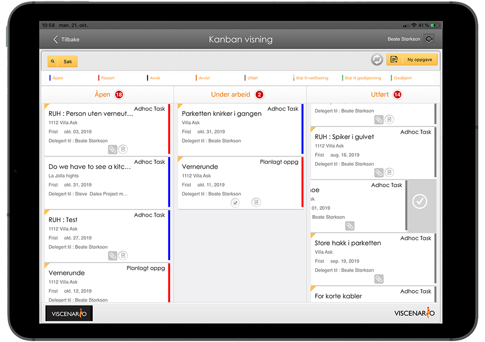
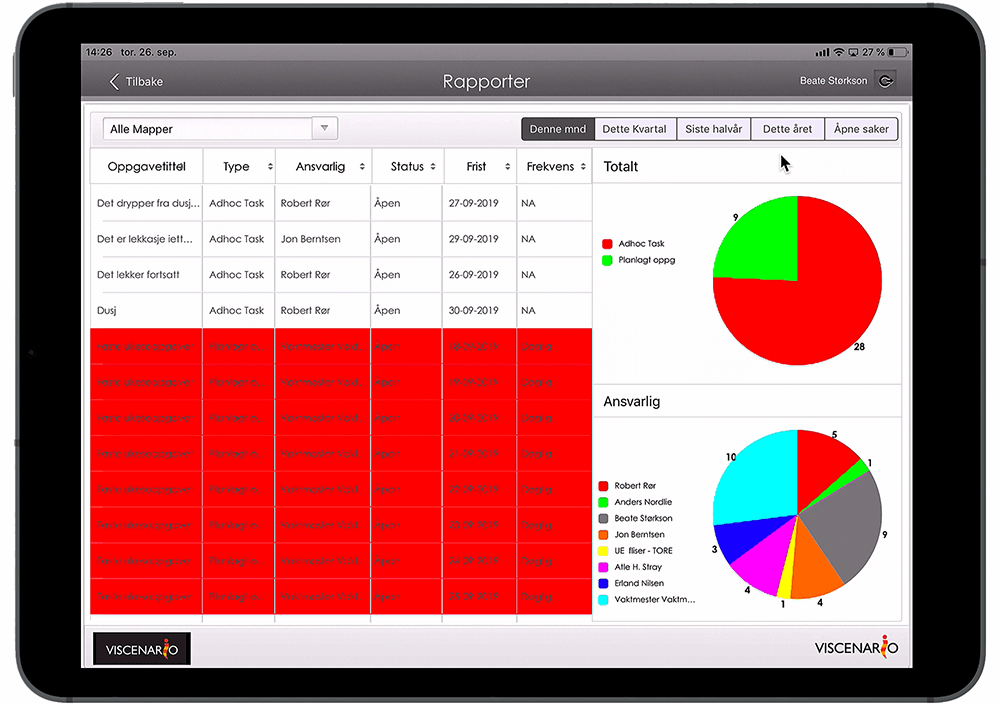

## Avvikshåndtering

Viscenario gir deg ett system for å håndtere [feil og mangler, avvik,](https://youtu.be/MTN60AsR3kg) [RUH,](https://youtu.be/IJvBylQoExc) [SJA,](https://youtu.be/lqGQH5ubrmA) [befaringer,](https://youtu.be/yu98RzfV9No) [KS sjekklister,](https://youtu.be/wyqkUBeUFdo) [tilvalg,](https://youtu.be/kbpImAmukMM) [FDV,](https://youtu.be/-75SOtjN8is) boligperm og [reklamasjonshåndtering](https://youtu.be/jI4arPWssxU) på mobilen, nettbrett og web.

**Spar 1 time per avvik**  
Live oversikt over status på alle avvik. Tilgjengelig på nettbrett og web.

**Full oversikt**  
Ansatte og underleverandører får push varsel og ser sine avvik på mobilen.

**Konsekvens?**  
Har avviket en konsekvens for økonomi, fremdrift eller kvalitet, eller mot KS-system, lover og forskrifter, beskrivelse, tegninger, planer eller bestillinger? Full saksbehandling og rapportering!

### Registrering av avvik på mobilen

Ved å [registrere avvik](https://youtu.be/hGi96lLQXbo) i Viscenario fra mobilen, nettbrettet eller i nettleseren, får du samlet alle avvikene i Viscenario. Du kan [ta bilde av](https://youtu.be/7FNXr7VxWP8) og beskrive feilene fra mobiltelefonen. I Viscenario på nettbrettet kan du også tegne på en tegning for å forklare hvor avviket er, samtidig som du kan ta et bilde av hva som må fikses. En underleverandør eller ansatt får et push-varsel på sin mobiltelefon og eventuelt beskjed på epost når det blir registrert nye avvik. Det er også mulig å legge til en [sjekkliste](https://youtu.be/wyqkUBeUFdo) til et avvik, om man ønsker at avviket skal dokumenteres i henhold til en sjekkliste.

### Avvikshåndtering – Hvilke avvik har en økonomisk konsekvens?

Det er også mulig for alle i prosjektet å markere avvik, som man tror har en konsekvens for prosjektet. Da vil prosjektledelsen bli varslet om dette og kan gjøre seg en vurdering om dette avviket har en konsekvens for økonomi, fremdrift eller kvalitet, eller om avviket gjelder KS-system, lover og forskrifter, beskrivelse, tegninger, planer eller bestillinger. Hvem som var ansvarlig for arbeidet der avviket oppstod er også viktig å registrere, samt kostnadene det har medført. Det er enkelt å hente ut rapporter på alle avvik som har kostet bedriften mer enn 500.000 kr, eller avvik dere har fått byggherren til å dekke.

### Prosjektledelsen har liveoversikt over alle avvikene

Prosjektledelsen har [oversikt](https://youtu.be/9hf7pZQZf2s) over alle avvikene de har registrert og fått selv, i en Kanban-visning (statusvisning) på nettbrettet. Her ser de enkelt gjeldende status på alle avvikene. Det er også egne rapporter for alle avvik på prosjektet på nettbrettet, hvor man enkelt kan se åpne avvik på et bygg eller en leilighet. Her kan man enkelt se hvilke personer og fag som ikke har rettet opp avviket/feilen. I nettleseren på PC-en kan man enkelt hente ut rapporter på avvik per leverandør eller fag, eller avvik som har en økonomisk konsekvens. Alle de registrerte dataene kan søkes på i nettleserversjonen av Viscenario.

### Standardisere dokumentering av avvik ved å bruke sjekklister

Ved å legge til en [sjekkliste](https://youtu.be/wyqkUBeUFdo) på et avvik, sikrer man seg at man standardiserer hvordan man skal dokumentere avviket. På hvert sjekkpunkt i sjekklisten kan man legge inn en kommentar med bilde eller lage en oppfølgingsoppgave/et avvik. Når sjekklisten er utfylt og du er ferdig med å dokumentere avviket, fletter Viscenario alt dette sammen til et PDF-dokument og lagrer det automatisk i dokumentmappene på det aktuelle prosjektet eller bygget. Du sparer alt etterarbeidet med å flette sammen bilder, tekst og avvik til et referat. I tillegg er alle avvikene/oppgavene som du har opprettet iforbindelse med sjekklisten allerede pushet ut til den/dem som skal utbedre de. Liveoversikt over alle oppgaver og avvik finner man da i Viscenario.  
Kundene våre legger inn sine egne sjekklister og tilpasser dem slik de ønsker.  
Man kan enkelt plukke sjekkpunkter fra flere sjekklister til ulike jobber. Det er også mulig å kombinere punktmarkeringer på tegninger ved å fylle ut en sjekkliste.

### Lærer fra prosjekt til prosjekt

Fordelen med å bruke Viscenario til avvikshåndtering er at man lett kan lære fra prosjekt til prosjekt. Du kan eksempel enkelt få en oversikt over eksempel antall avvik som har hatt en økonomisk konsekvens i prosjekt A, sammenlignet med prosjekt B, eksportert til Excel. Antall avvik sammenlignet mot tegninger, KS-system, fremdrift, osv.

### Tilgang til all informasjon om prosjektet på nettbrett eller web

Ved å bruke Viscenario til avvik har du med deg alle tegninger, FDV-dokumenter, tilvalg og tilvalgsordrer i appen på nettbrettet ditt. I tillegg har du [liveoversikt](https://youtu.be/9hf7pZQZf2s) over alle avvik som er på bygget og den aktuelle leiligheten. Denne informasjonen gjør at du har alt med deg – og tilgjengelig til en hver tid.

### Du sparer minimum 1 time i administrasjon per avvik

Kundene våre sparer minimum 1 time administrasjonsarbeid ved å bruke Viscenario til avvikshåndtering.
