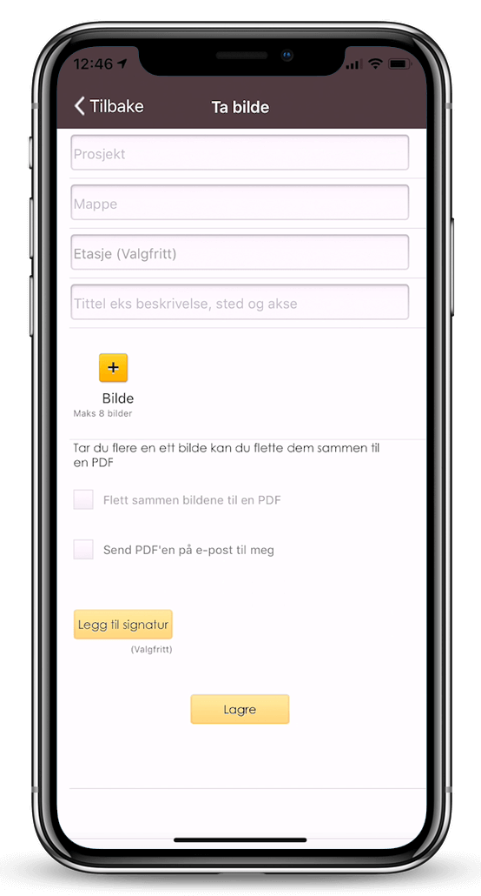
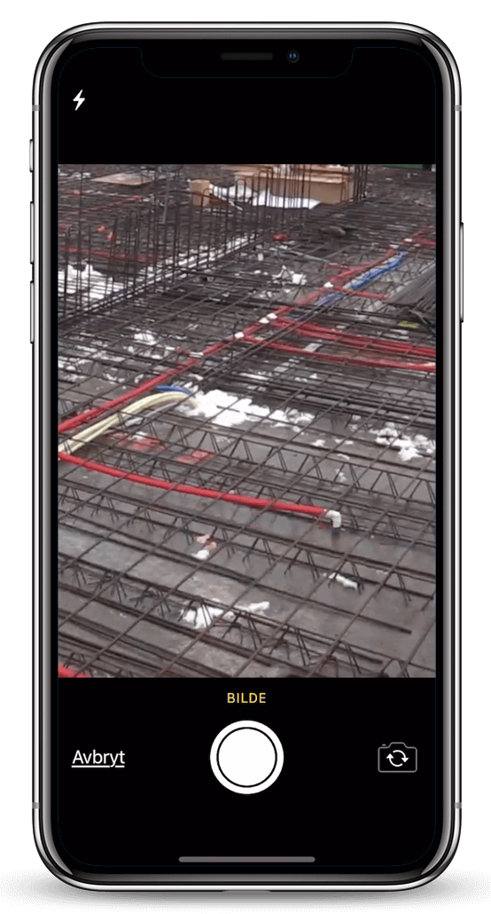

## Ta bilder fra mobilen og få de automatisk lagret på den aktuelle mappen

[Ta bilder](https://youtu.be/7FNXr7VxWP8) direkte med mobiltelefonen din eller hent bilder fra kamerarullen. Skriv inn forklaringer per bilde. Bildene kan entes sendes ett og ett eller flettes sammen til en PDF-rapport, hvor logo, prosjekt, bygg, leilighet, akse eller rom forklarer hvor bildene er tatt, samt hva som er på bildene. Bildene blir automatisk lagret på den aktuelle mappen i prosjektet eller på eiendommen. Det er ikke lenger strevsomt å få overført bilder fra telefonen til dokumenthåndteringssystemet. Bildene er så tilgjengelig både i nettleser og på nettbrett på aktuelt bygg eller leilighet.

Dette er en fin funksjon å bruke for blant annet å dokumentere betongarbeid, utført arbeid på rør eller bilder fra en befaring, som skal være underlaget til et tilbud.

 

**Spar 1 time i etterarbeid**  
Ved å bruke «ta bilde»-funksjonen får du flettet sammen bilder, tekst, logo og signatur. Dette lagres automatisk i dokumentmappen.

**Standardisere ved bruk av fast oppsett**  
Viscenario fletter sammen bilder, tekst og oppgaver til en dokumentasjon av utført arbeid.

**Automatisk lagring av bilder**  
Bildene lagres som bildefiler, samt at de flettes sammen til et PDF-dokument for å dokumentere for eksempel utført rørarbeid.

### Dokumenthåndteringssystem med Viscenario Drive

Viscenario har egen Drive, hvor mappene på de ulike prosjektene/eiendommen du har tilgang er synlig. I Viscenario Drive i utforsker på din Windows 8- eller 10-PC eller i Finder på din Mac vil du kunne dra og slippe dokumenter, for deretter å sende de til Viscenario i skyen. Viscenario støtter alle type filer; alt fra IFC (3D-modeller), DWG, PDF og Office-dokumenter for å nevne noen.

### Office 2013 og 2016 integrasjon

Viscenario har også plugins for Office 2013 og 2016. Slik at man kan jobbe med dokumenter i Word, Excel og PowerPoint. Endringer lagres som en ny versjon eller et nytt dokument. Det er enkelt å søke etter og endre på eksisterende dokumenter.

### Nettleser

I Viscenario i nettleseren kan man søke på kryss og tvers og laste ned dokumenter. Det er også mulig å laste opp dokumenter i Viscenario i nettleseren.

### Dokumentene er tilgjengelige på nettbrett

Når et dokument er oppdatert i Viscenario Drive, Office eller i nettleseren er det umiddelbart tilgjengelig på nettbrettet, slik at man for eksempel kan åpne DWG-tegningen i A360-appen til Autodesk eller man kan åpne en PDF-tegning og bruke den som et underlag for en befaring, der du kan punktmarkere stedene det er påvist avvik på. Du kan også bruke tegningen til å forklare hvor det er et avvik som må utbedres.

### Viscenario bruker Amazon Cloud

Fordelen med at Viscenario ligger i skyen er at det er enkelt å ha både interne og eksterne brukere på samme prosjekt. Man deler ut tilganger på de ulike mappene i et prosjekt eller på et bygg.
