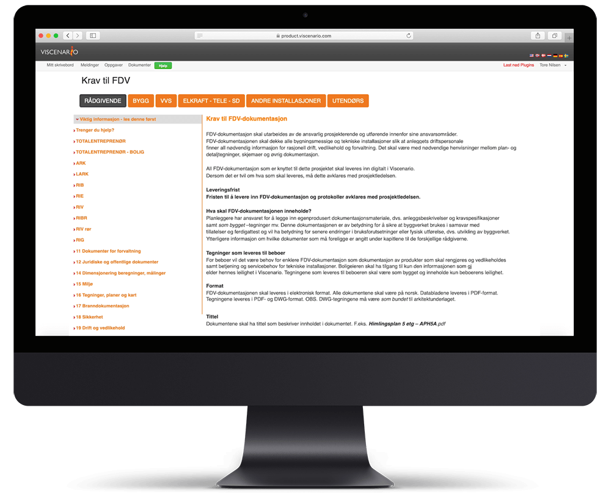
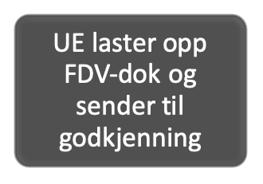
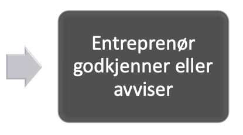
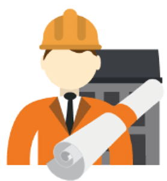
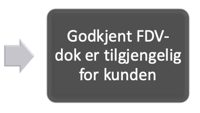
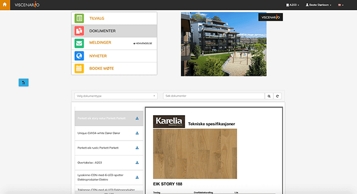

## Innsamling og bruk av FDV-dokumentasjon
**

I Viscenario kan [alle entreprenører finne maler for hvordan FDV-dokumentasjonen skal se ut, samt levere denne.](https://youtu.be/-75SOtjN8is) Når FDV-dokumentasjonen er godkjent får kunden FDV-dokumentasjonen sin enten via Viscenario-appen til [nettbrett](https://youtu.be/jl0Wip3xquw) eller via [nettleseren.](https://youtu.be/0MTsyDgSgkI) Har man mange eiendommer i Viscenario, er det enkelt å finne FDV på de ulike eiendommene. Det er enkelt å søke etter og finne FDV-dokumentasjonen. Vaktmesteren får [tilgang](https://youtu.be/jl0Wip3xquw) til FDV-dokumentasjon på Felles areal.

**All informasjon tilgjengelig**  
Alle dokumentene på felles areal er tilgjengelig ett sted

**Reklamerer fra appen**  
Eier/vaktmester tar bilde og melder i fra om feil og mangler fra mobilen eller nettbrettet.

**Får faste** **vedlikeholdsavtaler?**  
Oppfølging av inngåtte serviceavtaler.

### Viscenario har et fast oppsett med krav til FDV-dokumentasjon med maler for alle fagene

For å få en god FDV-dokumentasjon, kreves det gode rutiner og maler for hvordan FDV-dokumentasjonen skal se ut. Ved å bruke FDV-oppsettet som vi tilbyr i Viscenario, så vil alle underentreprenører og ansatte enkelt kunne laste ned maler på hva som skal leveres på de ulike fagene, med eksempeltekster.

### Underentreprenøren laster opp og sender FDV-dokumentasjonen til godkjenning

Underentreprenørene og de ansatte hos entreprenøren har i prosjektene tilgang til prosjektdokumenter og tegninger i Viscenario. De får også avvik pushet ut i Viscenario-appen. Når en underentreprenør eller ansatt går inn i Viscenario for å se på malene på sitt fag, vet de hvordan FDV-dokumentasjonen skal se ut. Når de har fylt ut malen bruker de enten [Viscenario Drive](https://www.youtube.com/watch?v=LxJb6rEdka8) til «å slippe» dokumentene på rett mappe i bygningsdelstabellen, eller de laster dem opp i nettleseren. Når de har [sendt det til godkjenning](https://youtu.be/-75SOtjN8is) vil dokumentkontrolleren eller FDV-rådgiveren enten [godkjenne eller avvise FDV-dokumentasjonen.](https://youtu.be/a-yqugPP16g) Godkjent FDV-dokumentasjon er da tilgjengelig i boligpermen for kjøperen og til styret i sameiet/byggeier for felles areal.

### Reklamerer på feil via web, mobilen eller nettbrett

I tillegg til å finne boliginformasjonen, kan kjøperen også reklamere på feil i Viscenario. Ved å ta bilde og beskrive hvor feilen befinner seg, så vil reklamasjonen [gå rett til Ettermarked,](https://youtu.be/jI4arPWssxU) som igjen kan delegere oppgaven til riktig fagperson.

### Får faste vedlikeholdsoppgaver i Viscenario-appen

Faste vedlikeholdsoppgaver som entreprenører mener byggeier bør gjøre, blir satt opp slik at vaktmesteren får e-post og varsel i Viscenario-appen når det er dags for bytte av filter, service på heis eller ventilasjon, osv.

### Forbefaringer, ferdigbefaringer, overtakelser og ettårsbefaringer

Når du bruker Viscenario på [befaringer](https://youtu.be/yu98RzfV9No) har du med deg alle tegninger, FDV-dokumenter, tilvalg og tilvalgsordre i Viscenario på nettbrettet ditt. I tillegg til dette har du live oversikt over alle avvik som er på bygget og den aktuelle leiligheten. Denne informasjonen gjør at du har alt med deg – og tilgjengelig til enhver tid.

### Protokollen blir automatisk opprettet, lagret og mailet

Når du bruker Viscenario på nettbrettet til befaringer, så får du også opp tegningene av bygget eller leiligheten, der du kan punktmarkere stedene det er påvist avvik på. Avvikene delegerer du da til riktig fagperson fra nettbrettet. Når du er ferdig kan byggherren eller kunden signere på nettbrettet sammen med deg. Viscenario fletter så sammen all informasjon som logo, prosjekt, bygg/leilighet, tegningsnummer, avvik med kommentarer og bilder, samt signaturene til de som var tilstede.

### Oppfølging av serviceavtaler i Viscenario

Faste serviceavtaler som er inngått i siste delen av byggeprosjektet settes opp slik at sameiet får varsel i Viscenario-appen når det er dags for å følge opp de ulike service avtalene. Da får den ansvarlige i styret i sameiet beskjed om å ringe den aktuelle serviceleverandøren. Sjekkliste på hva som skal sjekkes er vedlagt oppgaven, samt tegninger og dokumenter på aktuelt utstyr. Når servicen er utført haker servicemannen av på sjekklisten og signerer sammen med ham som har håndtert servicebesøket. På denne måten kan man enkelt følge opp at det er blitt utført service på alt fra heis til ventilasjonsanlegg.
