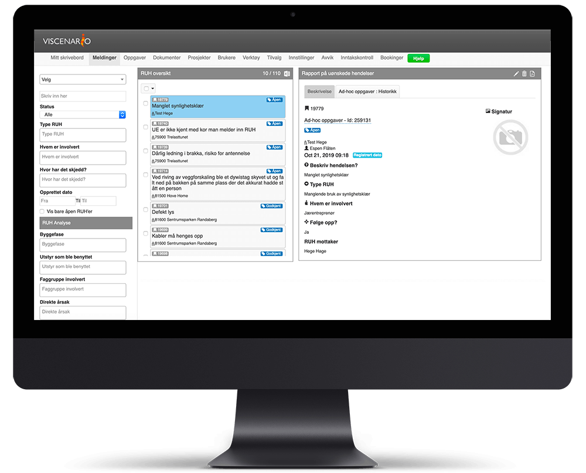
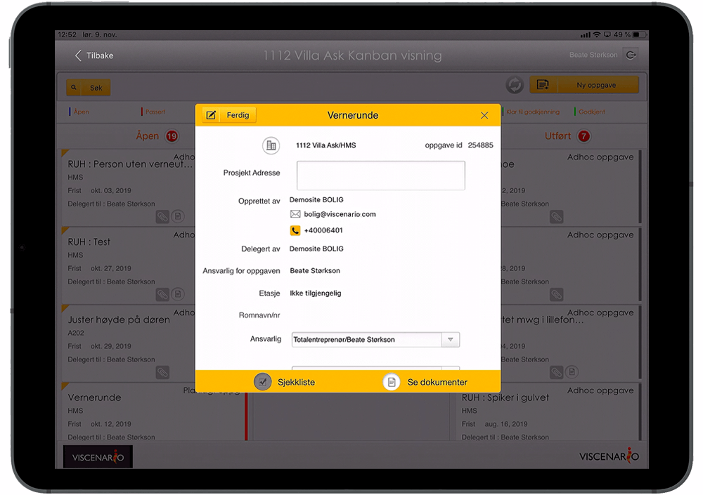
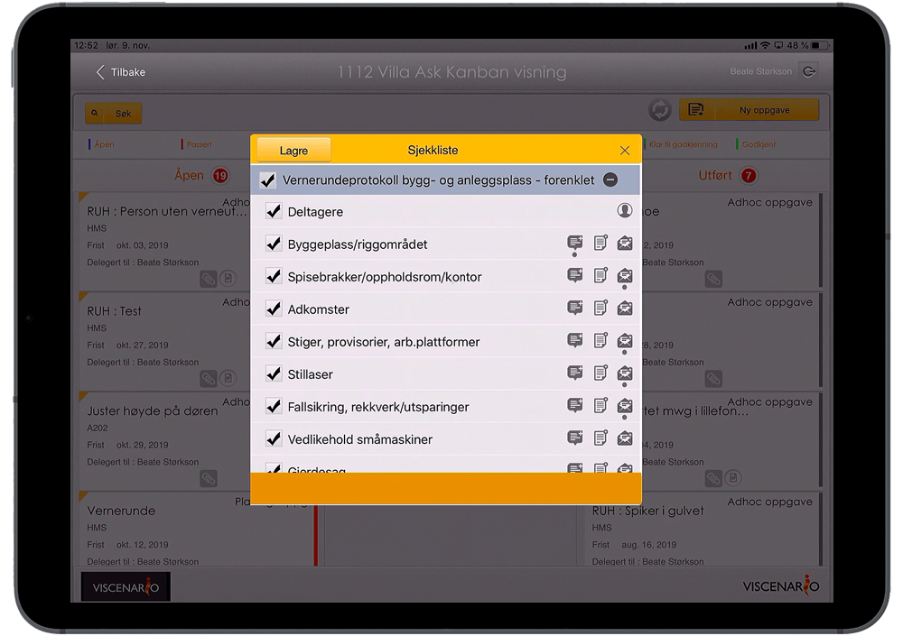

Med Viscenario som HMS-verktøy sparer bedriften din mye tid, samtidig som sikkerheten skjerpes. Rapportering av [RUH](https://youtu.be/IJvBylQoExc) og [SJA](https://youtu.be/lqGQH5ubrmA) gjøres på mobilen, og [vernerunder](https://youtu.be/1suew-8Se38) dokumenteres på mobil eller nettbrett. Ved å [registrere inn alle sertifikater og lisenser](https://youtu.be/tnLRdJ-wFM4) til alle på byggeplassen, har du også full oversikt over dette i Viscenario.

## RUH på mobilen

Innrapportering av [RUH](https://youtu.be/IJvBylQoExc) (uønskede hendelser) på byggeplass skjerper fokus på sikkerhet og bidrar til færre ulykker.

**Spar 1 time per RUH**  
Live oversikt over status på alle RUH. Tilgjengelig på mobil og web.

**Full oversikt**  
Enkelt henter ut oversikt over antall RUH per kategori.

**Lærer og skjerper fokus**  
skjerper fokus på sikkerhet og bidrar til færre ulykker.

### RUH fokus gir nedgang i antall ulykker

Erfaring fra våre kunder viser at en økning i RUH gir en nedgang i antall ulykker. Dette skyldes økt bevissthet rundt sikkerhet og fokus på å følge rutiner og forskrifter for å unngå farlige situasjoner.

Ved å bruke Viscenario på mobilen får alle prosjektdeltakere enkelt tilgang til å registrere RUH. Det er mulig å legge inn egne kategorier som det er viktig å måle på i din organisasjon. Prosjektledelsen [administrerer](https://youtu.be/Mv-5OhTFP20) registrerte RUH og må lukke det åpne avviket som da er opprettet. Det er enkelt for HMS-ansvarlig i prosjektet å hente ut oversikter over antall RUH på de ulike kategoriene, periodene og prosjektene.

### Digital mannskapsliste/inntakskontroll
**

Ved å [dokumentere alle sertifikater og lisenser](https://youtu.be/tnLRdJ-wFM4) på alle som jobber på byggeplassen oppfyller du kravet til regjeringen:

[Regjeringen innfører krav om elektronisk oversikt over ansatte på byggeplasser](https://www.regjeringen.no/no/aktuelt/innforer-krav-om-elektronisk-oversikt-over-ansatte-pa-byggeplasser/id2552262/)

I Viscenario tar man bilde av alle sertifikater og lisenser, den som registrerer seg inn må så akseptere PSI for selskapet. Deretter får den innregistrerte en bruker i Viscenario, slik at man kan registrere RUH, få oppgaver og levere FDV-dokumentasjon på aktuelt prosjekt.

### SJA på mobilen

Det er viktig å gjøre gode risikoanalyser for å forhindre ulykker og avvik. Ved å fylle ut en [SJA på mobiltelefonen](https://youtu.be/lqGQH5ubrmA) i Viscenario, så får du tatt bilder, gitt beskrivelse av arbeidet, registrert deltakere, mulige sikkerhetsrisikoer og sikkerhetstiltak/foreslått sikkerhetsutstyr samt signatur. Hele analysen er da fylt ut etter byggherreforskriften. Den som er SJA-mottaker på prosjektet får da pushvarsel i Viscenario-appen og mottar e-post. Han kan da enkelt godkjenne eller avvise SJA-en.

### [Faste ukentlige vernerunder](https://youtu.be/1suew-8Se38) – full oversikt over hva som ikke er løst siden forrige gang på nettbrettet

Ved å sette opp en planlagt oppgave med intervall hver uke eller annen hver uke, så vil man enkelt kunne se hva som ble kommentert eller registrert på forrige vernerunde, som ikke er utbedret i dag. Dette gir deg en live oversikt mens du er ute på neste runde.  
På et sjekkpunkt i vernerunden kan man registrere en [RUH](https://youtu.be/IJvBylQoExc) (Rapport om uønsket hendelse) og markere på tegningen hvor avviket har oppstått, samt ta bilde av hendelsen. Du kan lage oppfølgingsoppgaver og legge til en kommentar med bilde. Mottaker av avvikene får et pushvarsel på telefonen og dokumenterer at de er løst ved å ta bilde og notere hva som er utbedret, før de avslutter oppgaven.

<iframe src="https://www.youtube-nocookie.com/embed/MlSwZoxgSKQ" title="Viscenario video" loading="lazy" allow="encrypted-media; picture-in-picture" allowfullscreen></iframe>

