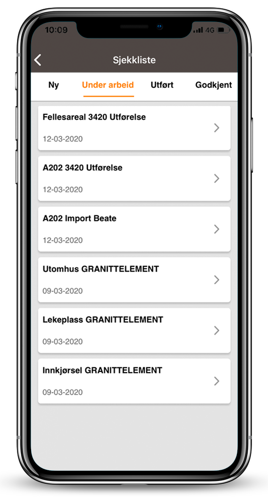
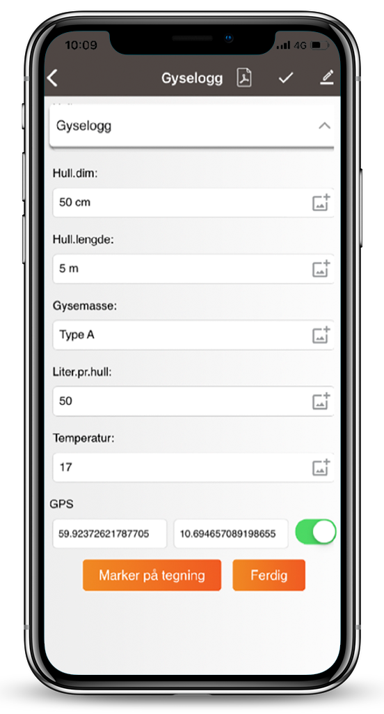

## Styringssystem, prosedyrer, maler, sjekklister, logger, bildedokumentasjon, avvikshåndtering, logistikkbooking
**

Mangler dere et styringssystem med prosedyrer, maler, dokumentarkiv og sjekklistene? Ved å bruke Viscenario til dette får du automatisk bedre prosjekter. Viscenario har maler for bl.a kontrollplan, kvalitetsplan, HMSplaner og mye mer. Ved å bruke Viscenario på mobilen til å fylle ut alle sjekklistene deres, vil de ferdig utfylte sjekklistene automatisk bli lagret på KS mappen i dokumentarkivet, slik at du får byggeplass-KS’en i orden.

[Sjekklister](https://youtu.be/wyqkUBeUFdo) og [logger](https://youtu.be/T1d1W_aLQb0) er viktige for internkontroller og for å dokumentere kvalitetsarbeid.  I Viscenario kan man bruke sjekklister og logger på mobilen. Når alt dette er i samme [styringssystem,](https://youtu.be/vYshpiGwaAE) får du full kontroll.

Fordelen med [sjekklister](https://youtu.be/wyqkUBeUFdo) er at man standardiserer hvordan man skal dokumentere en jobb. På hvert sjekkpunkt kan man legge inn en kommentar med bilde eller lage en oppfølgingsoppgave/et avvik. Når sjekklisten er utfylt og du har utført oppgaven(e), så fletter Viscenario alt dette sammen til en PDF og lagrer automatisk denne i KS-mappene på aktuelt prosjekt. [Loggmodulen](https://youtu.be/T1d1W_aLQb0) brukes til for eksempel støpedagbøker, dagslogger, gyselogger og forbruk.

### Bildedokumentasjon fra mobilen – lagres på aktuell bildemappen på prosjektet
**

[Ta bilder direkte med mobiltelefonen din](https://youtu.be/7FNXr7VxWP8) eller hent bilder fra kamerarullen. Skriv inn forklaringer per bilde. Bildene kan enten sendes ett av gangen eller flettes sammen til en PDF-rapport, hvor logo, prosjekt, bygg, leilighet, akse eller rom forklarer hvor bildene er tatt, samt hva som er på bildene.  
Bildene blir automatisk lagret på den aktuelle mappen i prosjektet. Det er ikke lenger mye slit og strev å få overført bilder fra mobiltelefonen din til dokumenthåndteringssystemet.  
Bildene blir etter opplasting øyeblikkelig tilgjengelig både i nettleser og på nettbrett på aktuelt bygg eller leilighet. Dette er en fin funksjon å bruke for å dokumentere betongarbeid, utført arbeid på rør eller bilder fra en befaring, som skal være underlaget til et tilbud.

### Avvikshåndtering

Alle [avvik](https://youtu.be/MTN60AsR3kg) du finner blir registrert og delegert til rett person mens du fyller ut sjekklister eller går befaringer. Det er lett å følge opp avvik, de kan analyseres og man kan enkelt hente ut oversikter per prosjekt eller per år. Alle oppgaver du har fått hvor fristen har passert får du e-post varsler på.

### Logistikk-booking

Modulen brukes til å [booke slott på kranen](https://youtu.be/xILgtcp8CDk) eller lasteplass på byggeplass. Alle leverandører får opp de ulike sonene, velger ønsket tid og booker slotten. Mannen i heisekranen følger løpende med på hvem som kommer fra sin mobiltelefon, han kan enkelt ringe å gi beskjed om det er noen forsinkelser. Byggeplassledelsen har full oversikt på PCen og kan enkelt omprioritere.

<iframe src="https://www.youtube-nocookie.com/embed/MlSwZoxgSKQ" title="Viscenario video" loading="lazy" allow="encrypted-media; picture-in-picture" allowfullscreen></iframe>

