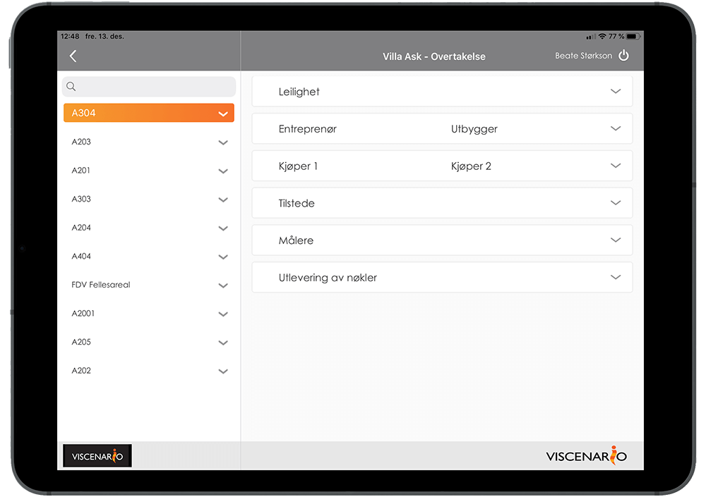
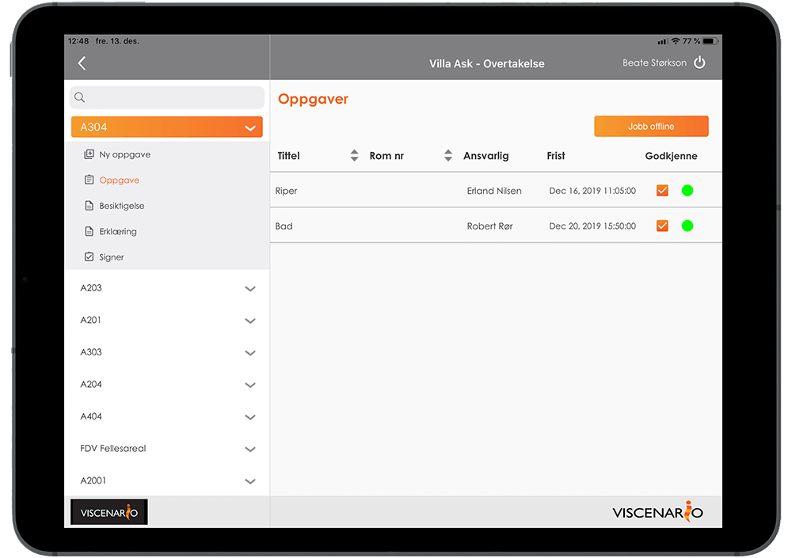
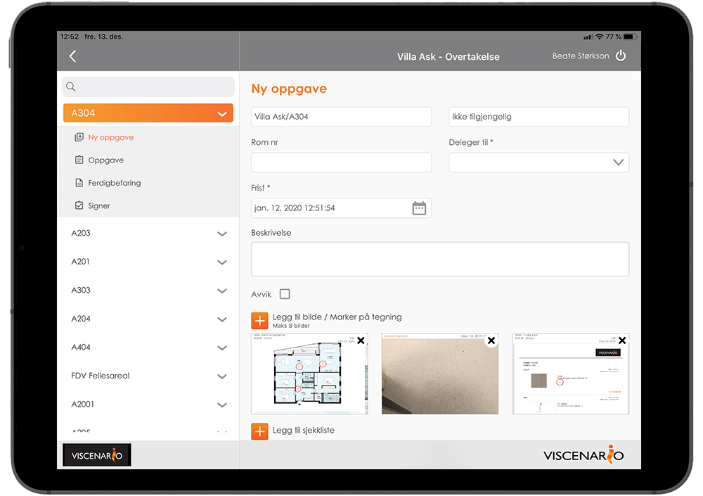
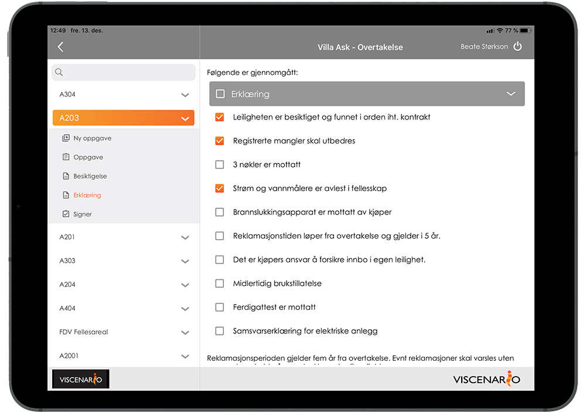
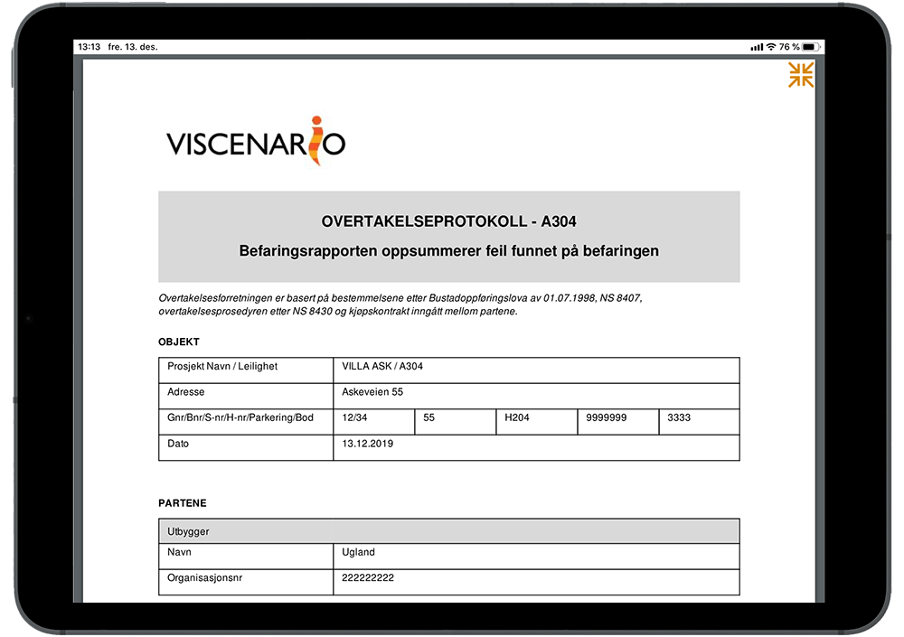

## Overtakelsesbefaringer på nettbrett

Ved å bruke Viscenario til å få dokumentert [overtakelser av bygg og leiligheter](https://youtu.be/RND2sr3meM0s) vil du spare all tiden du vanligvis ville brukt på kontoret i etterkant.

**All informasjon tilgjengelig**  
Tegninger, FDV, boligperm, tilvalg samt oversikt over innrapporterte feil og mangler er live på nettbrettet

**Sparer 1 time i etterarbeid**  
Viscenario fletter sammen signatur, bilder, tekst, avvik og tegning til en protokoll.

**Ser live oversikt over åpne avvik**  
Live oversikt over alle åpne feil og mangler er tilgjengelig på nettbrett. Krever ingen forberedelser før selve befaringen.

### Tilgang til all informasjon om prosjektet på nettbrett

Når du bruker Viscenario til overtakelser, har du med deg alle tegninger, FDV-dokumenter, tilvalg og tilvalgsordre i Viscenario på nettbrettet ditt. I tillegg har du liveoversikt over alle avvik på bygget og den aktuelle leiligheten. Denne informasjonen gjør at du har alt med deg – og tilgjengelig til en hver tid.

### Protokollen fra overtakelsen blir automatisk lagret og mailet

Ved å bruke Viscenario på nettbrett, får du opp tegningene av bygget eller leiligheten, der du kan punktmarkere stedene det er påvist avvik på. Det er også mulig å punktmarkere i tilvalgsordren, endringsordren eller andre dokumenter som er viktig å ha med på overtakelsen. Oppgaven(e) med å rette avvikene delegerer du da til riktig fagperson fra nettbrettet. Når du er ferdig med dette kan du og byggherren eller kunden signere på nettbrettet. Viscenario fletter så sammen all informasjon som logo, prosjekt, bygg/leilighet, tegningsnummer, avvik med kommentarer og bilder, samt signaturer fra de som var tilstede.

### Standardisere overtakelser ved å bruke sjekklister

Du kan også kombinere en overtakelsesbefaring med en sjekkliste. Fordelen med sjekklister er at man standardiserer hvordan man skal dokumentere overtakelsesbefaringen.  Når sjekklisten er utfylt og du er ferdig med overtakelsen, så fletter Viscenario alt dette sammen til et PDF-dokument og lagrer det automatisk i dokumentmappene på det aktuelle prosjektet eller bygget/leiligheten. Du sparer alt etterarbeid ved å flette sammen bilder, tekst og avvik til et referat. I tillegg til dette er alle avvikene/oppgavene som du har opprettet i forbindelse med sjekklisten allerede pushet ut til den/de som skal utbedre dem. Liveoversikt over alle oppgaver og avvik finner man da i Viscenario.

### Se livestatusene fra avvikene fra ferdigbefaringen
**

Under overtakelsesbefaringen ser du live status på alle avvikene dere fant på ferdigbefaringen med kunden. Det er enkelt å se status, slik at du slipper å registrere samme feil om igjen. Er oppgaven du registrerte sist allerede utført og godkjent, vil den ikke vises. Er den utført, godkjenner du den sammen med kunden.

### Fullføre mangelliste

Etter overtakelse utbedrer normalt entreprenøren manglene, når de er utbedret vil man bruke overtakelsesmodulen til å dokumentere at man har fullført mangellisten. Det er en egen PDF rapport som genereres når kjøper har signere på at manglene er utbedret. Også denne PDF blir automatisk sendt på e-post, samt lagret automatisk inn i Dokumentmappen under Min Side for kunden.

### Lærer fra prosjekt til prosjekt

Fordelen med å bruke Viscenario til overtakelser er at du kan lære fra prosjekt til prosjekt. Du kan for eksempel enkelt få ut en oversikt over hvor mange avvik som er funnet på alle overtakelser i prosjekt A, sammenlignet med antall avvik fra overtakelser i prosjekt B. Noe de fleste vet er at det er billigere å finne feilen(e) før overtakelse, så ved å ha fokus på å finne avvikene tidligere vil det være store besparelser i garantiperioden.
