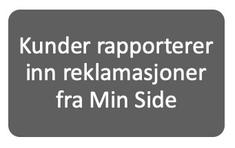
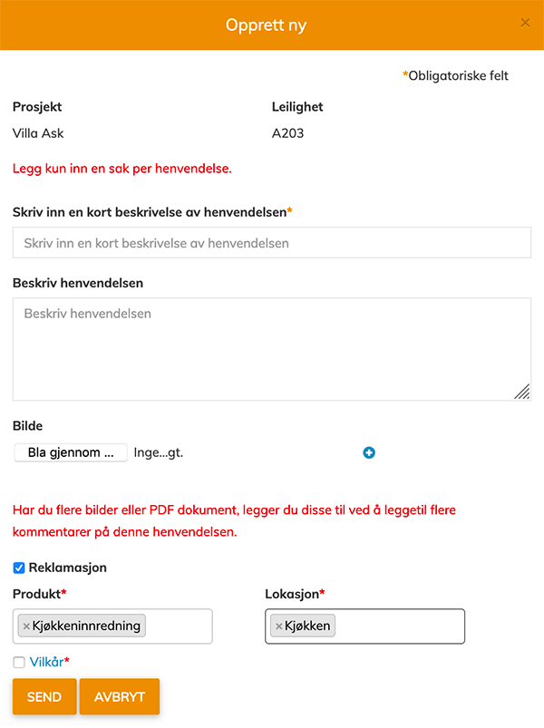
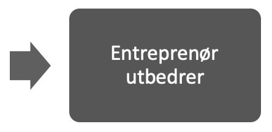
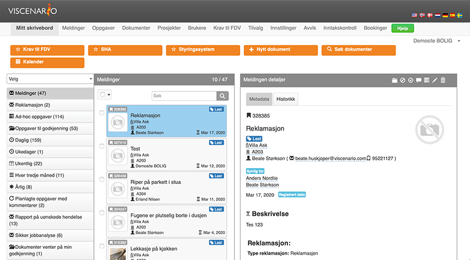
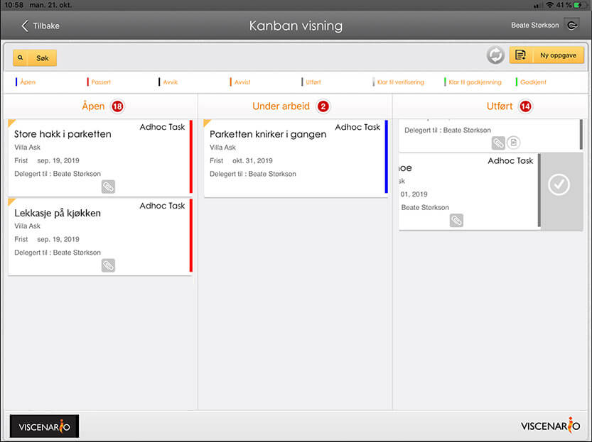
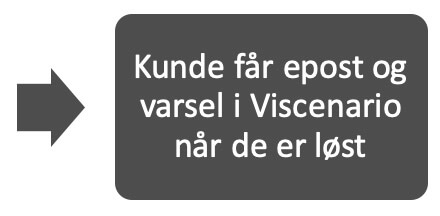
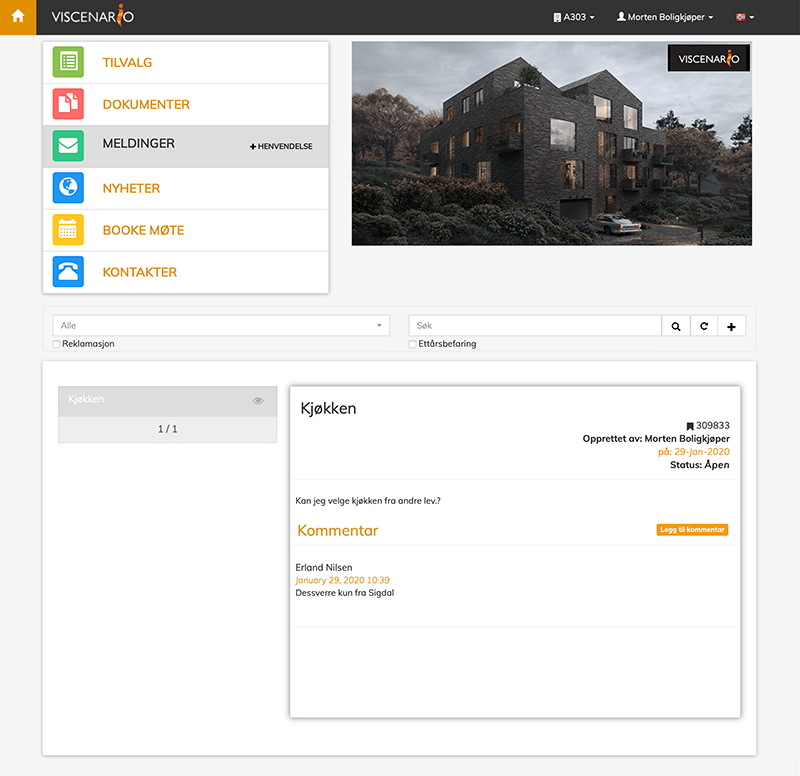

## Reklamasjonshåndtering
**

Ved å registrere reklamasjoner i Viscenario fra mobilen, nettbrettet eller i nettleseren, så får du samlet alle reklamasjonene i Viscenario. Du kan ta bilde av og beskrive hva som er feil. Du kan også gi denne muligheten til [leietakere, brukere av bygget](https://youtu.be/h3esBGSr1Qs) [eller kjøpere av leiligheter.](https://youtu.be/Rs4rMo9hRw8) Når [reklamasjoner kommer inn til ettermarked](https://youtu.be/jI4arPWssxU) eller servicedesken, så har de den elektronisk og kan enkelt delegere den til riktig fagperson for å få den utbedret. Den som reklamerte får pushvarsel og epost når reklamasjonen er utbedret. På denne måten har man liveoversikt over alle åpne reklamasjoner og status på dem. Det er også mulig å legge på en tekst med noen vilkår som kunden må akseptere for å kunne rapportere inn reklamasjoner. Eller merke reklamasjoner man ønsker skal ses på ifm ettårsbefaringen.

**Spar 1 time per reklamasjon**  
Live oversikt over status på alle reklamasjoner. Tilgjengelig på nettbrett og web.

**Full oversikt**  
Ansatte og underleverandører får push varsel og ser sine reklamasjoner på mobilen.

**Konsekvens?**  
Har reklamasjonen en konsekvens for økonomi, fremdrift eller kvalitet, eller mot KS-system, lover og forskrifter, beskrivelse, tegninger, planer eller bestillinger? Full saksbehandling og rapportering!

### Reklamasjonshåndtering – hvilke reklamasjoner har en økonomisk konsekvens?

Det er også mulig å markere reklamasjoner som man tror har en konsekvens. Da vil ledelsen få en varsling om dette og kan gjøre seg en vurdering på om hvorvidt denne reklamasjonen har en konsekvens for økonomi, fremdrift eller kvalitet. Eller om reklamasjonen går på KS-system, lover/forskrifter, beskrivelse, tegninger, planer eller bestillinger. Hvem som var ansvarlig for arbeidet som ble reklamert på er også viktig å registrere, samt kostnaden. Det er enkelt å hente ut rapporter på alle reklamasjoner som har kostet oss mer enn 500.000 kr, eller reklamasjoner vi har fått kunden til å dekke.

### Se live statusen over mangler fra overtakelsene, reklamasjoner eller innmeldte saker til ettårsbefaringen

Når kunden rapporterer inn reklamasjoner eller saker de ønsker skal ses på ifm ettårsbefaringen vil disse være tilgjengelig i Viscenario på nettbrettet, slik at du ikke har noe særlig forberedelse til ettårsbefaringen. Under selve befaringen går dere gjennom de innmeldte sakene, lukker de som kan lukkes og delegerer de som må løses, før selve referatet signeres og genereres.

### Lærer fra prosjekt til prosjekt

Fordelen med å bruke Viscenario til reklamasjonshåndtering er at man lett kan lære fra prosjekt til prosjekt. Du kan for eksempel enkelt få ut en oversikt over antall reklamasjoner som har hatt en økonomisk konsekvens i prosjekt A, sammenlignet med prosjekt B. Eller en oversikt over alle reklamasjoner som det er ønske om å se på ifm ettårsbefaringen.

### Tilgang til all informasjon om prosjektet på nettbrett og web

Ved å bruke Viscenario til reklamasjonshåndtering har du med deg alle tegninger, FDV-dokumenter, tilvalg og tilvalgsordre i Viscenario på nettbrettet ditt. I tillegg har du live oversikt over alle avvik og reklamasjoner som er på bygget og den aktuelle leiligheten. Denne informasjonen gjør at du har alt med deg – og tilgjengelig til enhver tid.

### Du sparer 1 time i administrasjon per reklamasjon

Kundene våre sparer minimum 1 time i administrasjon ved å bruke Viscenario til reklamasjonshåndtering.
