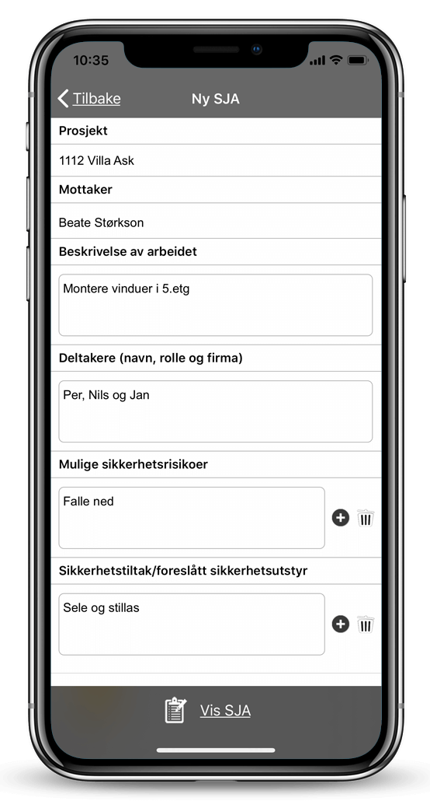
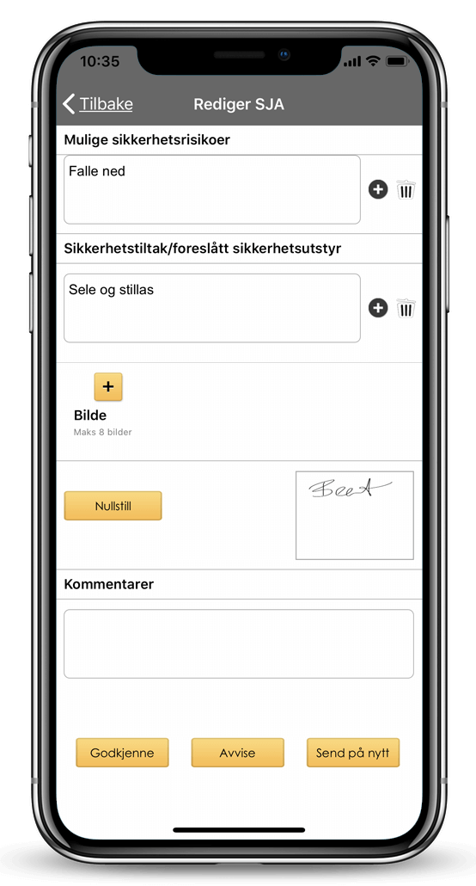

## SJA på mobilen

Det er viktig å gjøre gode risikoanalyser for å forhindre ulykker og avvik. Ved å fylle ut en [SJA på mobiltelefonen](https://youtu.be/lqGQH5ubrmA) i Viscenario, så får du tatt bilder, gitt beskrivelse av arbeidet, registrert deltakere, mulige sikkerhetsrisikoer og sikkerhetstiltak/foreslått sikkerhetsutstyr samt signatur. Hele analysen er da fylt ut etter byggherreforskriften. Den som er SJA-mottaker på prosjektet får da pushvarsel i Viscenario-appen og mottar e-post. Han kan da enkelt godkjenne eller avvise SJA-en.

**Spar 1 time per SJA**  
Registrering av SJA skjer på mobilen

**Godkjenner SJA på mobilen**  
Godkjenning av SJA skjer på mobilen

**Samler SJA**  
På denne måten får man samlet alle SJA elektronisk og kan enkelt gå tilbake og se dersom det skulle oppstå en ulykke og man trenger å klargjøre rapporter i den forbindelse.

