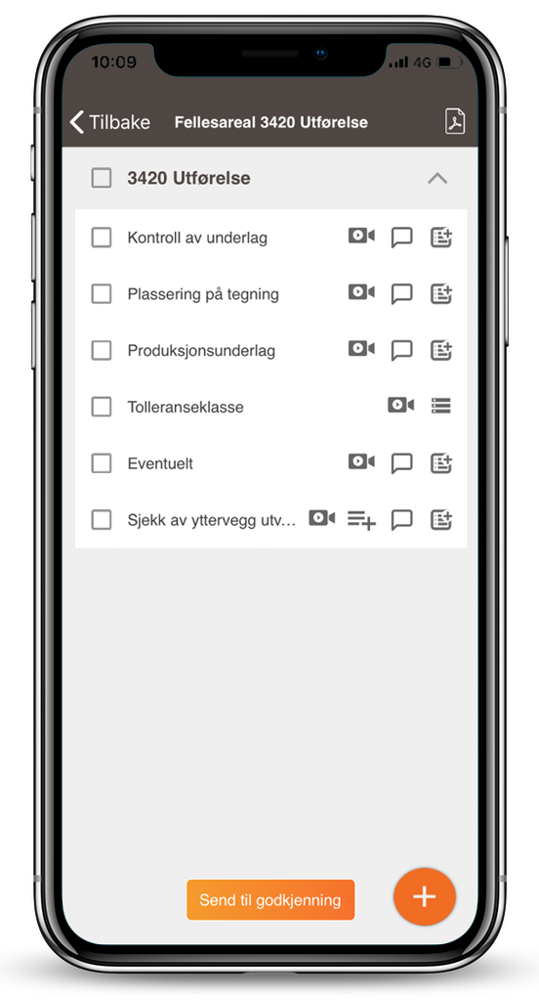
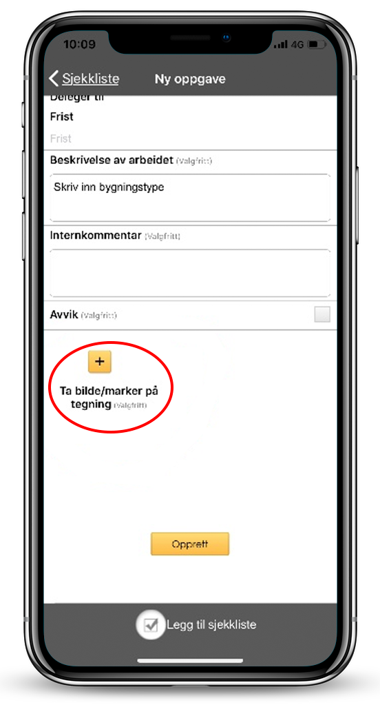
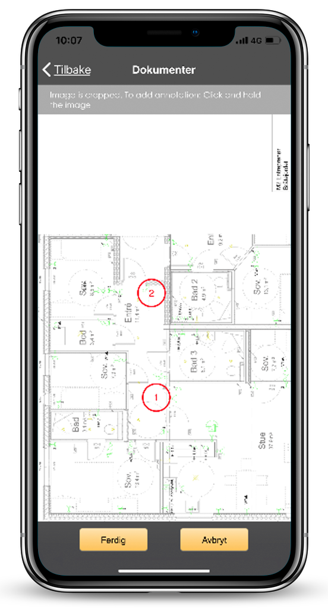

Viscenario gir deg ett system for å håndtere [feil og mangler, avvik,](https://youtu.be/MTN60AsR3kg) [RUH,](https://youtu.be/IJvBylQoExc) [SJA,](https://youtu.be/lqGQH5ubrmA) [befaringer,](https://youtu.be/yu98RzfV9No) [KS sjekklister,](https://youtu.be/wyqkUBeUFdo) [tilvalg,](https://youtu.be/kbpImAmukMM) [FDV,](https://youtu.be/-75SOtjN8is) boligperm og [reklamasjonshåndtering](https://youtu.be/jI4arPWssxU) på mobilen, nettbrett og web.

**Spar 1 time i etterarbeid**  
Ved å dokumentere på mobilen eller nettbrett der og da, slipper dere all kontortid i etterkant.

**Standardisere med bruk av sjekklister**  
Avvik man finner i forbindelse med bruk av en sjekkliste pushes til mobilen til den som må utbedre den.

**Lære fra prosjekt til prosjekt**  
Ved bruk av sjekklister standardiserer dere dokumenteringen. Derfor kan dere enkelt se hvilke avvik dere finner på de ulike jobbene.

## Utdypende informasjon om bruk av sjekklister

[Sjekklister](https://youtu.be/wyqkUBeUFdo) er viktige for internkontroller og for å dokumentere kvalitetsarbeid. I Viscenario kan man bruke sjekklister på mobilen, nettbrettet eller i nettleseren.  
En sjekkliste kan du koble mot en oppgave, som da enten er en ad-hoc eller planlagt oppgave. Flere kan også jobbe på en sjekkliste samtidig. Fordelen med sjekklister er at man standardiserer hvordan man skal dokumentere en jobb. På hvert sjekkpunkt kan man legge inn en kommentar med bilde eller lage en oppfølgingsoppgave/et avvik. Når sjekklisten er utfylt og du har utført oppgaven(e), så fletter Viscenario alt dette sammen til en PDF og lagrer automatisk denne i dokumentmappene på aktuelt prosjekt eller bygg. Du sparer deg selv for alt etterarbeid ved å flette sammen bilder, tekst og avvik til et referat. I tillegg til dette er alle avvikene/oppgavene som du har opprettet i forbindelse med sjekklisten, allerede pushet ut til den som må utbedre de. Liveoversikt over alle oppgaver og avvik finner man da i Viscenario.  
Bruker man sjekklister på planlagte oppgaver, som for eksempel på en [vernerunde](https://youtu.be/1suew-8Se38) eller ukesoppgave, så ser man enkelt hva som ikke ble gjort i forrige uke. Du slipper da å registrere samme feil om igjen. Er oppgavene du registrerte sist uke allerede utførte, så vil de ikke vises.  
Kundene våre legger inn sine egne sjekklister og tilpasser disse etter sine egne behov. Man kan enkelt plukke sjekkpunkter fra en sjekkliste til andre jobber. Det er også mulig å kombinere punktmarkeringer på tegninger ved å fylle ut en sjekkliste.

En av fordelene med å bruke Viscenario til sjekklister er at du kan lære fra prosjekt til prosjekt. Du kan for eksempel enkelt få ut en oversikt over hvor mange avvik vi har hatt fra en jobb (en jobb du har brukt sjekklister på) i prosjekt A, sammenlignet med antall avvik fra samme jobb i prosjekt B.

### Eksempel på ulike sjekklister

-   KS-sjekklister (f.eks. tømrerarbeid, betong eller armering)
-   Befaringsjekkliste for ferdigbefaring, overtakelse eller ettårsbefaring
-   Vernerunder
-   Serviceavtaler – sjekk på hva som skal sjekket i forbindelse med service på for eksempel ventilasjon eller heis
-   Brannrunder
-   Sesongoppgaver
-   Avtaler
-   Ukesoppgaver til vaktmester
-   Byggherremøter

Kundene våre sparer minimum 1 time i etterarbeid ved å bruke Viscenarios sjekklistemodul.
