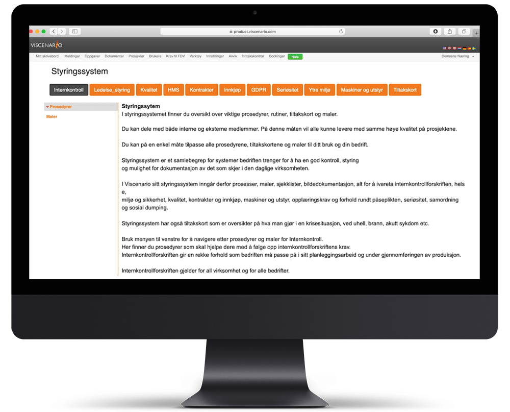

I [styringssystemet](https://youtu.be/vYshpiGwaAE) finner du oversikt over viktige prosedyrer, rutiner, tiltakskort og maler. Du kan dele med både interne og eksterne medlemmer. På denne måten vil alle kunne levere med samme høye kvalitet på prosjektene.

Du kan på en enkel måte tilpasse alle prosedyrene, tiltakskortene og maler til ditt bruk og din bedrift.

Styringssystem er et samlebegrep for systemer bedriften trenger for å ha en god kontroll, styring og mulighet for dokumentasjon av det som skjer i den daglige virksomheten.

I Viscenario sitt styringssystem inngår derfor prosedyrer, maler, sjekklister, bildedokumentasjon, alt for å ivareta internkontrollforskriften, helse, miljø og sikkerhet, kvalitet, kontrakter og innkjøp, maskiner og utstyr, opplæringskrav og forhold rundt påseplikten, seriøsitet, samordning og sosial dumping.

Styringssystem har også tiltakskort som er oversikter på hva man gjør i en krisesituasjon, ved uhell, brann, akutt sykdom etc.

Du finner prosedyrer som skal hjelpe dere med å følge opp internkontrollforskriftens krav. Internkontrollforskriften gir en rekke forhold som bedriften må passe på i sitt planleggingsarbeid og under gjennomføringen av produksjon.

Internkontrollforskriften gjelder for all virksomhet og for alle bedrifter.

**Samsvarsvurdering**

Vi har en egen samsvarsvurdering (laget i Excel) mot ISO, Kvalitet TEK, Kvalitet SAK 10, HMS AML del 1, HMS AML del 2, HMS seriøsitet, HMS koronasituasjonen, HMS – forskrift utføring av arbeid, HMS Forskrift om tiltaks- og grenseverdier, HMS arbeidsplassforskriften, HMS -produsentforskriften, HMS – forskrift organisasjon ,ledelse og medvirkning, HMS Forskrift om administrative ordninger, HMS -Forskrift om helse og sikkerhet i ekslpsjonsfarlige atmosfærer, HMS-kort på bygge- og anleggsplasser, HMS –  Forskrift om informasjons- og påseplikt, HMS Allmenngjøringsloven, HMS-forskrift om delvis allmenngjøring av tariffavtale for byggeplasser i Norge, HMS Byggherreforskriften, HMS- internkontrollforskriften, Miljøinformasjonsloven, Forskrift om miljørettet helsever, Miljø internkontrollforskriften, Miljø produktforskriften, Miljø forurensningsforskriften, Miljø forskrift om gjenvinning og behandling av avfall (avfallsforskriften), Miljø – REACH forskriften.

**Internkontroll**

Viscenario sitt styringssystem har gode prosedyrer som skal hjelpe bedriften med å følge opp internkontrollforskriftens krav. Internkontrollforskriften gir en rekke forhold som bedriften må passe på i sitt planleggingsarbeid og under gjennomføringen av produksjon. Internkontrollforskriften gjelder for all virksomhet og for alle bedrifter.

**Ledelse og styring**

I tillegg til de krav forskriftene, TEK, norske standarder, plan og bygningsloven setter, vil det også være behov for en god planlegging, gjennomføring og dokumentasjon på de arbeider som blir eller skal utføres av bedriften. Prosedyrene i forbindelse med ledelse og styring beskriver hvordan dette kan gjennomføres på en god og effektiv måte.

**Helse, miljø og sikkerhet (HMS)**

Helse, miljø og sikkerhet er grunnleggende forhold på en arbeidsplass eller byggeplass. Gjennom god planlegging og gode og grundige tiltak innenfor feltet HMS så siker man en trygg arbeidsplass for de ansatte. Byggherrens SHA plan (sikkerhet, helse og arbeidsmiljø) integreres fint inn i Viscenario sine prosedyrer i styringssystemet. Forhold som bla. vies stor oppmerksomhet er arbeid i høyden, sikkerhetstiltak for de som utfører arbeidene, rapportering og forebyggende arbeid.

**Seriøsitet**

Sosial dumping er et tema med stor oppmerksomhet av myndighetene. Viscenario sitt styringssystem er bygd opp for å ha fokus på dette viktige området. Det har vi gjort gjennom å legge ut sosial dumping som et eget område i vårt styringssystem. På denne måten får man frem gode prosedyrer rundt arbeidet med HMS kortene, opplæringskravene, inntakskontroll på byggeplass, samhandling og arbeidet med påseplikten. Vi har en egen logg som kan brukes når man gjennomfører selve påseplikten, med de kontroller man er forventet å skulle utføre i dette viktige arbeidet mot sosial dumping. Ved å følge de prosedyrene Viscenario har lagt inn vil man vise seg frem som en seriøs bedrift som tar seriøsitetsbegrepet på alvor.

**Ytre miljø**

Det å ta være på vårt miljø blir stadig viktigere og viktigere. Gjennom gode prosedyrer legger Viscenario sitt styringssystem opp til at man tar forholdet med ytre miljø seriøst på byggeplassen. I vårt ytre miljø arbeid inngår derfor prosedyrer både for kartlegging av miljø skadelige forhold, forebyggende arbeid, kjemikalie håndtering, avfallshåndtering og tiltak om uhell skulle inntreffe. Det er laget eget tiltakskort for forurensning av ytre miljø. Bruk av våre prosedyrer vil vise at man er en seriøs bedrift.

**Kvalitet**

Ved å benytte Viscenario sitt kvalitetssystem kan du enkelt dele det med både interne og eksterne prosjektmedlemmer. På denne måtene vil alle kunne levere samme høye kvalitet i prosjektet. Systemet inneholder viktige prosedyrer og maler for både å planlegge, gjennomføre og dokumentere kvalitetsarbeidet. Sammen med modulene for sjekklister, bildemodulene for dokumentasjon av utført arbeid, RUH delen for rapportering av kvalitetsavvik, befaringer, overlevering og FDV dokumentasjon, så får du et komplett system som er lett å bruke underveis i arbeidet, det gir en kjempe god mulighet for dokumentasjon, samtidig som det er enkelt i bruk. Systemet kan brukes uavhengig av bedriftsstørrelse. Dersom det er behov kan man selv på en enkelt måte gjøre nødvendige firmatilpasninger av prosedyrene, sjekklistene, malene etc. Dere legger inn deres egne sjekklister for de fagene dere selv leverer eller tverrfaglige sjekklister ved behov.

**Kontrakter**

Kontrakter skal være med på å hindre misforståelser mellom partene samtidig som de skal reguler det som skal utføres på prosjektet. Gjennom gode kontrakter vil man få på plass den viktige forventningsavklaringen man veldig ofte ser at det er behov for.

**Innkjøp**

Gode rutiner og systemer rundt innkjøp vil lette hverdagen på byggeplassen. Styringssystemet gir gjennom kapittelet innkjøp gode og nyttige retningslinjer.

**Maskiner og utstyr**

Her har Viscenario nyttige hjelpemidler ved HMS vurdering når du kjøper maskiner og utstyr.  Her dekkes også opplæringskrav i forbindelse  med bruk av maskiner og utstyr og hvordan du håndterer dette med kontrollpliktig utstyr . Gode momenter rundt kompetanse på de som skal gjennomføre vedlikehold på maskin og utstyrsparken til bedriften er også med. Prosedyrene som dekker opplæringen av brukerne legger vekt på hva som må til for å dekke kravene til dokumentert sikkerhetsopplæring, sertifisert opplæring og brukeropplæring / typeopplæring. Kapittelet har også logg for oppfølging av maskinparken samt en logg som viser kapasitet på større maskiner.

**Tiltakskort**

Viscenario har et eget område som heter tiltakskort. Tiltakskortene er ment å være hjelpemidler når man står i en krisesituasjon og må agere raskt. Kortene gir en kortfattet beskrivelse av hva de dekker og deretter hva som skal gjøres. Tiltakskortene vil ofte være akkurat det du trenger når situasjonen er som hektisk. Tiltakskortene gir en fin helhet som kompletterer opp Viscenario sitt styringssystem på en fin måte.
