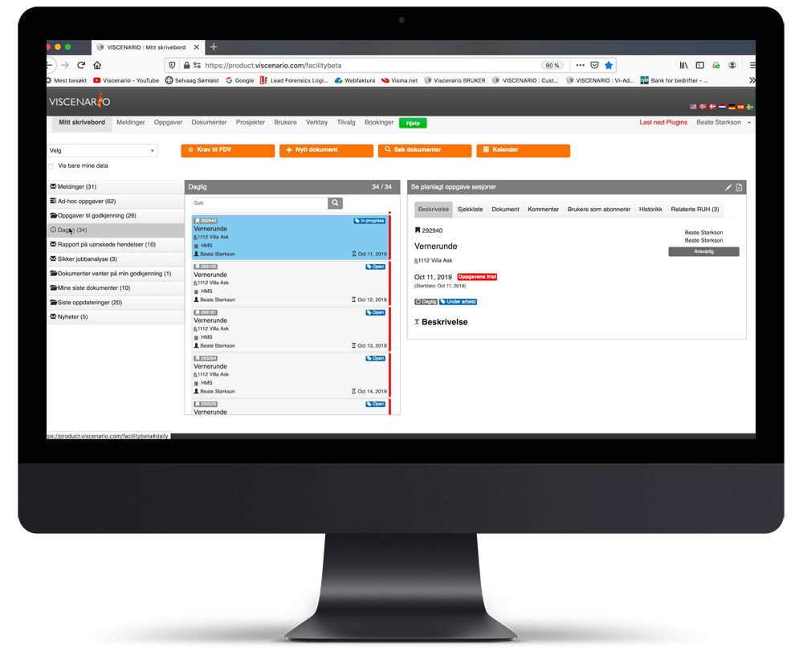

## Vernerunde på nettbrett

Ved å bruke Viscenario til å dokumentere [vernerunder,](https://youtu.be/1suew-8Se38) så vil du spare all kontortiden du ville ha brukt i etterkant av utført vernerunde. På denne måten vil du forebygge HMS-aktiviteter og unngå uheldige arbeidsmiljøforhold, samt avdekke risikoforhold og sikre at forbedringene utføres. På denne måten får du det beste verktøyet for å få et bilde av hva som foregår i prosjektene dine.

**All informasjon er lett tilgjengelig**  
Tegninger er tilgjengelig.

**Du sparer 1 time i etterarbeid**  
Viscenario fletter sammen signatur, bilder, tekst, avvik og tegninger til en protokoll for vernerunden.

**Se liveoversikt over åpne avvik**  
Liveoversikt over alle åpne RUH og avvik tilgjengelig på nettbrett. Krever ingen forberedelser før selve vernerunden.

### Faste ukentlige vernerunder – full oversikt over hva som ikke er løst siden forrige gang på nettbrettet

Ved å sette opp en planlagt oppgave med intervall hver uke eller annen hver uke, så vil man enkelt kunne se hva som ble kommentert eller registrert på forrige vernerunde, som ikke er utbedret i dag. Dette gir deg en live oversikt mens du er ute på neste runde.  
På et sjekkpunkt i vernerunden kan man registrere en [RUH](https://youtu.be/IJvBylQoExc) (Rapport om uønsket hendelse) og markere på tegningen hvor avviket har oppstått, samt ta bilde av hendelsen. Du kan lage oppfølgingsoppgaver og legge til en kommentar med bilde. Mottaker av avvikene får et pushvarsel på telefonen og dokumenterer at de er løst ved å ta bilde og notere hva som er utbedret, før de avslutter oppgaven.

### Lære fra prosjekt til prosjekt

Fordelen med å bruke Viscenario til vernerunder er at du enkelt kan lærer fra prosjekt til prosjekt. Du kan for eksempel enkelt få ut en oversikt over hvor mange avvik og RUH du har funnet på vernerundene i prosjekt A, sammenlignet med antall i prosjekt B.

Kundene våre legger inn egne, selvtilpassede sjekkpunkter for vernerundene sine.

### Du sparer 1,5 time i etterarbeid per vernerunderapport

Kundene våre sparer minimum 1,5 time i etterarbeid ved å bruke Viscenarios vernerundemodul.

### Prosjektledelsen har live oversikt over alle RUH og avvikene på prosjektet på nettbrett og web

Prosjektledelsen har oversikt over alle avvikene de har registrert og fått selv, i en Kanban-visning (statusvisning) på nettbrettet. Her ser de enkelt gjeldende status på alle oppgavene. Det er også egne rapporter for alle oppgaver på prosjektet på nettbrettet, hvor man enkelt kan se eksempel alle åpne på et bygg eller en leilighet. Her kan man enkelt se hvilke personer og fag som ikke har rettet opp avviket/feilen. I nettleseren på PC-en kan man enkelt hente ut rapporter på avvik og RUH per leverandør eller fag, eller avvik som har en økonomisk konsekvens. Alle de registrerte dataene kan søkes på i nettleserversjonen av Viscenario.

